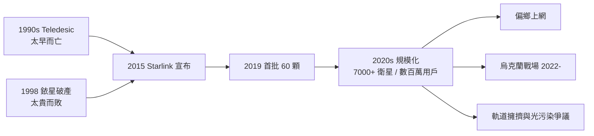

# 星鏈：LEO 衛星天網

## 太早的夢想：Teledesic 與銥星

用天上的衛星讓全世界上網，這個夢想比 Starlink 早了四分之一個世紀。1990 年代，比爾·蓋茲與電信富豪 Craig McCaw 支持的 **Teledesic** 計畫規劃發射八百多顆低軌衛星，打造「太空中的網際網路」——卻在 2002 年因成本失控與市場預測落空而放棄，一顆商用衛星都沒發射。更悲壯的是**銥星**（Iridium）：摩托羅拉主導、66 顆衛星、1998 年開通全球衛星電話，技術先進得令人讚嘆，卻敵不過地面行動網路的急速擴張——開業僅九個月便聲請破產，系統以原投資額約百分之一的價格被收購。它們的共同教訓是：發射成本太高、終端太貴、地面網路跑得太快。

## Musk 的答案：把發射成本打下來

2015 年，Elon Musk 宣布 Starlink 計畫；2019 年 5 月，首批 60 顆衛星搭乘獵鷹 9 號升空。Starlink 的突破不在單項衛星技術，而在**系統經濟學**：SpaceX 透過垂直整合自行設計量產衛星，把每顆衛星成本壓到傳統衛星的零頭；再配合獵鷹 9 號一級火箭回收復用，單次發射成本崩塌式下降。別人發衛星是一筆筆工程，Starlink 發衛星是流水線。至 2024–2025 年，在軌衛星已超過六千至七千顆，用戶數百萬——史上最大衛星星座，遠超所有人類歷史的總和。

技術上有三個關鍵：其一，**相控陣天線終端**——用戶家裡的碟形天線沒有機械轉動部件，用電子掃描追蹤每小時兩萬七千公里掠過天頂的衛星；經過迭代，終端成本從初期的三千美元降到數百美元量級。其二，**星間雷射鏈路**——衛星之間用雷射互聯，訊號在真空中以光速路由，不必每跳都折返地面站，對偏遠海洋與高緯度地區至關重要。其三，低軌道（約 550 公里）帶來的低延遲，比對地同步衛星六百毫秒的延遲低了兩個數量級，讓視訊與遊戲成為可能。

## 爆發的應用：從偏鄉到戰場

Starlink 最先改變的是**數位平權**：鄉村、島嶼、災區——過去寬頻不到的地方，如今一只終端就能上網。而 2022 年俄烏戰爭讓它一夕之間成為地緣政治要角：烏克蘭在地面通訊設施被毀後，依靠 Starlink 維持軍隊指揮與民用連網，無人機作戰高度依賴這張天網。這也把 Musk 推入前所未有的權力位置——2023 年報導披露他一度限制克里米亞地區的服務，引發「私人企業家能否單方面決定戰爭走向」的激烈爭論。單一公司掌握數千顆衛星與數百萬用戶的生殺大權，這在通訊史上沒有先例。航海與航空隨後跟進：郵輪、貨輪、航空公司陸續簽約，衛星寬頻從利基變成主流。

## 爭議：天文學家的怒火與凱斯勒幽靈

規模化帶來尖銳的爭議。天文學家發現 Starlink 衛星在望遠鏡影像中拖出一道道亮痕，干擾巡天觀測；SpaceX 雖為後續衛星加上遮光塗層與降軌策略，暗夜天空的改變已不可逆。更深的憂慮是**軌道擁塞**：低軌道可容納的衛星數量有限，碰撞會產生碎片、碎片引發連鎖碰撞——這就是所謂的**凱斯勒綜合徵**，一旦發生可能讓近地空間在數十年內無法使用。監管機構（美國 FCC、國際電信聯盟）的軌道與頻譜分配規則，正被迫在沒有先例的情況下演化。

## 冷戰 2.0：太空網路的競賽

Starlink 的成功引爆了模仿競賽。英國的 OneWeb 在破產重組後聚焦政府與企業市場，2023 年與 Eutelsat 合併；亞馬遜的 **Kuiper** 計畫在 2024–2025 年進入批量部署階段，目標三千餘顆衛星。中國則啟動了國家隊與商業隊雙線並進的**星網（Guowang）**與**千帆（G60）**星座，規劃各逾萬顆衛星，2024 年起加速發射。太空正成為新的冷戰棋盤：誰控制低軌道的頻譜與軌位，誰就控制下一代的通訊制高點。這場競賽的意涵遠超商業——當塔上的烽火在兩千八百年前接力點燃時，沒有人想到「讓訊息跨越障礙」最終會把人類的通訊網路掛上星光。從 1858 年橫越大西洋的海底電纜，到今日三千公里高空的雷射星鏈，人類連結的渴望不變，只是戰場從海底移到了天頂。
