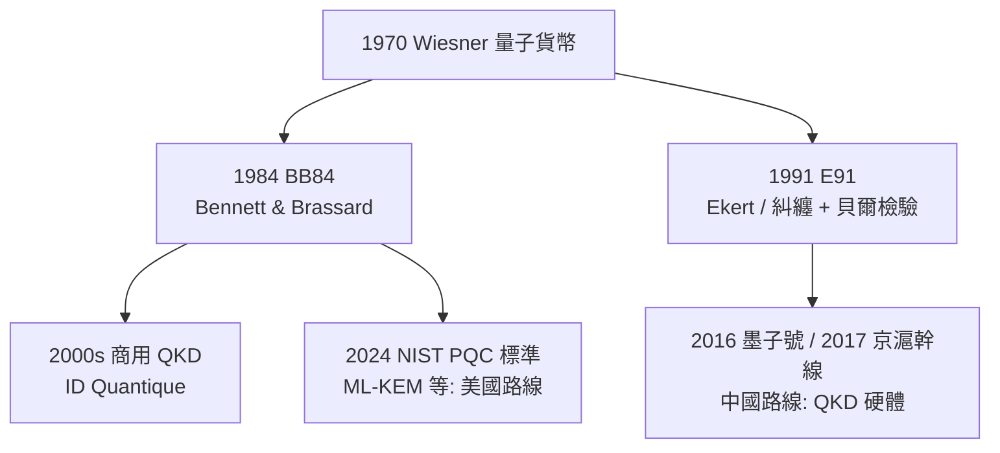

# 量子糾纏與 QKD：絕對安全？

## 一次一密的困境與物理的救贖

密碼學有個永恆的焦慮：所有公開的加密演算法，安全性都建立在「計算夠難」之上——RSA 依賴大數分解夠難，一旦數學突破或量子電腦成熟，城牆便一夕崩塌。有沒有不由數學、而由物理定律保證的安全？答案藏在量子力學裡。

## BB84：用光子的偏振說悄悄話

1984 年，IBM 的 Charles Bennett 與蒙特婁大學的 Gilles Brassard 提出了 **BB84 協議**——量子金鑰分發（QKD）的開山之作。原理優雅至極：發送方（Alice）把每個位元編碼在單光子的偏振或相位上，隨機選用兩組基之一；接收方（Bob）也隨機選基測量。事後兩人公開比對基的選擇（不比對結果），留下選基一致的位元作為原始金鑰。竊聽者的厄運在於**量子不可克隆定理**——未知量子態無法被複製——加上測量必然擾動量子態：任何竊聽都會在誤碼率上留下指紋，Alice 與 Bob 只要抽樣比對，就能算出竊聽的存在。安全性不靠「竊聽者算得慢」，而靠「竊聽者違反物理定律」。這是 1970 年 Stephen Wiesner 量子貨幣思想的復活，也是資訊理論家 Bennett 半路轉進量子世界的傳奇。

## E91：糾纏與貝爾不等式登場

1991 年，年輕的 Artur Ekert 提出 **E91 協議**，把故事推向更深處：金鑰編碼在**EPR 糾纏光子對**中，兩個粒子無論相距多遠都保持關聯。更妙的是，安全檢驗可以直接借用**貝爾不等式**——若竊聽者企圖測量粒子，糾纏關聯便會減弱，貝爾檢驗的統計結果立即現形。這條路線把通訊安全與量子力學基礎的百年辯論接了起來：1935 年愛因斯坦、波多爾斯基與羅森提出 EPR 悖論質疑「幽靈般的超距作用」，1964 年約翰·貝爾把它化為可檢驗的不等式，1982 年阿斯佩（Alain Aspect）的實驗裁定量子糾纏為真。當年哲學家爭論的奇異現象，四十年後成了金庫的鎖。

## 潘建偉與中國的工程躍進

把 QKD 從實驗桌推向工程規模的，是中國科學家潘建偉團隊。潘建偉 1990 年代在奧地利因斯布魯克隨 Anton Zeilinger 攻讀博士，參與了量子隱形傳態的開創實驗，此後回國建立團隊。2016 年 8 月，世界首顆量子通訊衛星**「墨子號」**發射升空，次年便完成多項里程碑：衛星與地面站之間逾千公里的糾纏分發（成果登上《Nature》封面）、星地 QKD、以及北京與維也納之間的洲際量子保密視訊。地面方面，2017 年開通的**京滬幹線**全長約兩千公里，串聯北京、濟南、合肥、上海，透過可信中繼站實現長途量子保密通訊，並與墨子號天地對接。金融與政務部門開始試用——這是 QKD 首次以國家規模落地。

## 分岔：QKD 硬體 vs PQC 演算法

歐美的路線選擇了不同岔路。商業 QKD 早就存在——日內瓦的 ID Quantique 自 2000 年代起販售 QKD 設備，保護過瑞士選舉計票傳輸。但美國國家標準技術研究院（NIST）在 2016 年徵集後，選擇押注**後量子密碼（PQC）**：用抗量子的數學演算法升級現有網路。2024 年 8 月，NIST 正式發布首批標準，包括基於晶格的 **ML-KEM**（金鑰封裝）、ML-DSA 與 SLH-DSA 簽章演算法。於是全球分岔成兩條路：**中國押注 QKD 硬體鏈路，美國押注 PQC 軟體演算法**——前者追求物理層安全，後者追求部署成本最小化。這場標準之爭也是信任之爭：美國情報圈質疑可信中繼的可靠性與設備側信道，中國則質疑 PQC 演算法終有一日被新數學攻破。

## 誠實的邊界：不是仙境

宣傳中「絕對安全」與工程現實之間有明確距離。其一，**距離與中繼**：光纖中光子損耗隨距離指數增長，點對點 QKD 的實用距離在數百公里量級，而量子訊號無法放大（不可克隆定理的代價），長距離只能靠「可信中繼站」——中繼節點上金鑰以經典形式存在，成為潛在破口；量子中繼器仍在實驗室早期階段。其二，**工程攻擊面**：理論安全的是協議，實現它的探測器卻有漏洞——探測致盲攻擊等側信道手法已在實驗室成功破解過商用 QKD 系統，逼得工程師發展出測量器件無關（MDI-QKD）等更強韌的協議。其三，QKD 只解決「金鑰分發」，金鑰的使用、儲存與終端安全仍是傳統問題。

最後釐清一個流行的誤解——**量子隱形傳態**：它傳的不是物質，而是量子態的資訊；需要糾纏對加上一條經典通道協同完成，因此**絕不超光速**，科幻中的「瞬間移動人體」與物理學的 teleportation 完全是兩回事。從貝爾不等式到墨子號，量子通訊的故事告訴我們：最反直覺的基礎科學，往往在半個世紀後成為最前線的工程——而「絕對」二字，永遠值得多問一句。
