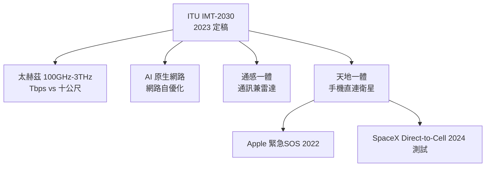

# 6G 與未來：太赫茲與科幻邊界

## 從 5G 的餘溫眺望 2030

當 5G 的商業成績單還在爭論之中，6G 的賽跑已經鳴槍。2023 年，國際電信聯盟（ITU）定稿了 IMT-2030 的願景框架，為第六代行動通訊勾勒方向：商用目標指向 2030 年前後。中國把 6G 寫進國家規劃、成立推進組，6G 專利申請量居前；美國則由電信產業組成 **Next G Alliance**（ATIS 主導）整合產官學力量；韓國、日本、芬蘭（諾基亞與奧盧大學是全球 6G 研究的重鎮）各有國家級計畫。歷史重演了 2010 年代的劇本：**標準未定，專利先行**——誰在早期多囤核心專利，誰就在十年後的授權談判桌上坐上座。

## 候選技術：在物理極限的牆上鑿窗

6G 的候選技術清單，每一項都在挑戰物理極限。

**太赫茲**（100 GHz–3 THz）：頻寬動輒數十 GHz，理論速率可達 Tbps 級。但物理的牆更高——大氣吸收劇烈、繞射幾乎為零、功率放大器在如此高頻效率暴跌，通訊距離可能只有十公尺量級。它註定不是覆蓋技術，而是「定點無線光纖」：晶片級的極短距離超高速鏈路，或許反而先在資料中心內部找到用武之地。

**AI 原生網路**：5G 的網路自動化只是輔助，6G 的野心是讓 AI 從設計之初就長在網路裡——即時優化波束、調度頻譜資源、預測擁塞、自癒故障。當網路複雜度超過人類工程師的理解能力，讓網路自己管理自己，几乎是唯一出路。

**通感一體**：讓通訊電波兼任雷達——基地台在傳資料的同時，從回波的擾動中「看見」環境：行人、車輛、無人機的軌跡。無線網路本身變成一張巨大的感測器網，這是自雷達誕生以來「通訊與偵測」兩個領域的歷史性合流。

**天地一體**：把衛星納入行動網路的標準架構，實現手機直連衛星。這條路已經提前開跑：Apple 自 2022 年起在 iPhone 上提供**緊急 SOS 衛星訊息**（與 Globalstar 合作）；SpaceX 的 **Direct-to-Cell** 則於 2024 年開始測試，讓一般 LTE 手機直接連上 Starlink 衛星。6G 的願景是把它從「救命功能」升級為「無所不在的常態覆蓋」——地面網與衛星網融為一張網。

## 觸覺、全息與身體的聯網

更遠的想像集中在「身體」上。**觸覺網路**追求遠距觸覺回饋：遠程手術醫生透過力回饋設備「感覺到」組織的阻力，工程師隔洋「觸摸」機器。這對延遲的要求比 URLLC 更苛刻——人類觸覺的協同感知延遲必須壓在個位數毫秒，目前仍以實驗室與展示為主。全息通訊則需要 Tbps 級頻寬傳輸立體光場，正是太赫茲被寄予的想像。而最深處的邊界是**腦機介面**：Neuralink 於 2024 年完成首例人體植入試驗，受試者以意念操控游標——當前仍是醫療輔助階段，但「直接聯網」的遠景提出了通訊史上從未有過的倫理難題：當思想可以成為介面，隱私、自主與人格的邊界在哪裡？監管與神科學界的共識是：醫療優先、漸進推進、倫理先行。

## 雙螺旋的收束：從烽火台到糾纏

回望這部通訊史，有一條貫穿的雙螺旋：一條是物理學的邊界，一條是人類連結的渴望。烽火台時代，通訊的定律是「可見即通訊」，光速與地平線是極限；電報把文字變成電脈衝，馬克斯威爾的方程式預言了電磁波；貝爾的電話讓聲音上線；Shannon 在 1948 年把「資訊」本身變成數學——位元、熵、通道容量，從此工程師知道極限在哪、以及極限可以逼近到什麼程度。此後每一代通訊，都是在 Shannon 劃定的邊界內向極限逼近：頻譜越用越高（從長波到毫米波到太赫茲），維度越用越多（時間、頻率、碼、空間、乃至量子態），而量子糾纏甚至展示了「非定域相關」這種超越經典直覺的關聯。

從 1858 年橫越大西洋電纜的慶典，到烏克蘭戰場上的衛星終端；從烽火台狼煙的一個位元（有敵/無敵），到墨子號分發的糾纏光子——技術翻天覆地，渴望從未改變。當 6G 之後通訊無所不在、萬物皆連，一個哲學問題浮上水面：**當連結變成空氣，「連結」本身還剩什麼意義？**或許答案和這部歷史開篇時一樣：通訊從來不只是傳遞資訊，而是確認「我被聽見」。技術永遠在突破物理的極限，而不變的，是人類想要被聽見的渴望。這，就是通訊技術的故事——一個尚未寫完的故事。
