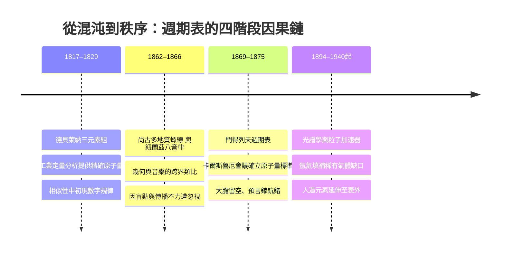

# 特別篇：元素週期表與元素的故事——從混沌到秩序的萬物密碼

## 引言：萬物的拼圖——我們為什麼需要週期表？

想象你站在一座巨大的圖書館前，館中堆著上百萬冊書籍，卻沒有目錄、沒有編號、沒有任何分類規則。你如何知道手邊這本書旁邊該放什麼書？你如何找到自己想要的知識？十九世紀初的化學家，面對的正是這樣一座圖書館——只不過書架上的書，換成了構成萬物的基本材料：元素。

人類早就意識到，世界看似千變萬化，背後卻應該有簡單的「積木」。古希臘哲學家恩培多克勒與亞里斯多德提出水、火、土、氣四元素說，認為萬物由這四種基本「性質」組合而成；東方的思想家則以金、木、水、火、土五行相生相剋，解釋物質的循環與轉化。這些體系優雅、自洽、易於背誦，卻有一個致命的缺陷：它們無法被檢驗。你既不能證明火是元素，也無法用它預測任何新物質的性質。

接下來的兩千年，是煉金術士的時代。他們在幽暗的地窖中加熱坩堝，用硫磺、水銀和鹽調和出無數配方。他們真心相信金屬是有機的「生命」，鉛可以培養成金。他們失敗了——卻也意外累積了大量實驗事實：新的酸、新的合金、新的顏料。混沌之中，一份份關於物質的觀察紀錄慢慢堆積，等待一場革命來整理。

革命的火種點燃於十八世紀末。拉瓦節（Antoine Lavoisier）以精確的天平取代思辨，證明燃燒是與氧的結合而非「燃素」的逃逸；他在《化學基礎論》（1789）中列出第一張可靠的元素名單——三十三種「不能被化學方法再分解」的簡單物質。這一刻，「元素」首次成為一個可以被**數**的概念。接著，道爾頓（John Dalton）的原子論（1803–1808）賦予每種元素一個關鍵參數：原子量。自此，每種元素都有了自己的「身分證號碼」，比較與排序終於有了共同的標尺。

於是問題自然浮現：如果把所有元素按某種順序排成一列，會發生什麼？

這正是本書要講的故事。週期表不是天才靈光一現的產物，而是一場跨越半個世紀、由數十位科學家接力完成的偵探工作。本書將沿著時間軸，走過四個關鍵階段，並在每一站追問三件事：**他們為什麼能推導出週期性的內在邏輯？當時還缺哪些元素、造成了什麼盲點？後人又是如何用光譜學與粒子加速器把拼圖補齊？**更重要的是，我們要看見科學之外的因果：工業革命對染料與冶金的需求、大學實驗室的制度創新、國際學術會議的建立，如何一步步驅動這場知識革命。

第一站，我們回到 1817 年的德國耶拿，一位藥劑師教授盯著鈣、鍶、鋇三種鹼土金屬的原子量，發現中間那個數字，恰好是兩端的平均值……

萬物的拼圖，即將擺下第一塊。
