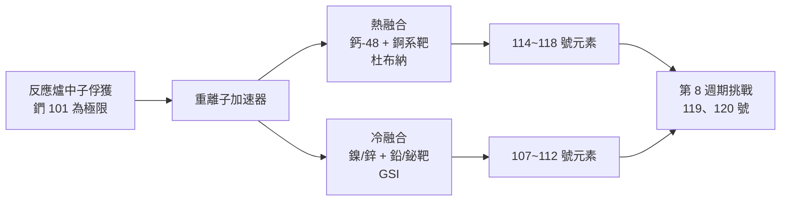

# 第 7 章 粒子加速器時代

## 第 1 節 後來如何發現？用高速離子「砸」出超重元素（冷融合與熱融合技術）

1950 年代的柏克萊，問題已經浮上檯面。西博格的團隊靠著反應爐裡日以繼夜的中子轟擊，把週期表一路推到 101 號鍆（Mendelevium）——但這條路走到了盡頭。中子俘獲一次只讓原子核多一個質量數，再多一次 β 衰變才升一個原子序，像是只能一階一階爬的樓梯。爬到鍆附近，半衰期已經縮短到小時、分鐘的等級；再往上，靶核衰變的速度比俘獲中子的速度還快，樓梯在腳下崩塌。化學家第一次承認：有些元素，用「煮」的做不出來，只能用「撞」的。

### 加速器：把粒子變成砲彈

轉捩點其實早就在 1930 年埋下。勞倫斯在柏克萊發明迴旋加速器，用磁場讓帶電粒子一圈圈旋轉、電場一圈圈加速，最後以驚人的動能射出。這個本來是核物理研究工具的機器，逐漸變成「人造元素工廠」的心臟。戰後，重離子加速器在冷戰兩側競相拔起：蘇聯杜布納的弗廖羅夫實驗室、美國柏克萊的勞倫斯實驗室、德國達姆施塔特的 GSI、以及日本理研的仁科中心——這四座設施，將成為未來半世紀元素命名戰的四個戰場。

思路很直接：與其讓原子核慢慢吸收中子，不如直接把一顆「已經帶著很多質子」的重離子，整顆砸進靶核裡，一次跳升幾十個原子序。問題是，兩顆都帶正電的原子核會互相排斥，必須加速到足以克服庫侖位障；而撞上去之後，絕大多數複合核會立刻「散架」（裂變），只有極少數幸運兒能冷卻下來、吐出幾顆中子、活成一個新元素。

### 熱融合與冷融合：兩條路線

到了 1970 年代，兩條技術路線成形。

**熱融合**：用相對「軟」的鈣-48 離子（質子數 20）轟擊錒系元素靶（錒系元素原子序高，例如鋦 96、鉲 98）。鈣-48 是罕見的「雙重魔法核」（質子 20、中子 28 都是殼層滿位），特別穩定，砸進靶核後複合核激發能較低，存活機率高。這條路的旗手是杜布納的奥加涅相（Yuri Oganessian）團隊——118 號元素 Og 正是以他命名，成為週期表上唯一以「在世科學家」命名的元素。

**冷融合**：用較重的砲彈（如鎳-62、鋅-70）轟擊鉛或鉍靶。鉛與鉍的原子核本身就是魔法數結構、異常穩定，融合後複合核激發能更低、只需蒸發一兩顆中子。代價是庫侖位障更高、需要更重的離子與更高的加速能量。這條路由 GSI 的明岑貝格（Peter Armbruster、Gottfried Münzenberg）團隊在 1980 年代發揚光大，先後製出 107（䍀，Bohrium）、108（䥑，Hassium）、109（䥾，Meitnerium）。

### Transfermium Wars：命名的政治學

造出來只是第一步；「叫什麼名字」是另一場戰爭。從 102 號鍩（Nobelium）開始，柏克萊、杜布納、斯德哥爾摩對「誰先發現」各執一詞，這場延燒數十年的爭執被戲稱為 **Transfermium Wars**（超鍆元素戰爭）。蘇聯人指控美國人搶先發表、美國人懷疑蘇聯數據無法重現；IUPAC 與 IUPAP 被迫成立仲裁委員會，逐一審查各實驗室的衰變鏈證據——科學史上罕見地，由國際組織擔任「發現權」的法庭。

1997 年 IUPAC 終於定案一攬子命名，妥協的痕跡處處可見：104 號以杜布納為名（𨧀，Dubnium），105 號給了柏克萊的西博格——西博格成為史上第一位「在世就進週期表」的人。此後的命名延續「地名＋人名」傳統：111 號䥑（Roentgenium）紀念倫琴，112 號鎶（Copernicium）紀念哥白尼，113 號鿭（Nihonium）來自日本的「にほん」，114 號鉇（Flerovium）紀念弗廖羅夫，116 號鉝（Livermorium）紀念利佛摩實驗室，117 號鿬（Tennessine）致敬田納西州，118 號鿫（Oganesson）致敬奥加涅相。

其中 113 號的意義特別深遠。2004 年起，日本理研仁科中心的森田健一郎（Kosuke Morita）團隊用鋅-70 轟擊鉍靶，歷經九年的漫長等待與無數次空槍，終於在 2012 年捕獲第三顆 113 號原子的完整衰變鏈。2015 年 IUPAC 承認理研的發現權——這是亞洲國家第一次把名字寫進週期表。「Nihonium」三個字背後，是日本戰後數十年科學投資的總結算，也標誌著元素發現不再是美蘇兩強的專利。

### 哀傷的統計：單原子的科學

超重元素科學最殘酷的面貌，是它的「樣本量」。一場為期數月的實驗，束流日夜不停地轟擊靶片，最後可能只得到 **一個** 原子。它的存在證據，是一連串 α 衰變的能量與時間間隔：例如 6.4 MeV、 followed by 9.8 MeV、再一顆自發裂變——這條「衰變鏈」就是全部的證據。統計學家會皺眉：n=1 的實驗能算科學嗎？評審委員會爭論的是：那條衰變鏈會不會只是背景雜訊的巧合？「主觀能階判定」——對每條衰變鏈賦予信心等級的仲裁過程——成為這門學問的必要之惡。這是科學史上最孤獨的領域：你證明了一件大事，但手上什麼也留不住，那顆原子在你看到它的千分之一秒內就消失了。

### 因果鏈條

中子俘獲的樓梯在鍆崩塌 → 驅動勞倫斯迴旋加速器蛻變為重離子加速器 → 冷戰使美蘇德日競相建設國家級設施 → 設施競爭催生熱融合與冷融合兩條技術路線 → 單原子發現引爆「誰先發現」的命名戰爭 → 迫使 IUPAC 建立國際仲裁制度 → 命名權成為國家科學實力的最高勳章 → 日本以 Nihonium 登上週期表，證明這場競賽仍在向外擴散——而競賽的下一個獎品，是「元素到底有沒有盡頭」的問題。
