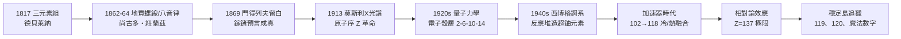

# 特別篇：元素週期表與元素的故事——從混沌到秩序的萬物密碼

嚴格按照年份脈絡編排，深入探討先驅們**為何能推導出週期表**的內在邏輯、當時**還缺哪些元素**（盲點與預言），以及科學家們後來是**如何透過光譜學與粒子加速器將它們找出來**的。

## 全書因果鏈總覽

## 目錄

### 引言

* [00-引言-萬物的拼圖](00-引言-萬物的拼圖.md)

### 第一階段：萌芽與尋路（1817 年–1860 年代）——規律的初現

* 第1章-1817年：德貝萊納的「三元素組」（Triads）
    * [1.1-德貝萊納的三元素組：從相似性尋找對稱](01.1-德貝萊納的三元素組：從相似性尋找對稱.md)
    * [1.2-規律的侷限：還缺哪些元素？](01.2-規律的侷限：還缺哪些元素？.md)
* 第2章-1862–1864年：尚古多的「地質螺線」與紐蘭茲的「八音律」
    * [2.1-尚古多的地質螺線：數學與化學的交會](02.1-尚古多的地質螺線：數學與化學的交會.md)
    * [2.2-紐蘭茲的八音律：為什麼遭到嘲笑？](02.2-紐蘭茲的八音律：為什麼遭到嘲笑？.md)

### 第二階段：預言與誕生（1869 年–1913 年）——秩序的確立

* 第3章-1869年：門得列夫的紙牌遊戲與偉大預言
    * [3.1-門得列夫的紙牌遊戲：化學性質的周期性](03.1-門得列夫的紙牌遊戲：化學性質的周期性.md)
    * [3.2-故意留白：預言中的空格](03.2-故意留白：預言中的空格.md)
    * [3.3-加利姆與日爾曼：預言化為現實](03.3-加利姆與日爾曼：預言化為現實.md)
* 第4章-1913年：莫斯利與 X 光光譜——原子序的革命
    * [4.1-碘與碲的錯位：原子量為什麼會排錯？](04.1-碘與碲的錯位：原子量為什麼會排錯？.md)
    * [4.2-莫斯利定律：原子序是元素的身份證字號](04.2-莫斯利定律：原子序是元素的身份證字號.md)
    * [4.3-填補空白：鎝43與鉕61](04.3-填補空白：鎝43與鉕61.md)

### 第三階段：量子革命與結構重塑（1920 年代–1940 年代）——底層邏輯

* 第5章-1920年代：玻爾與量子力學的電子殼層
    * [5.1-電子殼層：週期表為什麼長這樣？](05.1-電子殼層：週期表為什麼長這樣？.md)
    * [5.2-幾何與對稱：為什麼是 2、6、10、14？](05.2-幾何與對稱：為什麼是 2、6、10、14？.md)
* 第6章-1940年代：西博格與錒系元素的乾坤大挪移
    * [6.1-西博格的乾坤大挪移：重排錒系](06.1-西博格的乾坤大挪移：重排錒系.md)
    * [6.2-人工煉金術：反應堆創造超鈾元素](06.2-人工煉金術：反應堆創造超鈾元素.md)

### 第四階段：人工合成與島嶼之謎（1950 年代–至今）——極限的挑戰

* 第7章-粒子加速器時代：從 93 號到 118 號元素
    * [7.1-用高速離子砸出新元素：冷融合與熱融合](07.1-用高速離子砸出新元素：冷融合與熱融合.md)
    * [7.2-週期表的盡頭：相對論效應的畸變](07.2-週期表的盡頭：相對論效應的畸變.md)
* 第8章-尋找「穩定島」（Island of Stability）
    * [8.1-還缺哪些元素：119與120的追獵](08.1-還缺哪些元素：119與120的追獵.md)
    * [8.2-魔法數字與穩定島：原子核內部的殼層](08.2-魔法數字與穩定島：原子核內部的殼層.md)

### 結語

* [09-結語-從地殼岩石到宇宙盡頭](09-結語-從地殼岩石到宇宙盡頭.md)

---

### 本書三條主線

1. **規律的尋找總是先於解釋**：從經驗分類（三元素組、八音律）到量子理論（電子殼層、核殼層模型），規律先被「看見」，再被「理解」。
2. **「留白」是最強的方法論**：門得列夫的空格、莫斯利的缺口清點、穩定島的預言——科學由預言驅動的探索推向未知。
3. **儀器決定邊界**：光譜儀、X 射線譜、核反應堆、粒子加速器——每一次儀器革命，都改寫了元素清單。
