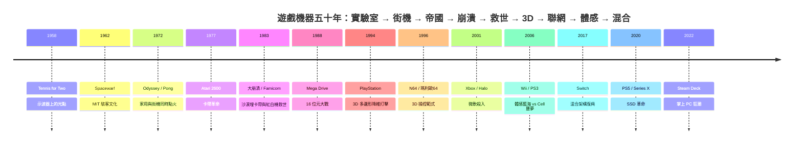

# 前言：客廳裏的數位遊樂場——遊戲機器如何成為人類尖端半導體與感官互動的終極熔爐

1958 年，布魯克黑文國家實驗室的一名核子物理學家，為了讓「原子日」的訪客覺得實驗室沒那麼可怕，在一台過時的類比電腦上接了一片示波器——螢幕上兩個光點隔網彈跳。這台每年只在展覽日開機的玩具，沒有專利、沒有商品化，卻是人類第一次把娛樂寫進電子的脈衝裡。六十年後，同樣的問題——「如何讓人玩」——推動著客製化處理器、固態硬碟 I/O 管線與硬體光線追蹤的最前沿。遊戲機，是人類史上少數「娛樂需求直接驅動半導體規格」的文明奇蹟。

## 一、遊戲硬體的三條演化主軸

遊戲機的半世紀演進，可以被壓縮成三條互相纏鬥的軸線：

- **運算架構**：從 MOS 6502 的 8 位元心臟，到 Motorola 68000 的 16 位元街機血統、索尼的 RISC＋幾何引擎、微軟把 x86 PC 塞進黑盒子，再到任天堂把 ARM 行動晶片變成混合主機——每一次架構選擇，都是效能、成本、開發者友善度與供應鏈政治的多方博弈。
- **儲存媒體**：卡帶（快但貴）→ CD-ROM（大但易盜版）→ DVD／藍光（格式戰的戰場）→ NVMe SSD（消滅讀取畫面）與數位下載——媒介的物理特性，直接決定了哪種遊戲可以存在：沒有光碟，就沒有《Final Fantasy VII》；沒有 SSD，就沒有即時傳送的開放世界。
- **人機互動**：橫井軍平的十字鍵 → 任天堂 64 的類比搖桿與 Z-targeting → Wii 的加速度感測 → Joy-Con 的 HD 震動——輸入介面的每一次範式轉移，都重新定義了「誰會來玩」。

## 二、五十年江山圖

## 三、本書的紀律

- **史實可考**：從 Higinbotham 的示波器網球、Bushnell 在 Magnavox 展示會上試玩過網球遊戲（1976 年專利訴訟判決的史實基礎）、1991 年 CES 任天堂與飛利浦的世紀分手，到 2007 年微軟為三紅認列 10.5 億美元——每個故事皆真實，迷因（如「沙漠埋卡帶」）會以 2014 年 Alamogordo 挖掘事件的考據結果對證。
- **機理可算**：TIA 晶片如何在 128 bytes RAM 上畫出畫面、Mode 7 的仿射變換矩陣、Cell 的 SPE 記憶體模型、光線追蹤的運算量級——每章至少一段可檢驗的工程推理。
- **因果可追**：科技的背後是經濟與制度——任天堂的權力金制度是對 1983 崩潰的制度性回應；索尼入場是一場被羞辱者的復仇；微軟的豪賭是對客廳控制權的戰略防禦；Wii 的藍海是對硬體軍備競賽的經濟學反叛。讀者將看到：每一台主機，都是工程判斷、財務豪賭與時代精神的化合物。

從示波器上的一對光點，到光線追蹤的即時反射——遊戲機器的故事，本質上是一群工程師與夢想家，把人類感官與矽晶片之間的距離，一微米一微米地壓縮。翻開下一頁，我們從那個不想讓訪客無聊的物理學家說起。
