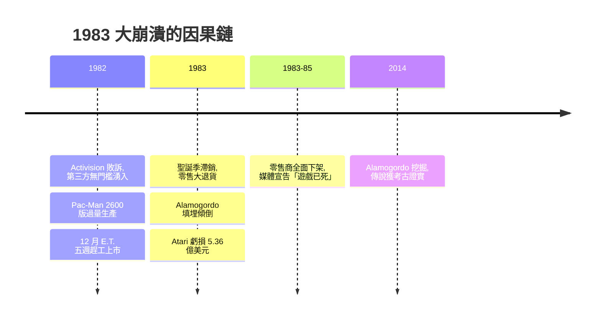

# 第 3 章 · 第 1 節 1983 大崩潰：填埋場裡的產業屍骸

1983 年，北美電子遊戲產業的營收從前一年約 32 億美元的高峰崩落到約 1 億美元量級——兩年內蒸發近 97%。零售商把貨架上的「電視遊戲」撤光，報導宣告這是曇花一現的玩具熱潮。史稱 **Atari shock / 1983 年北美遊戲大崩潰**。

## 前因：開放的閘門、氾濫的洪水

崩潰不是意外，而是制度缺陷的必然結算。1982 年 Activision 敗訴後，進入 Atari 2600 軟體市場毫無門檻：沒有授權金、沒有品質審查、沒有發行數量限制。結果是：

- **供給氾濫**。數十家廠商（從真誠的小團隊到燕麥片公司 Quaker Oats 旗下部門）搶發遊戲，市場上流通數千款卡帶，但每款平均銷量急速攤薄。
- **品質崩壞**。毫無把關的市場湧現大量粗製濫造的克隆與無法通關的爛作。消費者無從分辨好壞，買到一次爛遊戲，就對整個品類失去信任——**資訊不對稱摧毀了品類信譽**。
- **價格螺旋**。滯銷卡帶大打折扣（原價 30–40 美元的遊戲喊到 5 美元以下），消費者學會「等跳樓價」，新遊戲更賣不動，惡性循環。
- **家用電腦趁虛而入**。Commodore 64 以 199 美元（Timex Sinclair 更低）強攻「電腦也能玩遊戲且功能更強」的定位，同時搶走遊戲與玩具預算。

## 兩顆炸彈：Pac-Man 與 E.T.

Atari 自身的兩個決策成為崩潰的圖騰：

- **《Pac-Man》2600 版（1982）**：為聖誕季狂產 1,200 萬套（遠超當時 VCS 裝機量），移植品質卻極差——畫面閃爍、迷宮變色。玩家用腳投票，Atari 積壓數百萬套。
- **《E.T. the Extra-Terrestrial》（1982 年 12 月）**：Howard Scott Warshaw 在 **約五週** 內趕工完成（為搶電影熱度），玩法設計崩壞，玩家動輒掉進無數個坑裡。Atari 據傳生產 400–500 萬套，絕大多數滯銷。

## 新墨西哥的真相：從都市傳說到考古證實

滯銷貨去哪了？1983 年 9 月起，運載貨車深夜開往新墨西哥州 Alamogordo 附近，新聞報導 Atari 傾倒數萬片卡帶並碾壓後以混凝土封埋。數十年間，這件事被當成誇大的都市傳說——直到 **2014 年 4 月**，加拿大紀錄片團隊 《Atari: Game Over》主導的挖掘行動在 Alamogordo 市垃圾填埋場開挖，**真的挖出成噸的 Atari 卡帶與硬體**（E.T.、Pac-Man、Asteroids 等），市府與 Atari（當時已屬華納）文件證實 1983 年確有此舉，共運送約 792 批貨物的傾倒紀錄。傳說被考古學證實，成為產業史上最黑色幽默的實體證據。部分出土卡帶事後在 eBay 上以數百至上千美元成交——垃圾轉為文物。

## 後果：信心的雪崩

崩潰的傳導鏈條是零售端的信任崩塌：積壓退貨潮讓大型零售連鎖認定「電視遊戲」是騙錢的熱潮，全面下架並拒絕再進貨。Atari 1983 年虧損約 5.36 億美元，華納被迫拆售公司；Coleco、Mattel 等硬體商重傷或退出；Mattel 電子部門重創。媒體敘事定調為「電子遊戲已死」，產品從貨架上消失近兩年。**同一時間，日本卻在發生相反的事**：任天堂正在量產 Famicom。1985 年，一家做花札紙牌起家的京都公司將以「玩具」的名義，把遊戲重新帶回美國貨架——並且帶著 Atari 用崩潰換來的全部教訓。

> **本節要點**：1983 崩潰本質是一場「公地悲劇」——無權利金、無審查、無數量管制的開放軟體市場，讓個體理性（多發爛作搶錢）導致集體毀滅（品類信譽歸零）。任天堂之後建立的權力金與 Seal of Quality 制度，正是針對這場崩潰的每一個病因開出的處方。
