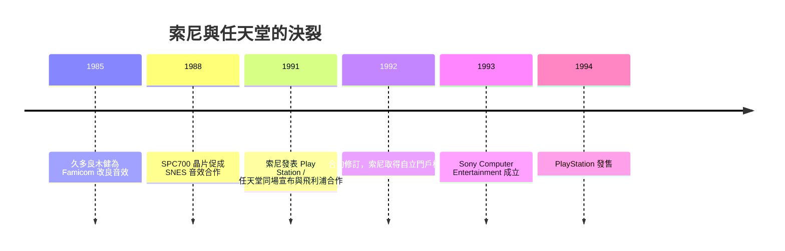

# 第 5 章 · 第 1 節 索尼與任天堂的分手：改變工業版圖的世紀裂痕

遊戲機史上最著名的一場「婚變」，起點竟是一顆音效晶片。

## 久多良木健與 SPC700

1980 年代中期，任天堂找上電子巨頭索尼，是因為 Super Famicom 的音效規格遲遲未定。索尼數位研究部門的工程師久多良木健（Ken Kutaragi）私下用索尼的晶片技術，為女兒玩的 Famicom 改良音效，隨後力排眾議爭取到合作案。他主導設計的 SPC700 音效核心（搭配 Sony 與徳州儀器技術混合的音源處理單元，內建 64KB 音效記憶體，支援 ADPCM 取樣）讓超任擁有當時家用機最出色的聲音表現。這次合作讓索尼正式踏入遊戲硬體供應鏈——也埋下裂痕的種子。

## 「Play Station」：光碟附加器的聯姻

久多良木健進一步說服雙方高層：下一代應該走向 CD-ROM。1988 年前後，兩公司簽署協議，索尼為超任開發 CD-ROM 讀取裝置，並可播放 CD 與 CD-i 格式軟體；這台機器內部同時搭載任天堂與索尼的晶片。計畫名稱就叫「Play Station」（後稱 SNES-CD）。對任天堂而言，這是借索尼之力進入光碟時代；對索尼而言，這是切入遊戲市場的灘頭堡。但合作條款埋藏爭議——合約賦予索尼對「Super Disc」格式相當的主導權與非遊戲用途的推廣空間，任天堂內部對「讓索尼掌握遊戲媒介標準」的不安與日俱增。

## 1991 年芝加哥 CES 的公開羞辱

1991 年 6 月，芝加哥消費電子展（CES）。索尼在會場上正式發表 Play Station，並由久多良木健在台上宣布與任天堂的合作。但就在索尼發表之際，任天堂同場宣布：將與荷蘭飛利浦（Philips）合作開發 SNES 的 CD-ROM 技術。對索尼而言，這不僅是背信，更是在自家發表會的地板上被公開打臉。索尼高層憤怒之餘，一度考慮將技術轉售給蘋果等對手開發遊戲機；任天堂隨後提出折衷方案——1992 年雙方修訂合約，任天堂承認索尼對「Play Station」名稱與軟體的部分權利，索尼可將其改造為獨立主機。這紙「休兵」條款，反而成了索尼自立門戶的法律通行證。

## 從裂痕到帝國的起點

1992 年，雙方合作實質破局。時任索尼社長大賀典雄支持久多良木健的路線：既然橫豎要進入遊戲業，就做自己的主機。1993 年索尼內部成立 Sony Computer Entertainment（SCE），1994 年 12 月 3 日，PlayStation 在日本問世。

mermaid 圖示這段裂痕的連鎖：

## 思想的教訓

這段歷史常被簡化為「任天堂背叛」，但深層結構是**媒介即權力**：誰掌握遊戲發行格式，誰就掌握 20 世紀末娛樂工業的入口。任天堂深知卡帶時代的授權鎖定（用授權金與晶片管制控制第三方）是其帝國根基，絕不容他廠染指；索尼則從中悟出——平台不需要「合資」，需要的是徹底的控制。一場 CES 的羞辱，把一家消費電子公司推上了遊戲王座，也終結了任天堂一家獨大的 8-bit／16-bit 黃金年代。
