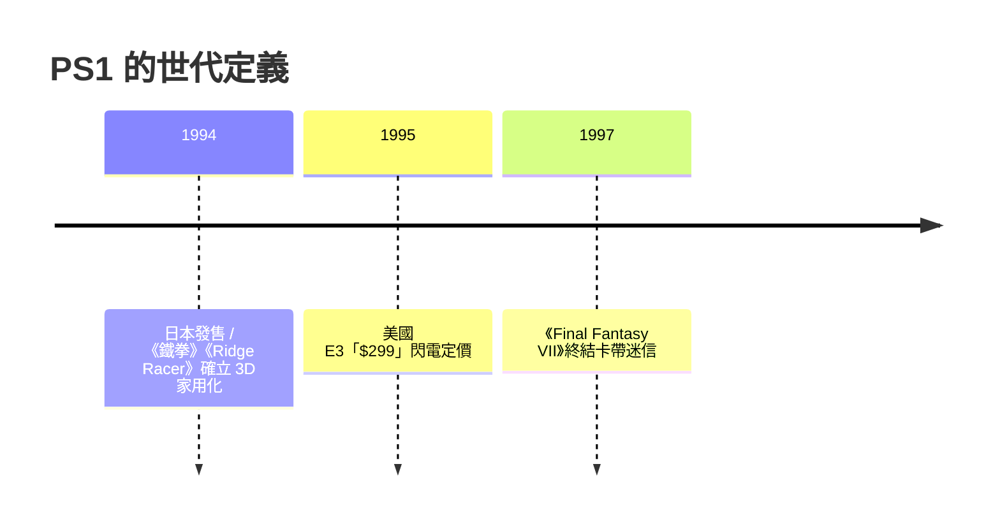

# 第 5 章 · 第 2 節 PS1 的 3D 降維打擊：多邊形時代的權力轉移

1994 年 12 月 3 日（日本）、1995 年 9 月 9 日（美國），索尼 PlayStation 上市。它不只是一款主機，而是把「3D 即時運算」從街機實驗室搬進千萬客廳的降維打擊。

## 硬體：為多邊形而生

PS1 的心臟是 32-bit RISC CPU——MIPS R3000A 相容核心，運作時脈約 33.8688 MHz。但真正的靈魂是兩顆輔助晶片：

- **GTE（Geometry Transformation Engine）**：固定的幾何變換引擎，專責頂點的旋轉、平移、投影與透視除法，把 CPU 從繁重的矩陣運算中解放出來。這是「為一件事做到極致」的專用化設計思想，而非通用 CPU 的萬能路線。
- **GPU**：負責光柵化（rasterization），在 1MB VRAM 中以雙緩衝 frame buffer 加 texture page 的佈局繪製像素。

整機沒有浮點運算器（FPU），GTE 採定點數運算——這解釋了後世玩家熟悉的許多視覺「性格」。

## 渲染管線與 affine 扭曲

PS1 的管線是：CPU 準備頂點資料 → GTE 做幾何變換與光照計算（flat shading 為主，每個多邊形單一明暗）→ GPU 以描繪命令繪製帶貼圖的多邊形。官方標稱效能約每秒 36 萬 flat-shaded polygons，實務上遊戲依場景與貼圖負載遠低於此。

最著名的缺陷是 **affine texture mapping**：GPU 在三角形內以線性（仿射）方式插值貼圖座標，不做透視校正（perspective-correct）的深度內插。結果是遠處或斜視的貼圖劇烈扭動、蠕動晃動——《Sega Rally》《Tomb Raider》裡地板紋理「沸騰」的畫面成為一代集體記憶。開發者用低解析度貼圖、將多邊形切小、甚至故意用暗色調來遮醜。這是「硬體省下透視校正電晶體，把扭曲甩給軟體適應」的典型成本取捨。

## 世代定義之作

- **《鐵拳》（1994/1995）**：Namco 以街機 System 11（PS1 架構的血親）移植，展示即時 3D 格鬥在家用機的可行性，角色多邊形不高但動作流暢，宣告 2D 格鬥讓位。
- **《Ridge Racer》（1994/1995）**： namco 的競速首發作，以貼圖多邊形賽道示範 3D 競速的臨場感。
- **《Final Fantasy VII》（1997）**：Square 為 CD 容量與 3D 預算離開任天堂陣營，三片 CD 的 CG 動畫與預算級製作，把 JRPG 推向全球主流，直接奠定 PS1 的勝局。

## 定價戰：$299 的閃電

1995 年 E3 上，SCEA 社長 Olaf Olafsson／Steve Race 上台只講了幾句話，最後一句「$299」便下台，比 Sega Saturn 的 $399 便宜一百美元，現場轟動。Saturn 雙 CPU 複雜、製造成本高，只能被迫提前上市與之對抗；PS1 則以精簡晶片數、高整合度（後期將 CPU+GTE+GPU 相關電路縮併為單晶片 SoC）持續壓低成本。定點數、affine 扭曲這些「缺陷」，全都轉化成了價格優勢。

## 歷史意義

PS1 證明：遊戲機不必追求架構優雅，而要追求**開發者容易理解、製造商壓得下成本、玩家買得起**的三位一體。全球累計銷售超過一億台，遊戲產業的重心從日本硬體廠的「設計者本位」，滑向「半導體成本曲線 + 第三方軟體經濟」的新秩序。3D 不只是畫面革命，更是經濟革命的載體。
