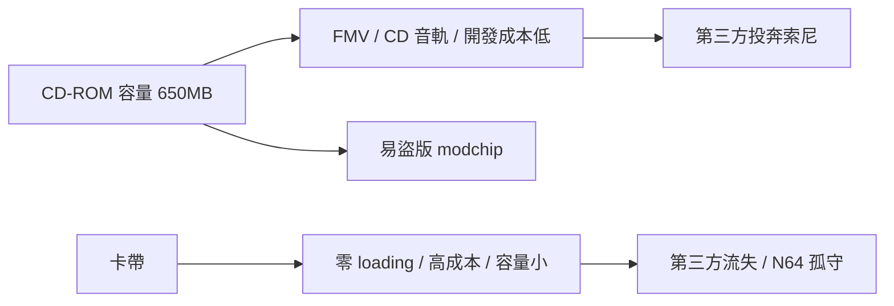

# 第 5 章 · 第 3 節 CD-ROM vs 卡帶：一場媒介革命的正反面

1990 年代中葉，遊戲產業的分歧不在創意，而在**儲存介質**。CD-ROM 與卡帶之爭，是容量、成本、管制與盜版的四方角力。

## 容量革命：650MB 對 8–32MB

一張 CD-ROM 容量約 650MB；同時代的超任卡帶普遍在 4–32MB 之間，N64 卡帶主力也在 8–64MB（成本所限多為 8–32MB）。數百倍的差距直接改寫了遊戲的形態：

- **FMV 全動態影像**：預錄影片成為可能，互動式電影遊戲（FMV adventure）如《Night Trap》應運而生。
- **CD 音軌配樂**：紅皮書音軌直接播放，交響化的配樂成本驟降，遊戲音樂告別合成器音源的「晶片音樂」美學。
- **開發成本下降**：卡帶需在生產前預估銷量、一次性開模壓製，賣不掉就是庫存黑洞；CD 壓片成本極低、可小量補貨，第三方廠商的財務風險大幅縮小——這是任天堂帝國鬆動的經濟根因。

## 《Night Trap》與 1993 年國會聽證

光碟的多媒體能量也引來政治風暴。1993 年 12 月，美國參議院就電玩暴力舉行聽證會，參議員 Lieberman 與 Kohl 點名《Night Trap》（世嘉 Mega-CD 的 FMV 遊戲）、《Mortal Kombat》等。《Night Trap》因其監視器式偷窺敘事被抨擊為「羞辱女性」，世嘉被迫撤下遊戲。這場聽證的直接產物是 1994 年成立的 ESRB 分級制度——**遊戲業以自律分級換取生存空間**，也讓遊戲從「兒童玩具」的法律想像走向「成人娛樂」的社會定位。制度變遷，竟由一張光碟的容量催生。

## N64 的卡帶孤守

任天堂 1996 年的 N64 堅持卡帶，理由並非頑固，而是冷靜的算計：

- **優點**：零載入時間、隨機存取、無需加裝昂貴光碟機與授權費問題、耐久。
- **代價**：容量限制了 FMV 與大型音源，《FFVII》所需的「三張 CD 的內容」塞不進一顆卡帶；壓片成本高，售價常達 $60–70，第三方授權利潤被壓縮；任天堂獨占卡帶製造權，形成對第三方的「卡帶稅」。

結果：Square 率先出走（1996 年宣布《FFVII》登陸 PS），Enix 等跟進，N64 的 RPG 陣容長期貧血。史實中，Square 高層明白表示容量與開發自由度是轉投索尼的原因。這場出走常被戲稱為「『loading』的問題」——卡帶沒有載入畫面，卻讓第三方載不進它的高牆。

## 雙面刃：modchip 與盜版文化

CD 的脆弱面是**可複製性**。一臺光碟燒錄器加上一片「modchip」（破解晶片，繞過主機的區碼與防拷檢查，如對 PS1 接線注入訊號欺騙 wobble 檢測），就能運行盜版與燒錄片。PS1 的 modchip 在亞洲、南美形成龐大灰色經濟，也意外擴大了主機的滲透率。盜版是光碟時代所有主機的宿命詛咒——但諷刺的是，壓片便宜的授權模式，仍遠比卡帶模式更能留住第三方。

## 結語

CD-ROM 之戰證明：**平台之爭的本質是供應鏈之爭**。誰讓開發者便宜地製造內容、讓玩家便宜地取得主機，誰就贏——即使代價是讓盜版也便宜。任天堂的卡帶堅守贏得了品質口碑，卻輸掉了整個第三方經濟。媒介即制度，制度即勝負。
