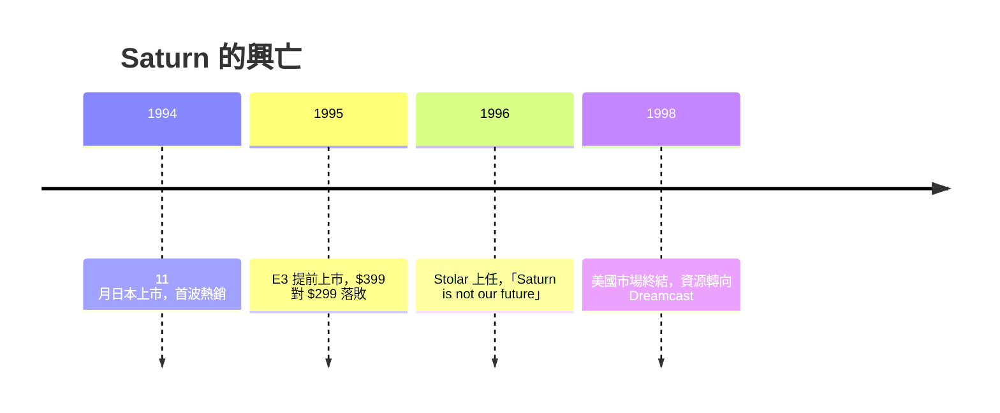

# 第 6 章 · 第 1 節 世嘉土星的雙 CPU 泥沼：組織內鬥如何寫進矽晶

1994 年 11 月（日本）上市的 SEGA Saturn，是遊戲機史上「組織政治直接鑄進硬體」的教科書案例。

## 為何是雙 SH-2？

Saturn 的架構源頭是街機。世嘉的 Model 1（Virtua Racing，1992）與 Model 2（Virtua Fighter 2、Daytona USA）基板，靠多晶片協作達成當時頂級的 3D 表現。家用化時，世嘉工程師面臨難題：既要維持世嘉賴以為生的 2D 街機移植能力（格鬥、射擊、賽車），又要追上 3D 浪潮。最終方案是：

- **兩顆日立 SH-2（32-bit RISC，約 28.6 MHz）**平行運作；
- 兩顆 VDP（VDP1 負責 sprite／多邊形描繪，VDP2 負責背景與平面）；
- 加上 Yamaha 的 68EC000 與 DSP 處理音效，共計多達 8–9 顆主要晶片。

雙 CPU 並行的難處在於**同步與分工**：沒有硬體級的任務分配器，開發者必須手動切分兩顆 CPU 的工作，任何資料競爭都導致畫面撕裂或卡頓。世嘉第一方團隊有街機工程師的私房心法，第三方卻如入迷宮——要在合理時間內用好這台機器，門檻極高。

## 2D 強者，3D 苦手

Saturn 的 VDP1 本質上是高階 sprite／quad（四邊形）描繪器，而非真正的三角形多邊形引擎：不支援透視校正貼圖、無深度緩衝（z-buffer），得靠排序繪製。結果是 2D 遊戲（如《Guilty Gear》時代前的格鬥移植、《Radiant Silvergun》）與 2.5D 表現極佳，但大規模 3D 場景既慢又難。同期 PS1 單一 CPU＋GTE＋GPU 的直線管線，反而更容易懂。開發者用腳投票。

## 提前上市的自殺式反擊

1995 年 5 月 E3，SCEA 宣布 PS 美版售價 $299。世嘉高層當場宣布 Saturn「今天就上市」，零售價 $399——為了搶先四個月，世嘉打亂了與零售商的既定供貨安排，得罪未收到首批貨的通路，且 $399 對 $299 的價差在消費者心中立刻定調。這是供應鏈與行銷節奏被競爭焦慮綁架的經典教訓。

## Bernie Stolar 與美國市場的安樂死

1996 年，世嘉美國換上 Bernie Stolar 掌舵。他以直言聞名，公開宣稱 **「Saturn is not our future」**（Saturn 不是我們的未來）——一方面是誠實的戰略止血，一方面也等於對零售商與消費者宣告「別再買這台機器」。他砍掉第三方某些遊戲、清倉存貨，把資源轉向 1998 年 11 月在美國發售的 Dreamcast；Saturn 在日本靠《櫻花大戰》等作品多活了一段時日，在美國則於 1998 年實質提前死亡。史實中，《Virtua Fighter 3》因 Model 3 基板效能遠超 Saturn，世嘉始終未推出忠實移植（街機版之外僅有外傳與改編作品），象徵「家用機追不上自家街機」的斷裂。

## 結語

Saturn 的悲劇不是工程師不行，而是**沒有人有權力說「不」**：街機部門要 2D、家用部門要 3D、高層要搶時間，於是全部需求都塞進同一台機器。硬體是組織的化石——雙 SH-2 的泥沼，正是世嘉內部權力結構的剖面圖。
