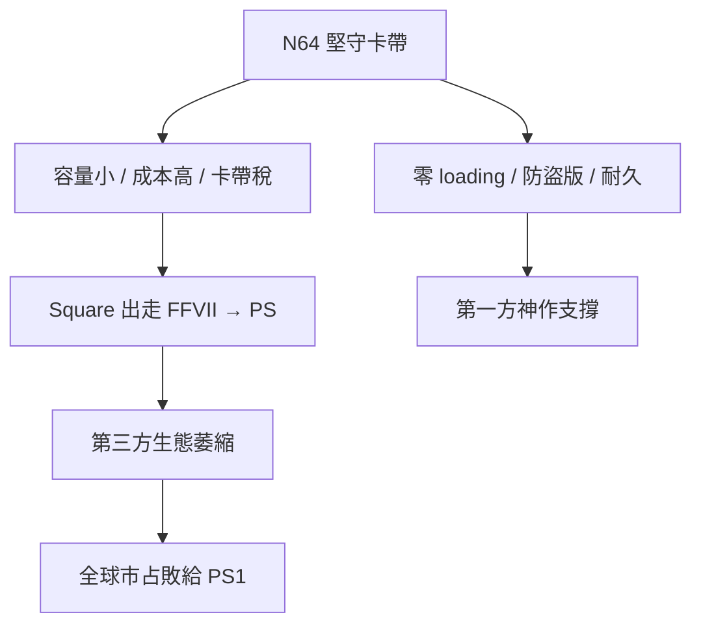

# 第 6 章 · 第 2 節 N64 的卡帶孤高：64-bit 榮光與第三方出走

1996 年 6 月（日本）／9 月（美國），任天堂 64 問世。它是史上最後一台以卡帶為主力媒介的旗艦主機，也是任天堂硬體工程美學的巔峰與黃昏。

## 硬體：SGI 的血統

N64 的運算核心是 **MIPS R4300**，一款 64-bit RISC CPU，主脈約 93.75 MHz；在其上層，任天堂與 Silicon Graphics（SGI）合作設計了 **RCP（Reality Coprocessor）**——內含 RSP（向量／幾何處理）與 RDP（像素描繪）的單晶片圖形子系統，配 4MB RDRAM（高頻寬但容量小）。SGI 當年是好萊塢特效與科學視覺化的霸主，把 workstation 級的圖形思想壓縮進消費性主機，讓《Super Mario 64》的即時 3D 遠超同期對手。發售時，「64-bit」本身即是行銷武器——雖然對遊戲實效有限，但象徵了任天堂「技術為遊戲服務」的自信。

## 卡帶的取捨：零 loading 的代價

N64 堅守卡帶，收穫的是真實的優勢：

- **零載入時間**：隨機存取讓《Super Mario 64》《Zelda》的關卡切換近乎即時；
- **耐久與防拷**：卡帶幾乎無法盜版（相較 PS1 的 modchip 泛濫）；
- **省去光碟機成本與故障率**。

但代價同樣真實：

- **容量**：主流卡帶 8–32MB（後期少數達 64MB），塞不下 CD 級的 FMV、音源與關卡資產；
- **成本**：壓製一片 CD 不過一美元上下，而一顆 N64 卡帶製造成本可達十餘美元，零售價常為 $60–70，是 PS 遊戲的近兩倍；
- **供貨權力**：卡帶只能由任天堂指定生產，第三方要預先下單、承擔庫存風險，且被抽取高額授權費——「卡帶稅」成為第三方的共同怨言。

## 《Final Fantasy VII》出走：帝國的裂痕

1996 年，Square 正式宣布《Final Fantasy VII》登陸 PlayStation。史實上，Square 高層（坂口博信一方）多次表示：N64 卡帶的容量與開發條件無法承載其構想——遊戲最終跨三張 CD，包含大量 CG 動畫與 CD 音軌。Enix 的《Dragon Quest VII》隨後也選擇 PS。JRPG 兩大旗艦離開任天堂陣營，等同宣告「卡帶無法服務大型內容產業」。N64 的第一方作品依然輝煌（瑪利歐、薩爾達、黃金眼），但第三方陣容長期貧血，北美以外的市占節節敗退。

## 數字與教訓

PS1 全球銷量破一億台；N64 終其生命週期約三千餘萬台（史實約 3,293 萬）。這不是技術失敗——N64 的 3D 技術在同世代無人能敵——而是**平台經濟的失敗**：任天堂用硬體品質對抗索尼的供應鏈經濟，輸的是「誰讓第三方更容易賺錢」。

## 結語

N64 的孤高證明了兩件事：第一，傑出的遊戲設計可以拯救一款主機的口碑，卻救不了它的生態；第二，媒介選擇從來不只是工程問題，而是對整個產業權力結構的政治表態。2001 年 GameCube 轉向迷你光碟，正是這場孤高的悄然認輸。
