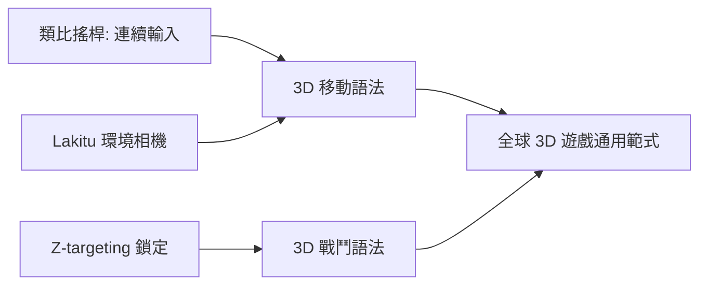

# 第 6 章 · 第 3 節 瑪利歐 64 與 3D 操控範式：發明「如何在第三維移動」

1996 年 6 月 23 日，《Super Mario 64》與 N64 同步上市。它解決的不是圖形問題，而是更根本的哲學問題：**人類如何在虛擬 3D 空間中移動而不迷失？** 這套答案，至今仍是全球 3D 遊戲的通用語法。

## 前提：類比搖桿

2D 時代的十字鍵（D-pad）只有「方向」，沒有「程度」。3D 移動需要連續的速度與角度向量。N64 手把首創量產化的**類比搖桿（analog stick）**——光學感測搖桿偏移量，輸出連續的類比數值，瑪利歐可因此緩步、快走、全速衝刺，轉彎半徑隨推桿角度連續變化。沒有這顆搖桿，瑪利歐 64 的空中操作精度無從成立。這是「輸入裝置的表達力決定遊戲語言的字彙量」的直接證明。

## 環境相機：Lakitu Cam

3D 遊戲第二大難題是鏡頭。瑪利歐 64 的方案叫 **Lakitu cam**：由隱形的「烏龜攝影師」邏輯控制鏡頭——跟隨玩家、避開牆壁、在關鍵點自動切換最佳角度，玩家再以 C 鍵手動微調。宮本茂團隊的核心洞察是：**鏡頭本身要被設計成遊戲角色**，有規則、有行為，而非單純的數學投影。在雙類比搖桿尚未普及的年代（N64 手把僅一顆類比搖桿），這套「環境智能鏡頭＋玩家微調」的混合方案，是當時最可行的解。

## Z-targeting：鎖定的發明

開發《薩爾達傳說：時之笛》（1998）時，團隊面臨更難的問題：3D 戰鬥中，玩家如何一邊移動、一邊維持對敵人的攻擊朝向？答案是 **Z-targeting**（按 Z 鍵鎖定目標，移動與攻擊皆相對目標參考系運作）。這個發明把「絕對空間操作」轉換為「相對目標操作」，瞬間降低了 3D 動作遊戲的認知負荷，成為此後幾乎所有 3D 動作／RPG／動作冒險遊戲鎖定系統的直系祖先（《黑暗靈魂》的鎖定、無數遊戲的 soft lock 皆源於此）。

## 三搖桿之前的鏡頭問題

在雙類比搖桿成為標準（PS Dual Analog／DualShock 1997）之前，鏡頭控制始終是妥協的藝術：自動鏡頭會笨拙、全手動不夠按鍵。瑪利歐 64 選擇「自動為主、手動為輔」；DualShock 普及後，「左搖桿移動、右搖桿轉鏡頭」才成為 FPS 與 3D 動作的雙軸範式。瑪利歐 64 的價值在於：它在硬體尚不完備時，用設計智慧先補上了半邊，並驗證了另一半的需求方向。

## 為何後世都要學它

《王國之心》（2002）、《超級瑪利歐陽光》乃至開放世界遊戲的移動手感，都可追溯到瑪利歐 64 建立的原則：**連續輸入、慣性物理、以角色動畫回饋狀態、鏡頭服務於空間理解**。宮本茂的名言「一個瑪利歐能做的不只是跳」在此升維——跳躍從 2D 的越障手段，變成 3D 空間的度量衡。

## 結語

瑪利歐 64 證明：範式革命的關鍵常不在運算力，而在**人機介面的重新發明**。硬體給了像素，任天堂給了文法。此後二十年，整個產業都在用它的語言寫作。
