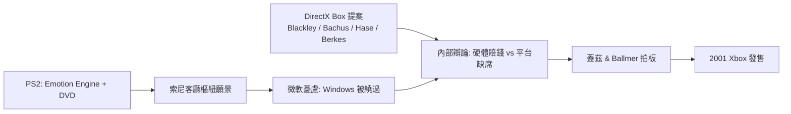

# 第 7 章 · 第 1 節 微軟的戰略防禦：Xbox 誕生的客廳焦慮

Xbox 不是為了「做遊戲機」而誕生，而是為了**保衛 Windows**。這是一場教科書級的戰略防禦（strategic defense）。

## 索尼的宣戰：Emotion Engine 與客廳樞紐

1999 年東京電玩展與 2000 年 PS2 上市前後，索尼的行銷話術極具野心：PS2 的 Emotion Engine CPU 不只跑遊戲，還能播放 DVD——PS2 上市初期，低價 DVD 播放器身分甚至比遊戲功能更能促銷。索尼描繪的願景是：**PS2 將成為客廳的數位娛樂樞紐**，統合電影、音樂與遊戲。對微軟而言，這幅圖景的可怕之處不在遊戲，而在**作業系統的邊界**：如果家庭上網與數位生活的入口是一台 PlayStation，那麼 Windows 在 PC 上的壟斷將被繞過，下一個世代的運算平台之戰，微軟將直接缺席。

## DirectX Box：四位工程師的提案

比爾·蓋茲御前提案的起源，是微軟 DirectX 團隊的四位工程師：**Seamus Blackley、Kevin Bachus、Ted Hase、Otto Berkes**。他們的原始構想相當務實：把 PC 的 x86 架構與 DirectX API 直接包裝成遊戲主機——「DirectX Box」，讓 PC 遊戲開發者幾乎無痛移植，用既有生態對抗封閉的日系主機。這個提案與微軟遊戲部門（含 Ed Fries 領導的遊戲工作室團隊）的推動合流。Blackley 之後成為 Xbox 的公眾面孔與第一方技術宣傳者。團隊後來把名稱縮短為「Xbox」，成功通過商標與市場測試。

## 拍板：蓋茲與 Ballmer 的決斷

內部並非一面倒。做硬體意味著微軟要走出利潤率極高的軟體舒適圈，投身每台都賠錢的消費性硬體泥潭；與日系廠商合作授權的路線（曾與 SEGA 談過、也評估過與其他廠牌結盟）都在內部辯論過。最終，比爾·蓋茲與 CEO Steve Ballmer 從戰略高度拍板：**寧可賠錢，不可缺席**。2000 年 3 月，蓋茲在 Game Developer Conference 發表 Xbox 計畫；2001 年 1 月的 CES，Xbox 正式亮相。這是微軟史上罕見的「防禦性進攻」——用一個新戰場的投入，阻止既有戰場的崩塌。

## 思想層次：平台壟斷者的戰爭邏輯

Xbox 的誕生揭示了平台資本主義的殘酷規則：**壟斷者最怕的不是對手變強，而是戰場轉移**。索尼用遊戲機做特洛伊木馬，微軟就用遊戲機蓋城牆。Blackley 等人的文化貢獻在於給了這場防禦戰一個工程化的靈魂——「Xbox 就是 PC」的直覺，讓微軟能用最熟悉的武器（x86、DirectX、乙太網路）打仗。而這個「PC 塞進客廳」的架構，也將直接決定下一代 Xbox 的體型、成本與命運。
