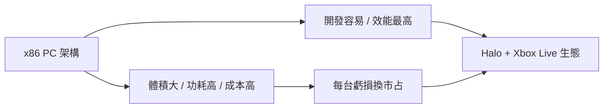

# 第 7 章 · 第 2 節 Xbox 黑色巨獸：PC 塞進客廳的代價

2001 年 11 月 15 日，微軟 Xbox 在北美上市。它是遊戲機史上最「不像遊戲機」的遊戲機——一台被拔掉鍵盤的 PC，塞進了客廳的電視櫃。

## 規格：當時主機的降維規格

Xbox 的內在就是 PC：

- **CPU**：Intel Pentium III 特製版（Coppermine 血統），時脈 733 MHz——對比 PS2 的 Emotion Engine（約 294.9 MHz 級的 RISC 設計）與 GameCube 的 IBM Gekko（約 485 MHz），Xbox 的通用運算力最高；
- **GPU**：NVIDIA 特製晶片（NV2A，GeForce 3 血統），時脈約 233 MHz；
- **記憶體**：64MB 統一記憶體，是同世代之最；
- **內建硬碟**：8GB——史上第一台把硬碟列為標準配備的主流主機，免記憶卡即可存檔，更為未來的音樂抓取與遊戲快取鋪路；
- **乙太網路孔**：原生網路介面，硬體層面直接預訂了線上時代。

「DirectX Box」的命名忠實反映架構：x86 + DirectX + PC 元件供應鏈。對開發者而言，這是史上最平易近人的主機——C/C++、熟悉的工具鏈、統一記憶體架構，幾乎是「跟 PC 一樣，但大家用同一台機器」。

## 體型與重量：PC 的物理宿命

硬體越強，供電與散熱越兇。Xbox 體積龐大（約 32×25×8.5 公分級）、重量約 4 公斤，配上一顆笨重的外部電源供應器——日系主機多將電源內建或極度輕薄（PS2 厚度僅 Xbox 的三分之一左右）。黑色巨大機殼、綠色 X 字標與突起的 DVD 托盤，讓它獲得「黑色巨獸」「烤箱」等渾名。這是**PC 供應鏈邏輯**（用現成零件堆效能）與**消費電子邏輯**（極小化、極靜音、極省電）的直接衝突，微軟選了前者。

## 賠本買市場：每台都虧的財務結構

Xbox 的物料成本高於售價 $299——初期的實際虧損幅度外界估計可達每台一百美元級（微軟從未公布確切數字，此處保守表述）。這是平台戰爭的標準算式：**硬體虧損，軟體與授權回收**。微軟原計畫向日本廠商洽談代工與合作未果（與 SEGA 的談判無疾而終），最終以自有品牌硬闖。結果是 Xbox 一世銷量約兩千四百萬台，遠低於 PS2 的一億五千萬級，微軟遊戲部門連年虧損數十億美元——但成功在客廳站穩腳步，並孕育了 Halo 與 Xbox Live 兩大資產。

## 與日系主機的哲學對比

PS2 的 Emotion Engine 是「自製晶片的浪漫」——索尼親手設計 CPU 以掌握命運，代價是開發難度；GameCube 是「精緻平衡」——IBM CPU + ATI GPU，小而高效，成本低但規格不炫。Xbox 則是「採購的暴力」——Intel + NVIDIA，不造晶片，只做整合。三條路線對應三種企業基因：Sony 的垂直整合、任天堂的玩具工藝、微軟的平台採購。歷史後續證明，微軟的路線在下一世代（360）才真正發威。

## 結語

Xbox 一世在商業上失敗，在戰略上成功。它證明微軟敢於在虧損中維持十年的耐心，也證明 PC 架構進入客廳是可行之路——這條路，將在 2005 年的 Xbox 360 上開花。
