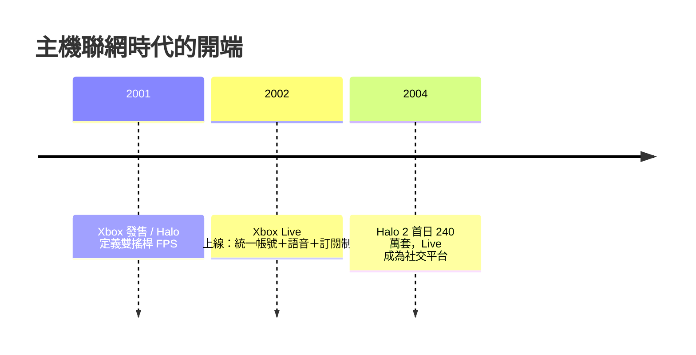

# 第 7 章 · 第 3 節 Halo 與 Xbox Live：主機聯網時代的開端

Xbox 贏得客廳的兩件武器，一件改變了手感，一件改變了社會結構：Bungie 的《Halo》與 2002 年的 Xbox Live。

## Halo：雙搖桿 FPS 的範式

Bungie 原是 Mac 遊戲名廠（Myth、Marathon），1999 年被微軟收購，Halo 從 Mac 展示品轉為 Xbox 首發護航作，2001 年 11 月 15 日與主機同步發售。《Halo: Combat Evolved》解決了主機 FPS 的世紀難題——**如何在雲搖桿上打出射擊遊戲的精準**：

- **左搖桿移動、右搖桿視角**的雙軸分工成為標準；
- **自動瞄準輔助與射擊黏性（aim assist）**：Bungie 用細膩的磁吸式輔助補償類比搖桿的精度劣勢，讓輔助「看不見」卻「感覺得到」；
- **護盾值＋回復設計**：護盾先掉、血量後損的階層設計，降低了死亡懲罰的挫敗，成為日後主流 FPS 的原型；
- **載具與步行的無縫切換**、戰役中的大規模 AI 群體戰術，開創「戰場沙盒」的敘事節奏。

這套語法直接定義了《決勝時刻》《最後一戰》之後二十年主機 FPS 的操作學。Halo 累計銷量破五百萬套（含後續版本），是 Xbox 的文化火種。

## Xbox Live：付費訂閱的賭注

2002 年 11 月 15 日，Xbox Live 上線。微軟的設計在當時極為激進：

- **統一帳號（Gamertag）**：跨遊戲的身分與好友名單，不再一遊戲一帳號；
- **統一語音聊天**：主機隨附／販售耳機，語音內建於服務層，玩家開箱即聊；
- **訂閱費制**：年費約 $49.99，拒絕廣告補貼，主打品質與安全；
- **強制架構**：微軟要求聯網遊戲必須接上 Live 的認證與配對基礎建設，創造一致性體驗。

賭注的背景是**寬頻普及的時勢**：2002 年前後，美日韓的寬頻（ADSL／Cable）滲透率跨過關鍵門檻，撥接上網的延遲與電話占線不再可忍。微軟押注「寬頻進客廳」與「玩家願為體驗付月費」同時成立——兩者都在幾年內成真。當時的 PS2 線上服務零散、免費但無統一帳號，任天堂則幾乎缺席。

## 《Halo 2》：2004 年的社交革命

2004 年 11 月 9 日，《Halo 2》發售，首日北美銷售約 240 萬套，創下當時娛樂產品首日紀錄。更重要的是它把 Xbox Live 變成**社交空間**：配對系統（matchmaking）依技術與風格分組、 clan（戰隊）文化、派對系統讓好友組隊跨越地理——客廳裡的少年第一次與全大陸的陌生人組隊開黑。史實上，Halo 2 上線後長期占據 Live 遊玩時數的極大份額，「玩 Live」一度幾乎等於「玩 Halo 2」。

## 結語

Halo 供給了內容，Live 供給了基礎建設，寬頻供給了時勢。三者交會，主機從「客廳的單機玩具」變成「線上社交的終端」。索尼與任天堂被迫跟進，網路對戰與訂閱服務自此成為主機的標準配備——遊戲產業的服務化時代，從這裡開始。
