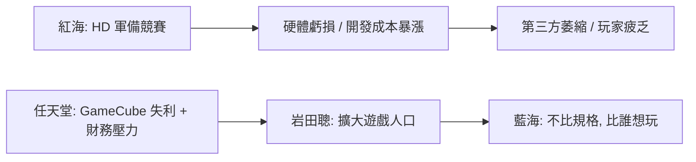

# 第 8 章 · 第 1 節 硬體軍備競賽泥沼：高畫質紅海與岩田聰的藍海

2005–2006 年，主機產業分裂成兩種世界觀：一種相信更快、更貴、更真實；一種相信更簡單、更便宜、更多人。前者叫 Xbox 360 與 PS3，後者叫 Wii。

## 紅海：高畫質軍備競賽

- **Xbox 360（2005 年 11 月）**：IBM 三核心 PowerPC CPU（Xenon，每核雙執行緒，約 3.2 GHz）＋ ATI Xenos GPU（統一著色器架構，首次將 unified shader 帶進主機），領先一年上市搶得 HD 世代先機。
- **PS3（2006 年 11 月）**：Sony／IBM／Toshiba 合作的 Cell 寬頻處理器（1 個 PPE＋7 個啟用 SPE，約 3.2 GHz）＋ NVIDIA RSX GPU。Cell 理論浮點效能驚人，但異質多核極難程式化，開發成本與學習曲線陡峭。
- **售價**：PS3 以 20GB／60GB 兩版本在北美以 $499／$599 上市——比 PS2 的 $299 貴上近一倍，50GB 藍光光碟機與 Cell 的成本轉嫁給玩家。結果是 PS3 初期銷售疲軟，Sony 遊戲部門連年巨額虧損，平山英雄主導的硬體部門承受巨大壓力。

兩台機器的開發成本都以「十億美元級」計，單機售價低於成本，遊戲開發預算也因 HD 美術而暴漲（百萬美元級→千萬美元級）。整個產業被捲入「更高成本、更少廠商敢做遊戲、更大爆款依賴」的紅海循環。史實上，Ken Kutaragi 也因 Cell／PS3 的困局而於 2007 年卸任 SCE 社長。

## 任天堂的財務壓力

在此之前，任天堂剛經歷最黑暗的一代：GameCube（2001）全球銷量約 2,174 萬台，遠低於 N64，更不及 PS2 的五分之一；第三方軟體持續流向 PS2。若 Wii 再打輸規格戰，任天堂可能淪為二線廠。**這不是從容的戰略選擇，而是被逼上梁山的求生。**

## 岩田聰的哲學：「擴大遊戲人口」

2002 年接任社長的岩田聰（Satoru Iwata），是程式師出身的經營者（HAL 研究所時期以親自改 code 拯救《Super Smash Bros.》開發聞名）。他的診斷直指核心：遊戲人口沒有成長，玩家越來越重度、非玩家越來越疏離，產業在自我閉環。他的處方是**「擴大遊戲人口」**——不做更強的機器，做讓「媽媽、阿嬤、上班族」都願意拿起的機器。這與宮本茂長年的「健康、家庭、直覺」設計思想合流，也與管理學的「藍海戰略」（價值創新：不做競爭維度上的更好，而做競爭維度上的不同）暗合。

## 思想的交鋒

這是企業戰略史的一課：**當所有玩家在同一維度競爭時，改變維度比贏得維度更便宜**。微軟與索尼在矽與光碟上燒錢，任天堂選擇在「人的手」上投資——感測器與介面，而非晶圓製程。2006 年，答案揭曉：Wii 以不到對手一半的效能與價格，賣出了世代最高的數量。紅海裡的巨獸們，輸給了一個簡單的問題：「什麼樣的人，從來不玩遊戲？」
