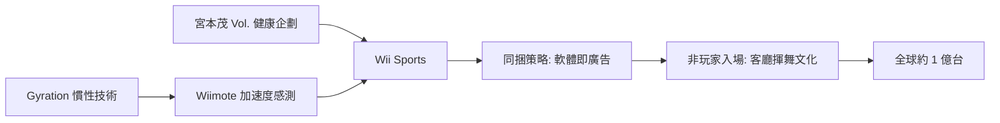

# 第 8 章 · 第 2 節 Wii 體感破局：把遊戲機變成全家的玩具

2006 年 11 月（北美 11/19、日本 12/2），Wii 上市。它效能墊底、售價最低，卻賣出約一億台，成為任天堂史上最暢銷的家用主機。破局的關鍵，是把手從「按鈕的集合」變成「身體的延伸」。

## Wiimote：加速度感測器與 Gyration

Wii 遙控器（Wiimote）的核心是**三軸加速度感測器**：量測三個方向的加速度向量，推算揮動的方向與力道，配合紅外線感測條（sensor bar）實現螢幕指標。任天堂並非無中生有——2005 年，任天堂收購了美國公司 **Gyration** 的相關資產與技術；Gyration 長年研發慣性感測的空中滑鼠技術，其專利與人才成為 Wiimote 的直接技術基礎。 Wiimote 的設計哲學是「低門檻、高直覺」：揮一下＝揮劍，指著螢幕＝指標，新手不需背按鍵表。這是輸入介面的降維——不追蹤 3D 姿態的精密光學，而用便宜可靠的加速度計＋人的直覺補完。

## 從 Vol. 到 Wii Sports：宮本茂的健康思想

宮本茂團隊內部曾推動一個名為 **Vol.**（取自「volume」，量測身體）的健康概念企劃：讓全家人每天在客廳量測身體、一起運動的遊戲。這個想法與岩田聰「擴大遊戲人口」戰略合流，最終成為 **《Wii Sports》**——網球、棒球、保齡球、高爾夫、拳擊五項運動，全部用「揮手」操作。它不是硬核遊戲，而是**社交儀式**：客廳裡的物理揮舞，讓旁觀者立刻理解玩法，並想親自拿起遙控器。

## Bundle 策略：軟體即廣告

任天堂做出關鍵決策：在多數地區將《Wii Sports》**與主機同捆**出售（北美等地），日本則以低價《Wii Sports》套裝跟進。這讓每一台 Wii 都自帶「全家試玩說明書」——非玩家買機器的第一個小時就有成功體驗。結果是病毒式的口碑循環：朋友來家裡玩過，回家就買一台。歷史上少有主機把首發遊戲當廣告預算來經營，Wii 是教科書案例。

## 低規格大賣的悖論

Wii 的效能明顯低於 Xbox 360 與 PS3（以 IBM Broadway CPU ＋ ATI Hollywood GPU 為基礎，無 HD 輸出），售價僅 $249。第三方大作幾乎無法移植，但這反而逼出任天堂的純粹路線：**遊戲的價值在操作與共樂，不在解析度**。Wii 全球銷量約 1.0163 億台，超越 PS3 與 Xbox 360，登上該世代之冠。

## 療養院裡的遊戲機

Wii 上市後，全球媒體廣泛報導一個新現象：**療養院與社區中心購入 Wii 給長輩玩保齡球**——不用跑、不用跳，揮手即可對戰，成為高齡照護的社交活動。孩童、父母、祖父母同場競技的畫面，是電玩四十年歷史中前所未有的圖景。岩田聰的「擴大遊戲人口」不只是口號，而在客廳與療養院裡被物理驗證。

## 結語

Wii 證明了藍海戰略的兌現：當敵人在矽上軍備競賽，你在人的手上創新。但也埋下伏筆——當 HD 浪潮碾來、體感新鮮感退燒，低規格的代價將在幾年後清算。
