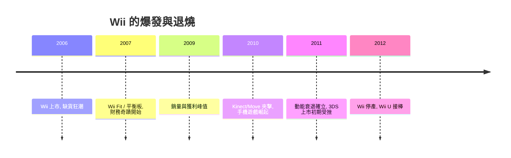

# 第 8 章 · 第 3 節 體感狂潮與財務奇蹟：一座火山的爆發與退燒

Wii 的成功不只是賣出主機，而是引爆了一整層從未存在過的市場——休閒玩家（casual gamers）的火山噴發。噴發有多壯觀，退燒就有多劇烈。

## Wii Fit：把遊戲機變成體重計

2007 年底（日本 12 月、歐美 2008 年初），任天堂推出 **《Wii Fit》與 Wii Balance Board（平衡板）**。平衡板內建四點壓力感測器，量測體重與重心偏移，支援瑜伽、肌力訓練、有氧與平衡小遊戲。它把「遊戲機」重新定義為**家庭健康器材**：買它的理由不再是打電動，而是減重與姿態。史實上《Wii Fit》全球銷量達兩千多萬套，是史上最暢銷的遊戲之一——一款「非遊戲」遊戲登上銷售榜頂，象徵休閒市場的規模已超越傳統玩家的想像。

## 社交聚會文化

Wii 改寫了遊戲的社交場景：從「一人在螢幕前」變成「全家輪流揮棒」。《Wii Sports》《Wii Party》《Just Dance》（Ubisoft，靠單支 Wiimote 追蹤舞步）成為派對標準配備；聖誕節的客廳、大學宿舍、婚禮餘興節目都出現了 Wii。遊戲從私密的 hobby，短暫地變成了**客廳的公共儀式**。

## 供不應求的供應鏈

2006 年末到 2008 年，Wii 長期缺貨：北美與日本通路一補貨即售罄，黃牛加價轉售成為新聞，任天堂被迫多次增產、公開為缺貨道歉。這是遊戲機史上罕見的「賣太快」——任天堂自身也低估了非玩家市場的規模。供應鏈的極限反過來成為飢餓行銷，進一步推高聲勢。

## 第三方跟風與 shovelware

爆款必然吸引寄生者。開發成本低（不需 HD 美術、不需大團隊）＋玩家辨識度低（休閒客只認得「Wii」這個品牌）＝**shovelware** 泛濫：寵物養成、健身、迷你遊戲合輯、授權改編作大量湧入，媒體與硬核玩家對 Wii 遊戲庫的品質評價持續下滑。任天堂的第一方軟體依然堅挺，但第三方生態呈現「數量多、口碑低、退場快」的泡沫結構——這正是火山式市場的副作用。

## 奇蹟曲線與退燒

任天堂的財務隨 Wii 衝上歷史高峰：2007–2009 會計年度連續創下史上最高營收與營業利益，股價一度漲至歷史天價區，單季營業利益率常達兩成以上——一家遊戲公司做出消費電子史上頂級的獲利表現。但 2010 年起動能明顯衰退：

- **無 HD**：Wii 僅支援 480p，在 HD 電視全面普及後，畫面劣勢成為社交尷尬；
- **第三方流失**：HD 大作缺席，核心玩家轉向 PS3／Xbox 360；
- **休閒市場被截胡**：智慧型手機與 App Store（2008）以更低門檻、更便宜的手遊直接吸走休閒玩家——Wii 培育的人口，被 iPhone 收割；
- **體感新鮮感耗盡**：PS3 Move 與 Xbox Kinect（2010）跟進體感，反而稀釋了 Wii 的獨特性。

Wii 的年銷量自 2009 年峰後逐年陡降，2012 年停產，全球最終約 1.0163 億台。任天堂營業利益自 2009 年度的高峰連續多年下滑，之後轉入虧損。

## 結語：Wii U 的伏筆

Wii 證明藍海可以贏，也證明藍海的脆弱：**擴大來的人口，忠誠度也最淺**——新鮮感一過、替代品一出，非玩家走得和來時一樣快。任天堂錯把火山當成了地基，Wii U（2012）試圖用「雙螢幕」再賭一次介面革命，卻在 HD 世代的溝通混亂中摔得更慘。Wii 的教訓成為下一節的序曲：奇蹟的會計學，與衰退的預言。
