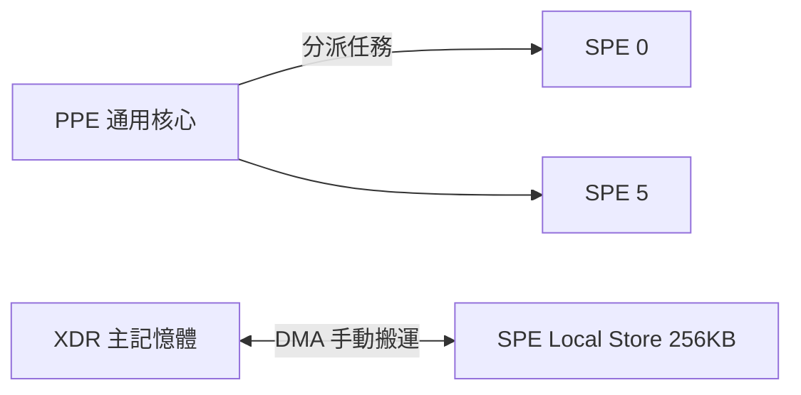

# 第 9 章 · 第 1 節 Cell 處理器噩夢：九核心怪獸

2006 年 11 月，PlayStation 3 在日本上市，售價 49,980 日圓——比 PS2 貴了將近一倍。讓這台機器如此昂貴、如此強大、也如此令開發者頭痛的，是一顆怪獸級晶片：Cell Broadband Engine。

## 三巨頭的豪賭

Cell 誕生於 2001 年成立的 STI 聯盟（Sony/Toshiba/IBM）。三家公司投入數十億美元建廠，目標是打造「超級電腦級」的消費性處理器。索尼的算盤不只是遊戲：Cell 還要進入電視與伺服器，成為整個數位家電帝國的心臟。

## 架構：1 個 PPE 加 8 個 SPE

Cell 的設計思想是「非對稱多核心」：

- **1 個 PPE**（Power Processing Element）：基於 IBM POWER 架構的通用核心，支援雙執行緒，負責作業系統與任務分派。
- **8 個 SPE**（Synergistic Processing Elements）：128 位元 SIMD 向量處理器，各有 256KB 本地儲存（Local Store），主攻浮點運算。實際上為提高良率，PS3 中封鎖 1 顆，作業系統再佔用 1 顆，**遊戲可用 6 顆**。

官方宣稱的單精度浮點效能達到 TFLOPS 級（確切數字因測量口徑而異，但確實遠超同期 PC CPU）。美國洛斯阿拉莫斯國家實驗室甚至用上萬顆 Cell 打造超級電腦「Roadrunner」，2008 年率先突破 petaflop。

## 恐怖算力與地獄編程

問題在於：**算力不等人**。SPE 沒有傳統意義上的快取與虛擬記憶體，只有 256KB 的本地儲存。資料必須由程式設計師親手用 **DMA**（Direct Memory Access）在主記憶體與 Local Store 之間搬運——先發 DMA 請求、等待完成、處理、再送回，一切手動排程。這是 1980 年代以前、連 SGI 工作站都拋棄了的編程模型。

遊戲邏輯通常是巢狀分支的串行程式碼，硬塞進六顆向量處理器意味著：將演算法拆成資料平行塊、手寫雙緩衝、預測延遲。R 星與頑皮狗等頂尖團隊最終馴服了它——《秘境探險》系列的畫面震撼業界——但多數第三方廠商的 PS3 版本表現明顯落後 Xbox 360 版。**跨平台開發的經濟學**決定了市場：開發成本暴增、延期頻傳，許多工作室乾脆放棄 PS3。

## 後果：x86 的回歸

2010 年，索尼內部已開始規劃 PS4。新團隊做出務實決定：回歸 **x86_64**，選用 AMD 的 Jaguar 低功耗核心。PS4（2013）的開發環境與 PC 幾乎無異，第三方秒速移植，首發即大勝。Cell 剩餘的遺產——多核心並行思想——最終被所有現代 CPU 與 GPU 運算吸收，但代價是索尼錯失了 PS3 世代的半程，以及 STI 聯盟數十億美元的學費。

**教訓**：架構的先進性，必須讓位給生態的易用性。工程師的浪漫，敵不過開發者的時程表與股東的報表。
