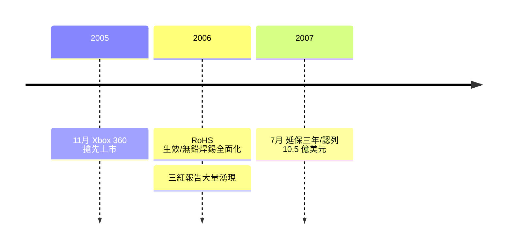

# 第 9 章 · 第 2 節 三紅危機：十億美元的焊點

2005 年 11 月，微軟搶在 PS3 之前一年推出 Xbox 360，贏得了關鍵的先發優勢。但到了 2006 年底，一個詞開始在論壇上蔓延：**三紅**（Red Ring of Death）——主機正面環形電源燈中的三段亮起紅色，代表硬體致命錯誤，機器自此報廢。

## 病理：焊點的疲勞

三紅的直接成因，是**主機板與封裝晶片間焊接接點的失效**。

背景是制度與技術的交錯：歐盟 2003 年通過 **RoHS** 指令（有害物質限用），2006 年 7 月生效，全面禁用含鉛焊錫。整個電子業被迫轉向**無鉛焊錫**（lead-free solder，主要為錫銀銅合金）。無鉛焊料熔點更高、機械性質更脆，抗熱循環疲勞的能力遜於傳統鉛錫焊料。

Xbox 360 的 Xenon CPU 與 Xenos GPU 封裝面積大、發熱密度高，機內溫度劇烈升降。每一次開機關機，基板與晶片封裝以不同速率熱脹冷縮，焊點承受反覆剪切應力——這是經典的**熱循環疲勞**（thermal cycling fatigue）。數十次、數百次循環後，焊點產生微裂紋，接觸失效，GPU 讀不到資料，三紅出現。許多玩家的經驗也印證了這一點：把主機用毛巾包住「烤」一段時間，讓焊點受熱重新接觸，機器偶爾能暫時復活——這正是接點間歇性失效的特徵。

## 為什麼會這樣？

上市時間壓力是核心因素。微軟要在 PS3 之前至少一年發售，工程驗證與長期可靠度測試的時間被壓縮；散熱與機構設計在量產壓力下妥協；晶片出貨良率與封裝製程（涉及不同基板材料與黏晶膠的組合）在量產初期多次變更，品質一致性難以保證。這不是單一缺陷，而是**時間、成本、良率三角下的系統性風險**。

## 十億五千萬的認帳

到 2007 年中，外界估計故障率可能高達三成以上（微軟從未公布確切數字）。2007 年 7 月 5 日，微軟宣布：**將 Xbox 360 保固延長至三年**（針對三紅類硬體故障），並在當季財報認列 **10.5 億美元**的相關費用——大部分為延保準備金與換機成本。這筆費用吞掉了 Xbox 部門多年累積的營收成果，前後共召回維修了數百萬台機器，並且換機所生產的新機持續出貨，形成一場漫長的「內部輸血」。

## 工程史的教訓

三紅事件成為全球電子製造業的教科書案例：**可靠度工程不能為上市日期讓路**。此後微軟大幅修改散熱與封裝設計（Jasper、Valhalla 等改版逐步降低功耗與故障率），業界也更重視封裝基板、黏晶材料與熱循環壽命的驗證。

對微軟而言，這 10.5 億美元買到了兩樣東西：玩家的信任，以及一條刻進企業文化的鐵律——**硬體品質的帳，遲早要還，而且含利息**。
