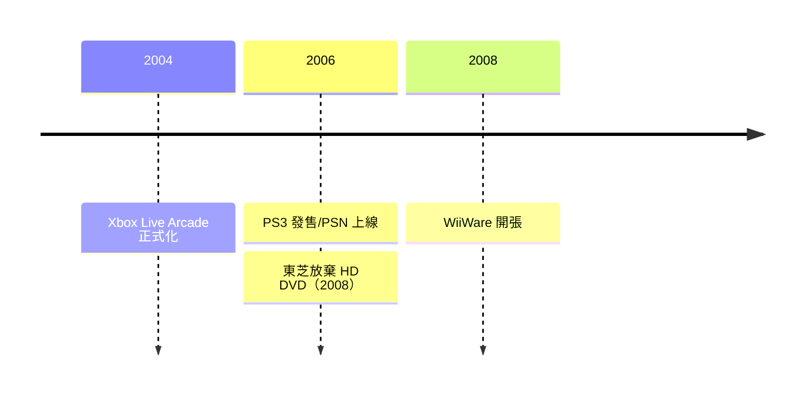

# 第 9 章 · 第 3 節 藍光勝利與數位商店：碟片的黃昏序曲

2006 至 2008 年，遊戲主機意外成為一場**影音格式戰爭**的決定性戰場。這是繼 VHS 對 Betamax 之後，消費電子史上最後一次「實體載體」的皇位爭奪戰。

## HD DVD 對 Blu-ray

高畫質電視普及後，DVD 的容量（4.7GB）容不下 HD 電影，兩大陣營爭奪下一代光碟標準：

| | **Blu-ray（藍光）** | **HD DVD** |
|---|---|---|
| 主導 | 索尼、松下、飛利浦 | 東芝、NEC |
| 陣營外援 | 蘋果、戴爾、迪士尼等 | 微軟、英特爾、環球、派拉蒙（部分時期） |
| 單層容量 | 25GB | 15GB |
| 與 DVD 製程相容性 | 需新產線 | 較高 |

微軟押注 HD DVD，除戰略聯盟外，也讓 Xbox 360 以外接 USB HD DVD 光碟機的方式「不表態地」參戰；索尼則把賭注押在 PS3 本體——**每一台 PS3 都是一部藍光播放機**。

## PS3：格式戰的特洛伊木馬

PS3 首發貴，但相較同級藍光播放機（當時市價一千美元上下）反而「便宜」。隨著 PS3 累計銷量爬升至千萬台級別，**藍光播放機的裝機量被遊戲機買出來了**。好萊塢片商計算的是格式經濟學：哪邊裝機量高、防拷更穩，就發哪邊。2008 年 1 月，華納兄弟宣布獨家支持藍光，成為壓垮駱駝的關鍵一擊；2008 年 2 月 19 日，**東芝正式宣布放棄 HD DVD**，長達六年的格式戰落幕。

耐人尋味的是：藍光的勝利是「皮洛士式」的。索尼贏了格式，卻輸了世代——PS3 銷售失利讓藍光部門與遊戲部門共同背負虧損。而真正終結所有光碟的，是下一個敵人：**頻寬**。

## 數位發行的萌芽

同一時期，三大主機不約而同打開了數位下載的閘門：

- **Xbox Live Arcade**（2004 年正式化）：《Geometry Wars》《Braid》《Castle Crashers》證明小型獨立作品能靠下載獲利。
- **PlayStation Network / PSN Store**（2006）：索尼首度跨入數位通路，附贈獨立遊戲與經典下載。
- **WiiWare**（2008）與 Virtual Console：任天堂讓 FC、SFC、N64 老遊戲以付費下載復活，也開放小型新作。

## 制度的鬆動

數位發行鬆動的不只是通路，而是一整套**零售制度**：實體光碟時代，遊戲由壓片廠、物流、經銷商、零售店層層分潤，二手市場再切走一塊；數位商店讓發行商直接面對玩家，毛利結構劇變，獨立開發者不再需要發行商的鋪貨能力。實體店（GameStop、Game 等專門店）仍是主流，但閘門已開——十幾年後，數位銷售將占主機遊戲營收的大半。

藍光贏了與 HD DVD 的戰爭，卻在十年後輸給了沒有碟片的世界。PS3 的藍光光碟，成了實體介質最後一次的輝煌。
