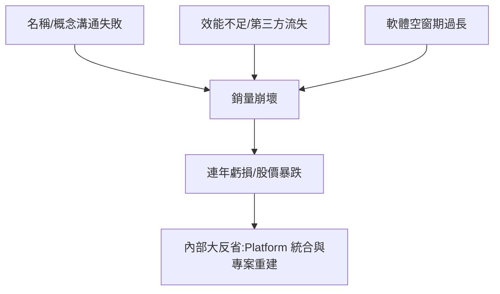

# 第 10 章 · 第 1 節 Wii U 的慘敗反思：兩個螢幕的誤會

2012 年 11 月，任天堂推出 Wii 的後繼機種 Wii U。四年後，這台主機以約 **1,350 萬台**的累計銷量黯然退場——不到 Wii 的一成，是任天堂家用主機史上最慘烈的失敗。

## GamePad：天才的想法，失敗的溝通

Wii U 的核心概念是 **GamePad**：一支內建 6.2 吋觸控螢幕的平板狀控制器，主機輸出電視、控制器輸出第二畫面，實現「非對稱遊玩」——《任天堂明星大亂鬥》的零食模式、ZombiU 的地圖與背包、《超級瑪利歐 3D 世界》的輔助視角，都是精巧的實驗。

問題出在傳播。任天堂向世界展示的畫面，是一個人拿著「有螢幕的手把」玩遊戲——消費者看到的第一反應是：**「這是 Wii 的新周邊吧？」** 而主機本體外觀保守、命名又是 Wii 的延伸，「Wii U」聽起來像 Wii 的改款配件。任天堂事後在股東問答與內部檢討中坦承：**沒能把「這是一台全新主機」傳達出去**。岩田聰後來多次公開反省：「我們輸在說明力。」

## 效能、第三方與時間表

硬體上，Wii U 採用 IBM PowerPC（Espresso 三核心）與 AMD GPU（Latte），效能僅略高於 Xbox 360/PS3 世代——卻比 2013 年登場的 PS4/Xbox One 低了一個檔次。跨平台大作《決勝時刻》《刺客教條》系列隨後不再登陸或表現受限，第三方再次大規模流失。更致命的是**遊戲荒**：首發陣容貧弱，《超級瑪利歐 3D 世界》要到一年後才問世，而攸關生死的第一方大作《瑪利歐賽車 8》與《Splatoon》姍姍來遲——救了口碑，救不了銷量。

## 瀕臨虧損的帝國

財務數字揭示危機的深度：

- **2011 財年**：任天堂年度淨損約 432 億日圓（3DS 降價衝擊）。
- **2012、2013 財年**：連續虧損， Wii U 首發即卖不動。
- **2014 財年**：僅靠《Pokémon GO》熱潮前夜的持股匯兌與成本緊縮勉強守住微利，員工薪資被社長带头減薪（岩田聰自減一半薪資的新聞震動業界）。

任天堂股價從 Wii 巔峰跌掉八成，分析師公開建議「放棄硬體、把瑪利歐賣給智慧型手機」。**這是任天堂 1960 年代以來最深的存亡危機。**

## 反省文化的價值

難能可貴的是任天堂的**內部反省文化**。開發本部沒有把失敗歸咎於市場，而是在內部系統性檢討：GamePad 為什麼沒人懂？Wii 的藍海客人為什麼流失？這些反省直接催生了兩個決定——**軟硬體平台統合**（家用與掌機團隊合一，即 NX 計畫的起點）與**重新用一張畫面、一句話說清楚產品**（Switch 的廣告就是最好的反例證明）。

2015 年 7 月，岩田聰病逝，未能親眼看到復興。他留下的遺產，是一台必須成功、也終將成功的機器。
