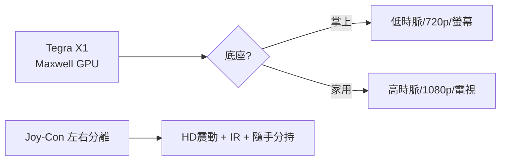

# 第 10 章 · 第 2 節 Tegra 與 Joy-Con：混合架構的誕生

2017 年 3 月 3 日，Nintendo Switch 上市。廣告只有一句話的視覺邏輯：一個人在電視前玩，把主機從底座抽起，畫面無縫轉到手中——**家用主機與掌上主機，從此是同一台機器**。

## 從 Wii U 的灰燼中長出

Switch 的原點正是 Wii U 的失敗反省。任天堂內部代號 NX 的計畫確立了兩條原則：其一，**用一支廣告就說清楚**；其二，**平台統合**——岩田聰生前推動家用與掌機開發組織合併（2015 年成立「企劃製作本部」），掌機線（3DS）與家用線（Wii U）的經驗匯流成一條產品線。這是任天堂自 Game & Watch 以來「軟硬一體」傳統的極致：不做通用電腦，只為遊戲體驗定制機器。

## Tegra X1：借來的軍火

硬體上，任天堂做了與 Cell 世代完全相反的選擇：**不客製晶片，用現成方案**。Switch 核心是 NVIDIA **Tegra X1**——2015 年發表的行動 SoC，採 ARM Cortex-A57/A53 為主的 CPU 叢集，GPU 則是 NVIDIA **Maxwell** 架構（256 個 CUDA 核心）。本質上是一顆平板級晶片，性能不及同代 PS4/Xbox One，卻換來低功耗、低成本與**隨插即用的整合度**。

關鍵工程在於**底座模式**：掌上模式 GPU 以低時脈運行以控溫控耗；插入底座後提高時脈並輸出 1080p 到電視。一台機器、兩種功耗檔位，任天堂用軟體與散熱設計把「掌機性能」拉進了客廳。

## Joy-Con：把控制器拆成兩半

Joy-Con 的工業設計是 Switch 的靈魂：

- **可拆卸**：左右各自獨立，可一人雙持、兩人對分，多人遊戲隨時隨地發生——這是 Wii「隨手可玩」哲學的延續。
- **HD 震動**：以音圈致動器（voice coil actuator，原理近似微型喇叭線圈）取代傳統偏心馬達，能表現細膩振動紋理（官方展示如「兩顆冰塊在盒中碰撞」的觸感）；官方對其細節披露有限，外界推測涉及精密的振動訊號控制。
- **IR 動感感應器**：右 Joy-Con 尾端內建紅外線相機，可讀取手勢與物體形狀（《1-2-Switch》的猜拳即是展示）。

## 營運交接：君島到古川

2015 年岩田聰逝世後，君島達己接任社長，完成 Switch 的開發與上市與財務重建；2018 年 4 月，44 歲的古川俊太郎接任社長——他是任天堂史上最年輕的社長，代表產品企劃出身的年輕世代全面接班。交接之平穩，恰與產品的成功互為因果：**好的產品讓組織的改變被原諒，好的組織讓下一個產品被期待**。

Switch 首月即破百萬，首年賣出超過 1,700 萬台——遠超 Wii U 終生銷量。混合架構不是技術突破，而是**概念的勝利**：把「在哪裡玩」的選擇權，還給玩家。
