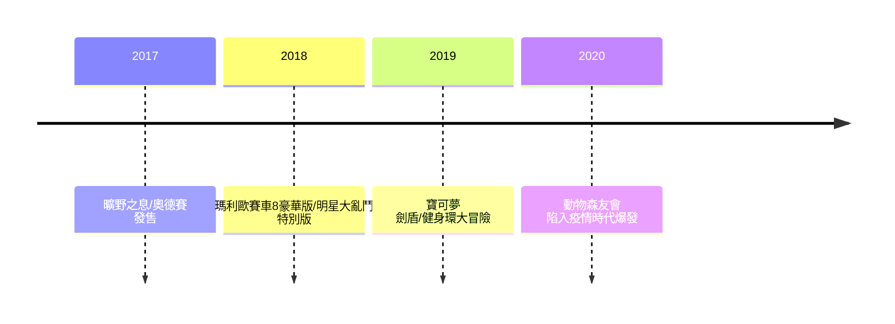

# 第 10 章 · 第 3 節 曠野之息與億台帝國復興：海拉魯的復國之戰

如果說 Switch 是任天堂的軀體，那麼《薩爾達傳說：曠野之息》就是它的靈魂。2017 年 3 月 3 日，這款遊戲與主機同步發售，用一片無邊無際的海拉魯大陸，宣告了一個帝國的復興。

## 十年磨一劍的開放世界

《曠野之息》開發始於 Wii U 時代（2013 年左右啟動，团队規模三百餘人，耗時近五年），是最後一款 Wii U 第一方大作，也是 Switch 首發旗艦。它的革命不是「做一個開放世界」，而是**重新定義開放世界的規則**：

- **化學引擎**：火會延燒草地、金屬導電、木筏順風漂流。世界有一套一致的**物理與物質法則**，玩家用任何方式組合都成立。爬牆、滑翔、砍樹造橋——「三角法則」讓每個地標都召喚玩家自訂路徑。
- **手把手教學歸零**：捨棄系列傳統的線性迷宮引導，改以「引力設計」（地景本身的視覺吸引）驅動探索。監督藤林秀麿、總監若井淑、技術監督堂田卓宏在 GDC 2017 的演講中，公開了這套以物理引擎與系統化規則驅動的設計。

同年 10 月，《超級瑪利歐 奧德賽》以「帽子附身」機制重造 3D 平台遊戲，兩款滿分級大作構成 Switch 的軟體雙柱。

## 軟體驅動的銷量曲線

任天堂的復興公式，歷史上重複過三次：FC、Wii、Switch——**一台主機，一個殺手級概念，加上節奏精準的第一方大作**。

《健身環大冒險》在 2020 年疫情中一度炒到原價數倍，《集合啦！動物森友會》首年即破三千萬套，成為社會現象。軟體與硬體互相拉抬的飛輪全速運轉。

## 億台帝國

Switch 於 2021 年突破 1 億台，並持續長銷——史上沒有一台主機的銷量曲線在第 4、5 年仍在創新高。至 2024 年，Switch 累計銷量突破 **1.4 億台**，成為**史上最暢銷遊戲機之一**（名列歷史前茅，與 PS2、DS 同列億台俱樂部的頂端）。財務上，任天堂從 2011-2014 年的連續虧損谷底，回到年營業利益逾數千億日圓、淨現金儲備豐沛的狀態——**從瀕危到史上最賺錢的遊戲公司之一，只用了六年**。

## 復興的思想史意義

《曠野之息》的深層啟示在於**設計哲學的反轉**：過去三十年，遊戲設計的潮流是「設計師控制一切」（任務列表、小地圖、引導箭頭）；《曠野之息》則相信「**系統 + 玩家自由**」——設計師只定義物理法則與地標，把敘事權還給玩家。這不是跟風西方開放世界，而是用任天堂的語言（玩具感、法則一致性、觸感）重寫了開放世界的定義，反過來影響了此後全球的遊戲設計。

Wii U 時代那句「我們輸在說明力」的反省，在此得到了最完整的償還：一張海拉魯的日出截圖，不需要任何解釋，全世界都懂了。
