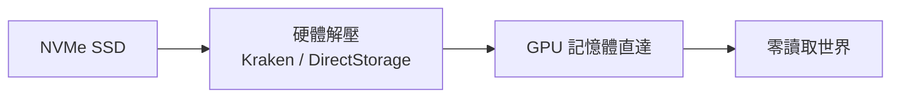

# 第 11 章 · 第 1 節 SSD 革命：讀取畫面的死亡

2020 年 11 月，PS5 與 Xbox Series X/S 上市。這一代主機最深刻的變革，不是 CPU 或 GPU，而是一個看似平凡的零件：**NVMe SSD**。它消滅的不只是載入時間，而是一種延續三十年的遊戲設計範式。

## 機械時代的詛咒

從卡帶到 DVD 到藍光，主機的資料讀取速度始終被碟片與機械硬碟封鎖。PS4 的機械硬碟循序讀取約 100 MB/s 上下，隨機讀取更是僅約 1 MB/s 級別。開發者被迫構築重重緩衝：讀取畫面、電梯、長廊、 airlock——**《惡靈勢力》的電梯、《魔獸世界》的地下城 loading，本質上都是在替硬碟表演**。開放世界更需以「串流」技術一邊玩一邊偷讀磁碟，記憶體裡永遠藏著你還沒看到的資料。

## PS5：客製 I/O 的極致

PS5 的 I/O 子系統是索尼自 Cell 之後最大膽的客製設計：

- **客製 8 通道 NVMe SSD 控制器**，原始頻寬 5.5 GB/s（壓縮頻寬標稱 8–9 GB/s 以上，視資料可壓縮率而定），約為 PS4 機械硬碟的百倍量級。
- **Kraken 解壓引擎**：PS4 世代 zlib 演算法的後繼者，由硬體專用解壓單元即時解壓，不佔 CPU。
- **DMA 與 I/O coherency 單元**：資料從 SSD 直達 GPU 記憶體，全程繞過 CPU——某種意義上，這是 Cell 時代「搬資料」的教訓，被反轉成「讓搬資料徹底消失」。

Sony 機器架構師 Mark Cerny 在 2020 年的線上發表會中，以《漫威蜘蛛人》為例：主角在紐約大樓間以高速飛簷走壁，PS4 上需靠技巧性串流勉強掩蓋，而 SSD 世代可以直接**瞬間傳送整個城市區塊**——《漫威蜘蛛人：邁爾斯·莫拉雷斯》的快速旅行已接近零讀取。

## Xbox：Velocity Architecture

微軟的答案是 **Velocity Architecture**：客製 NVMe SSD（Series X 約 2.4 GB/s 原始頻寬）、**DirectStorage API**（讓遊戲直接以 GPU 導向的方式批量讀取與解壓，繞過傳統檔案系統瓶頸）、以及硬體解壓單元與 **Sampler Feedback Streaming**（只載入 GPU 真正需要的材質 mip 層級，材質串流效率倍增）。DirectStorage 後續也下放到 Windows PC，改寫了 PC 遊戲的 I/O 常識。

## 設計範式的解放

SSD 對開發者的解放是結構性的：**記憶體邊界消失了**。關卡不再需要用長廊隔開；快速旅行不再跳黑畫面；《瑞奇與叮當：時空跳轉》實現了「邊跳躍邊切換次元」的即時場景轉換。設計師終於可以「想到哪、傳到哪」。

當然，代價也真實存在：SSD 容量昂貴，主機內建容量被壓縮，玩家開始為「刪哪個遊戲」煩惱。但歷史方向已定——如同當年從卡帶到 CD解放了音樂與過場動畫，**SSD 消滅了「等待」本身**。載入畫面，這個從雅達利時代就與玩家共存的儀式，就此走入歷史。
