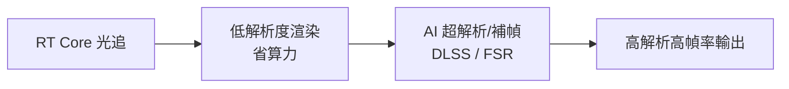

# 第 11 章 · 第 2 節 光線追蹤與畫面極限：AI 接管像素

2020 年的第九世代主機，第一次把**硬體級光線追蹤**帶進客廳。這項曾被視為離線算圖專屬的技術，如何從好萊塢渲染農場走進遊戲機，背後是圖形學三十年範式的轉折。

## 從光柵到光線：範式的對決

傳統即時繪圖採**光柵化**（rasterization）：把三角形投影到螢幕、貼上材質、再用經驗公式「假裝」有光影。它極快，但陰影、反射、全域光照都是「作弊」——鏡子裡的世界要靠螢幕空間反射（SSR）硬湊，看不到的就不存在。

**光線追蹤**（ray tracing）則忠實模擬物理：從鏡頭反向發射光線，計算它與場景三角形的交點、反彈、折射。1980 年 Turner Whitted 的經典論文奠定基礎，此後三十年它只在離線算圖（皮克斯電影、建築視覺化）中存在——因為每像素要追蹤成千上萬條光線，算力需求是光柵化的百倍以上。

## RT Core：專用硬體的臨門一腳

2018 年，NVIDIA Turing 架構（RTX 20 系列）首次內建 **RT Core**——專門做「光線—三角形求交測試」的固定功能單元，配合**Tensor Core** 的 AI 降噪，讓即時光追第一次變得可行。PS5 與 Xbox Series X/S 的 AMD RDNA 2 GPU 則以**光線加速器**（Ray Accelerator）實現同類功能，使光追成為第九世代主機的標準配備——《漫威蜘蛛人：邁爾斯》的光追反射、《Minecraft RTX》的全域光照，都是標誌性應用。

## HDMI 2.1、4K/120Hz 與 VRR

顯示端的制度同步進化：**HDMI 2.1**（2017 年定案）將頻寬提升至 48 Gbps，支援 4K@120Hz、**VRR**（可變更新率，消除畫面撕裂而不需垂直同步的延遲代價）、ALLM 低延遲模式。電視從「看電影的」變成「玩遊戲的」，顯示器與電視的邊界模糊。

## 算力不夠，AI 來湊

真正的革命在**升頻**（upscaling）。原生渲染 4K 120fps 所需的算力，連高階 PC 都吃力。解法是把「畫每個像素」改成「畫低解析度 + AI 推斷放大」：

- **DLSS**（NVIDIA，2019 起）：用 Tensor Core 跑深度學習超解析與時間補償，後續版本加入**畫格生成**（Frame Generation）——由 AI 直接「腦補」中間畫格。
- **FSR**（AMD，2021 起）：空間/時間性升頻，不依賴專用硬體，主機與跨平台均可使用。

這是**畫面經濟學的改寫**：過去「畫質 = 電晶體數 = 電費」，現在「畫質 = 模型訓練品質」。GPU 的競爭軸線從「多少 TFLOPS」轉向「多少 TOPS」——晶片設計思想在 2018 年後發生了一次不亞於當年可程式化著色器的斷裂。

## 邊界的消融

到本世代後期，主機與 PC 的效能邊界、以及「誰算畫面」的邊界都在溶解：主機用 AI 補幀追平中階 PC，PC 用光追追平電影。唯一不變的是玩家的古老直覺——**畫面極限永遠在下一張顯卡發表會上**。
