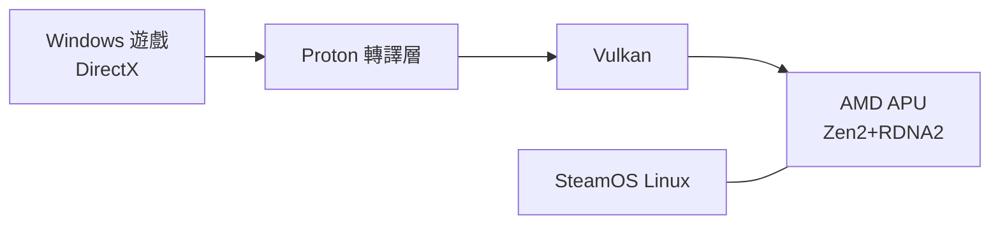

# 第 11 章 · 第 3 節 Steam Deck 掌上 PC 狂潮：把整個遊戲庫塞進口袋

2022 年 2 月，Valve——這家靠 Steam 數位商店統治 PC 遊戲發行的公司——推出了自己的硬體：**Steam Deck**。起售價 **399 美元**，一台能跑整個 Steam 遊戲庫的 Linux 掌機。三年內，它掀起了一場 PC 掌機的軍備競賽，把一個任天堂獨佔了三十年的品類，變成 PC 生態的競技場。

## 為什麼是 Valve？

邏輯藏在商業模式裡。Valve 的核心資產是 **Steam**——數億用戶、數萬款遊戲的分發平台。當手機蠶食碎片時間、任天堂壟斷掌上場景，Valve 最怕的是**玩家離開 PC 的時間**。Steam Deck 的本質不是賣硬體，而是**保衛遊戲時間的份額**：你搭地鐵時玩什麼？答案應該還是你的 Steam 庫。

## APU：Zen 2 + RDNA 2

硬體選擇展現了驚人的時機紅利。Steam Deck 搭載 AMD 客製 APU：**4 核心 Zen 2 CPU + 8 個運算單元的 RDNA 2 GPU**——正是 PS5/Xbox Series 同世代的架構，縮小到掌上功耗檔位（4–15W TDP 可調）。這意味著：為第九世代主機開發的遊戲，天生就適合 Deck 的算力級別。加上 16GB LPDDR5 統一記憶體與 7 吋 800p 螢幕，**399 美元的價格成為不可能被 PC 市場複製的補貼級定價**——Valve 賺的是庫存遊戲的錢，不是機器的錢。

## Proton：Linux 的十年逆襲

最反直覺的決定是作業系統。Steam Deck 不跑 Windows，而是基於 Arch Linux 的 **SteamOS**，靠 **Proton** 相容層（Wine 的 Valve 強化版，整合 DirectX→Vulkan 轉譯）運行 Windows 遊戲。這是 Valve 十年佈局的收穫：自 2013 年 Steam Machines 以來，Valve 一直在對抗 Windows 的壟斷。Proton 的相容性在 ProtonDB 社群評級下逐年精進，多數 3A 大作在 Deck 上直接可玩；Valve 更把 SteamOS 開放授權給第三方掌機（2025 年起）。

## PC 掌機大爆發

Deck 證明了品類存在後，Windows 陣營立刻蜂擁而入：**ASUS ROG Ally**（2023，Z1 Extreme APU，120Hz 螢幕）、**Lenovo Legion Go**（2023，8.8 吋可拆式螢幕）等相繼登場，規格軍備競賽直逼輕薄筆電。掌機市場從任天堂的獨角戲，變成**PC 生態的延伸戰場**。

## 文化意義：遊戲庫的隨身化

Steam Deck 的深層意義是**所有權與連續性**：玩家花二十年累積的 Steam 庫（含遠古老遊戲、模組、雲端存檔）第一次可以「隨身帶走、隨處續玩」。這與主機世代的斷裂邏輯（每七年在新機器重買一切）截然相反——**PC 的哲學是累積，主機的哲學是換代**。

Valve 用一台掌機證明：開放生態不必是紙上談兵。而 2013 年失敗的 Steam Machines，終於在九年後，以另一種姿態還魂。
