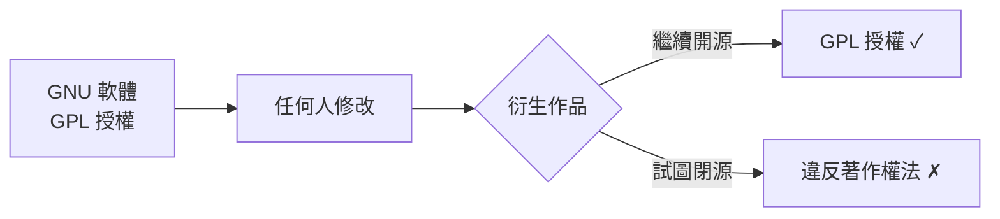

# 2.3 Copyleft 法律條款與 GPL 許可證：用著作權法本身反抗著作權壟斷的法律發明

## 問題：寬鬆共享會被「吸乾」

GNU 早期版本的工具（如 Emacs 的發布條款）是「准許自由散布」的簡單授權。RMS 很快意識到致命漏洞：

> 如果 GNU 工具以寬鬆條款授權，**公司可以拿走它、加入修改、變成專有軟體**——共享的成果會被資本主義的「合法占取」一粒不剩地吸乾。

這正是 1984 年前的實際案例：BSD 的許多改進被商業公司拿去封閉；Lisp 機器的教訓也在眼前。**單純的善意會被博弈論擊敗。**

## Copyleft：以子之矛攻子之盾

RMS 與律師朋友的解答是 **Copyleft（著佐權）**——一個法律上的「反用」：

1. **以著作權法取得程式的版權**（作者主張權利）；
2. **在授權條款中授權所有人**自由使用、修改、散布——**但附帶一個條件**：
3. **衍生作品必須以相同條款發布**，並**必須公開原始碼**（「感染性」viral clause 的俗稱）。

這是一個**自我執行的博弈設計**：它不靠道德勸說，而用**財產法的強制力**（違約即侵權）來維持開放狀態的穩定——**用著作權法本身，來廢除著作權壟斷**。RMS 戲稱這個名字是與 copyright 的雙關玩笑（left 的政治雙關）。

## 1989 年：GPL v1 誕生

**1989 年 2 月**，FSF 發布**GNU 通用公共許可證第 1 版（GPL v1）**，由律師 Mark Fischer 協助起草。1991 年的 **GPL v2** 增加了著名的第 7 條「**自由被限制則整體失效**」條款（若法院判令他人不得自由散布，則你無權散布該軟體）——一種對法律強制力的「核武對等」設計。

### GPL 的三個關鍵特徵

1. **傳染性（infectiousness）**：與 GPL 程式碼混合的衍生作品**必須**以 GPL 發布；
2. **原始碼義務**：散布二進位必須同時提供（或保證可取得）完整源碼；
3. **非歧視**：任何人、任何用途皆可用（包括商業使用）——**GPL 不反商業，只反「閉源衍生」**。

## 功過與爭議：法律武器的兩面性

Copyleft 的歷史影響兩極：

**正面**：

- **保護了生態的開放性**：Linux 核心以 GPL v2 發布，正是因為 GPL 的「傳染性」，才使整個核心二十年來**始終保持開源**，未被商業勢力閉源化；
- **催生了對抗商業封鎖的法律思想**：Copyleft 證明契約設計可以維護公共財（這個思想後來影響了 Creative Commons 等知識共享運動）。

**爭議**：

- **「病毒式」的商業恐懼**：公司擔心 GPL 程式碼「污染」自家專有產品，許多企業一度明文禁止員工使用 GPL 軟體——這為 1998 年的「Open Source」運動（選擇較寬鬆的 MIT/BSD/Apache 許可證）提供了動機；
- **與寬鬆陣營的內戰**：RMS 將 MIT/BSD 許可證貶為「准許用戶失去自由的特洛伊木馬」，這種道德攻擊使自由軟體陣營在 1990 年代被商業世界視為激進左派。

## 2007 年：GPL v3 與戰略轉折

GPL v3（2007）回應了新時代的挑戰：

- **反 Tivoization**：針對 TiVo 等硬體使用 GPL 軟體但**以硬體簽章鎖死修改後核心**的做法，v3 要求提供安裝資訊——**把自由延伸到硬體層**；
- **反軟體專利與反數位版權管理（DRM）條款**；
- Linus Torvalds **拒絕**將 Linux 核心升級到 v3（他反對 Tivoization 條款與法律說教的擴張）——**自由軟體內部的哲學分裂公之於眾**。

## 小結

Copyleft 是人類法律史上一次奇特的發明：**以所有權的形式，達成反所有權的目的**。它證明了「制度設計可以對抗制度本身的濫用」，也確立了 GPL 作為開放生態守護者的地位。但它的道德鋒芒，也注定要與一個務實的新運動分道揚鑣——那個運動，將從 Linux 與 Netscape 的浪潮中誕生。
