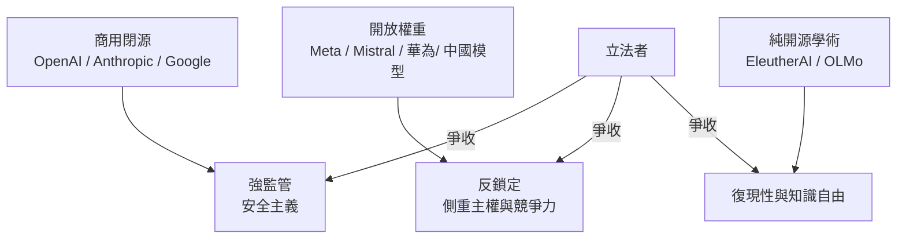
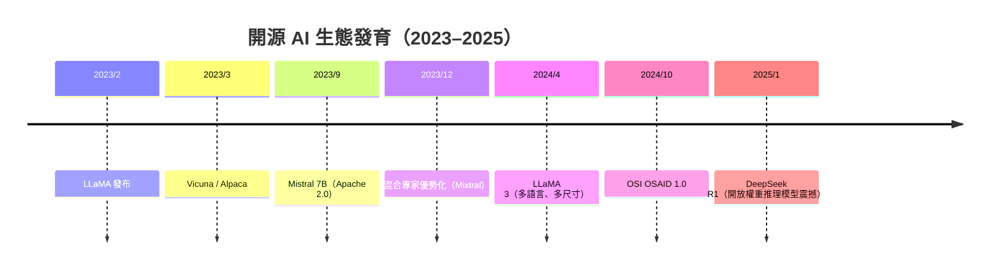

# 9.3 開源 AI 與閉源商業大模型的世紀對決：安全監管、創作者版權與生態繁榮的博弈

## 一場三方分裂的「AI 世界大戰」

2023–2024 年，AI 產業的陣營已清晰分裂：

三方在**三個戰場**同時交火。

## 戰場一：安全監管

### 監管的兩極

- **「強 監管陣營」**（閉源巨頭與多數立法者）主張「**前瞻監管**（ex ante）」：
  - **歐盟 AI Act（2024 通過）**——以**風險等級**分類 AI 系統，並為**基礎模型（foundation model）設立強制義務**（透明、防偏見、安全報告）；
  - **緊急研討**（2030 前景）亦提出「**模型權重不應自由散布**」域告知；
- **「開放陣營」**（Meta、Mistral、開源學術群體）主張「**開放 = 安全**」：**更多人研究與紅隊測試（red-teaming）**，而非**少數公司的黑箱壟斷**。

### 開源的監理悖論

開源 AI 的監管難點：

1. **應用層管不了底層**——模型在開放權重之下**散布得到處都是**；
2. **「規定模型」的法本能適時適用**——**歐盟 AI Act 把「提供權重」的公司看做「AI provider」**，**但散布者不事廠**；
3. **成熟拉鋸**：對**OSI** 和**Meta** 來說，**「許可證自我規制」**（如 LLaMA 的**使用政策**）是個可行方案——**但只要把「**禁止濫用**」條款加入許可證，就不再是 Open Source**。

## 戰場二：創作者版權

2023–2024 年是一場全球訴訟潮：

| 案件 | 主旨 |
|---|---|
| **NY Times v. OpenAI / Microsoft**（2023/12 提起） | 新聞資料用於訓練是否侵權 |
| **Getty Images v. Stability AI**（2023 起） | 影像訓練資料的商業使用 |
| **歐盟 DSM 條令的 TDM 例外**（Text and Data Mining 例外） | 學術研究可用；商業用途可依「opt-out」退出——**歐洲是對出版界相對友好的戰場** |

**法律結論至今未定**，各界提出三條出路：

1. **授權市場**（個別資料授權交易）——「**資料商品化**」；
2. **集體議價**（出版者聯盟、內容許可聯盟）——設立較清晰的分紅機制；
3. **擴充「合理使用（fair use）」以涵蓋訓練**——依賴法院逐案認定。

**開源 AI 的處境更艰难**——**一旦絡訓練資料的挪用被認定非法**，**Meta/開源這一方會合理受到不同力度的擔憂**。

## 戰場三：經濟與生態

### 經濟的光譜

| 開放程度 | 代表 | 商業模式 |
|---|---|---|
| 純閉源（API 訂閱） | OpenAI、Anthropic | 銷售算力與服務 |
| 開放權重 + 專有生態 | Meta、xAI | 賣**廣告/社交增強**、破壞對手的定價 |
| 全開源（權重＋代碼） | Mistral、EleutherAI | 賣**企業服務與算力** |
| **基礎設施開源** | **Hugging Face、vLLM、Ray** | 賣**算力、雲/marketplace 訂閱** |

### 開源對產業的三大貢獻

1. **基準的公共化**：**MMLU、HELM、LMSYS Chatbot Arena** 等基準的**推動與透明**，是開源研究風潮的直接副產品——競爭的透明化**推動了技術進步**；
2. **各地的新繁榮**：**Mistral（法）、IBM Granite、中國的 DeepSeek（2025 年 R1 的開放權重推理模型成為全球震撼）**——**各國都能以「本地開源」參與 AI 競賽**；
3. **對閉源陣營的定價壓制**：**開透的技術提供了「免費替代品」**——迫使 OpenAI／Anthropic 的定價持續下調，產業整體成本下降。

### 生態繁榮的證據

開源 AI 生態完整的發育線索（2023–2025）：

## 小結

AI 時代的開放之戰，重演了歷史規律：**每一次範式轉移期，開源都是「對抗的力量」與「被商業吸收的力量」**——閉源巨頭以監管保護自己，開放陣營以「賣別的東西」趨近免費。下一章，聚焦後開源時代的社會懸崖——地緣政治、去中心化資助與自治 AI 的邊界。
