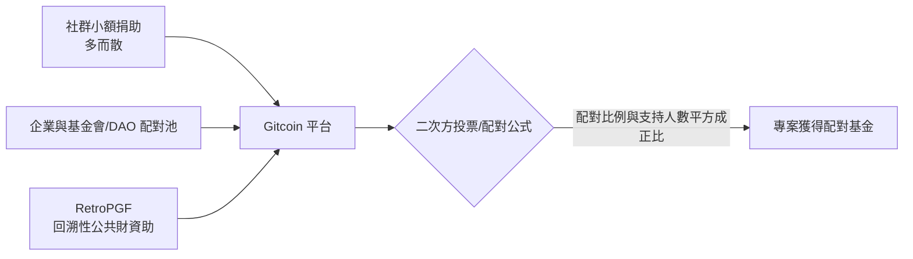

# 10.2 去中心化開源資助（Web3/Gitcoin）與維護者經濟學：如何讓開源創作者獲得可持續回報？

## 開源最大的永續難題：貢獻者的收入

2010 年代後，市場經歷兩次大震盪——**Log4j 供應鏈恐慌**（2021）與**許可證白嫖大戰**（2018–2024）——但有一個未解之謎始終不變：**維護者沒有穩定收入。**

**Nadia Eghbal 的《Working in Public》**（2020）歸納出兩類維護者的處境：

- **熱門維護者**：有大公司主動僱用（最後往往成為員工或受薪維護者）；
- **長尾維護者**：小型專案被成千上百的下游依賴，**卻以個人業餘時間撐起全球基礎設施**——**一人、零收入**，是這個生態最尷尬的常態。

不解決這件事，**維護者倦怠**與**供應鏈安全**就是同一種病。

## 資助模式的探險史

### 1. 公司僱用（1990s–2010s）

- **紅帽**等公司僱用核心開源工程師——**最穩定、最成功，但產出依公司路線而定**；
- 問題：**沒有公司撐腰的專案，就沒有錢**。

### 2. 打賞與訂閱（2010s 起）

- **Flattr（2010）、Gratipay（2012–2017）**：早期實驗，社群鼓勵但成效有限——**本金與注意力都不足**；Gratipay 2017 年關閉，被視為「善意經濟」的警訊；
- **Patreon（2013 起）**：訂閱打賞，創作者經濟的主力，開源專案使用率不高；
- **GitHub Sponsors（2019）**：把「贊助」按鈕嵌入代碼平台，降低給付摩擦；
- **Tidelift（2017–2023）**：把維護者包裝成企業可訂閱的「保固服務」——2023 年因無法持續而轉手出售，是「**開源的商業保險**」是否可行的鮮明教訓。

### 3. 基金會與公益資助

- **Software Freedom Conservancy**：為多個開源專案提供美國非營利法人庇護；
- **Open Collective（2015）**：以**財務透明**為核心——任何人可捐款至專案的「collective」，帳目全公開——**把 open source 的精神應用到「資金的 open」**；
- **Google Open Source Peer Bonus（2010 起）**、微軟/AWS 的資助計畫；
- **OpenSSF Alpha-Omega（2022）**：微軟等出資，定向資助全球核心基礎設施專案的安全維護。

### 4. 政府公共財資助（2020 年代的制度化）

- **歐盟 NGI（Next Generation Internet）** 授助計畫；**法國、荷蘭 NLnet 基金會**長期資助個人開發者；
- **美國政府**在 Log4j 後把「開源軟體安全」納入國安預算討論；
- **「公共基礎設施」**的定位——**軟體如同道路與橋樑，由公共資源維護**——首次具有制度化可能（詳情見 7.3 的制度反應）。

## Web3 資助實驗：Gitcoin 與二次方資助

**Gitcoin**（2017 年創立，服務以太坊生態）在 **2021–2024 年**以**「二次方募資（Quadratic Funding）」**機制成為開源資助的新典範：

> **核心思想**：一個專案獲得越多**人數**的小額捐款（符合二次方放大的公式），得到的配對資金就越多——重視「社群廣度」而非資本集中。
> 這個概念構想出自 **Vitalik Buterin、Glen Weyl、Puja Ohlhaver 等人**的 2018–19 年經濟學論文（Liberal Radicalism / 二次方投票、二次方資助）。

**成果**：Gitcoin Grants 各輪次為數千個開源專案分配了數千萬至數億美元的配對資金；**Optimism 的 RetroPGF（2021 起）** 將概念延伸——**先做好公共財，再由社群投票補助**（基金規模數億美元），衍生了一種「**事後定價公共財**」的經濟思想實驗。

## 維護者經濟學的三個結構性難題

1. **多數專案沒有收入**：資助計畫只覆蓋頂部極少數專案；
2. **養分在下游而非上游**：用該專案的是企業，但企業沒有直接付錢給維護者的簡單通道（**依賴反覆多層**）；
3. **資助不可預期**：捐款是「**注意力經濟**」——維護者不敢把生命押在别人的善意上。

## 可能的新解方向

- **公共財預算法**：把核心基礎設施專案納入**政府/歐盟**的年度預算（**歐洲的計畫**最為接近）；
- **SFPA（Software maintained as public asset）**：如**歐盟的 Sovereign Tech Fund**（2022 起，德國成立的**自主技術基金**，專門**依賴安全維護****核心專案**——已資助多個基礎設施專案，是新的定義代表）；
- **社會保險思想**：**以公共作品註冊**、**公共僱用**的長期護持（仍屬概念）；
- **DAO 與公共財分配**：以鏈上規則決定**資助的自動撥款**（仍有多項實驗）。

## 小結

維護者經濟學最終要回答的問題是：**全世界共享的軟體基礎設施，需要感謝的是個人**。Gitcoin、OpenCollective 與**歐洲基金**的社會試驗有用的樣板，**在深度上尚屬起步**——**「公共財的工資由誰出」是下一個十年最急迫的制度問題**。
