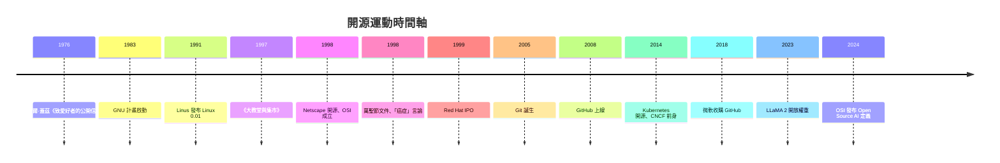

# 《開放原始碼的故事：從自由軟體聖戰、Linux 傳奇、GitHub 生態到 AI 大模型開放運動》

> 一本寫給軟體工程師、開源貢獻者、科技史研習者與數位文明觀察者的專題史。
> 開放原始碼（Open Source）從來不只是免費下載的軟體許可證——它是人類文明史上規模最大、影響最深遠的跨國協同創作與知識共享運動。

## 前言：共享的心智共享庫——開源運動如何重構人類軟體文明的底座

本書以**歷史演進與開源哲學／商業範式轉移**為主軸，記錄人類如何從早期 MIT 與貝爾實驗室的原始共享精神，走過理查·斯托曼的自由軟體聖戰、林納斯·托瓦茲與 Linux 的崛起，經歷微軟等商業巨頭從「開源是毒瘤」到「擁抱開源」的世紀大逆轉，直到當代的 GitHub 生態、雲原生 Foundation 與 AI 時代的大模型開放運動。

---

## 目錄

### 第一篇：前開源時代與自由軟體聖戰的破曉（1950 年代 – 1980 年代）

* 第1章-黑客文化與原始軟體共享精神
    * [1.1-MIT 與鐵道模型俱樂部：開源精神的文化基因](01.1-MIT與鐵道模型俱樂部.md)
    * [1.2-貝爾實驗室與早期 UNIX 的磁帶郵寄共享](01.2-貝爾實驗室與早期UNIX共享.md)
    * [1.3-比爾·蓋茲《致愛好者的公開信》：商業化衝突起點](01.3-致愛好者的公開信.md)

* 第2章-理查·斯托曼與 GNU 自由軟體運動
    * [2.1-印表機驅動程式引發的怒火](02.1-印表機驅動程式的怒火.md)
    * [2.2-1983 年 GNU 計畫與自由軟體基金會](02.2-GNU計畫與FSF.md)
    * [2.3-Copyleft 與 GPL：用著作權法反抗著作權壟斷](02.3-Copyleft與GPL.md)

### 第二篇：Linux 橫空出世與開源術語的正式誕生（1990 年代）

* 第3章-林納斯·托瓦茲與 Linux 核心：網際網路上的開源奇蹟
    * [3.1-1991 年赫爾辛基的 BBS 帖子](03.1-1991年赫爾辛基BBS帖子.md)
    * [3.2-網際網路與 GNU/Linux 的世紀大結合](03.2-GNU與Linux世紀結合.md)
    * [3.3-埃里克·雷蒙與《大教堂與集市》](03.3-大教堂與集市.md)

* 第4章-1998 年「Open Source」術語的誕生與 OSI 組織
    * [4.1-網景的絕境豪賭：開放 Navigator 原始碼](04.1-網景的絕境豪賭.md)
    * [4.2-1998 年帕洛阿爾托戰略會議](04.2-帕洛阿爾托戰略會議.md)
    * [4.3-OSI 與許可證譜系：GPL、MIT、Apache、BSD](04.3-OSI與許可證譜系.md)

### 第三篇：商業巨頭的帝國反擊與開源的血性包圍（1990 年代末 – 2000 年代）

* 第5章-微軟的「毒瘤」論與開源防禦戰
    * [5.1-萬聖節文件洩露事件](05.1-萬聖節文件洩露.md)
    * [5.2-鮑爾默：「Linux 是某種癌症」](05.2-Linux是某種癌症.md)
    * [5.3-Apache 與 LAMP：開源統治網際網路基礎設施](05.3-Apache與LAMP.md)

* 第6章-開源商業模式的探索：從紅帽到 MySQL
    * [6.1-紅帽：免費軟體、收費服務的上市之路](06.1-紅帽模式.md)
    * [6.2-雙重許可證：MySQL 的商業黑馬之路](06.2-雙重許可與MySQL.md)
    * [6.3-社群與商業資本的權力博弈](06.3-社群與商業的博弈.md)

### 第四篇：GitHub 革命、DevOps 與雲原生基金會（2010 年代）

* 第7章-Git、GitHub 與全人類代碼庫的社群化
    * [7.1-2005 年林納斯兩週寫出 Git](07.1-林納斯兩週寫出Git.md)
    * [7.2-2008 年 GitHub：Fork + Pull Request 的社交編程](07.2-GitHub社交編程.md)
    * [7.3-維護者倦怠與 Log4j 的基礎設施風險](07.3-維護者倦怠與Log4j.md)

* 第8章-雲端時代與基金會治理：Linux 基金會與 CNCF
    * [8.1-微軟 75 億美元收購 GitHub](08.1-微軟收購GitHub.md)
    * [8.2-谷歌開源 Kubernetes 與 CNCF](08.2-Kubernetes與CNCF.md)
    * [8.3-「白嫖」爭議與許可證逆轉大戰](08.3-白嫖爭議與許可證逆轉.md)

### 第五篇：AI 時代的開放運動與開源的未來邊界（2020 年代 – 至今）

* 第9章-大語言模型與「Open-Source AI」的終極論爭
    * [9.1-從 OpenAI 到 Meta LLaMA](09.1-從OpenAI到LLaMA.md)
    * [9.2-什麼是真正的「開源 AI」？](09.2-開源AI的定義之爭.md)
    * [9.3-開源 AI 與閉源大模型的世紀對決](09.3-開源與閉源AI對決.md)

* 第10章-後開源時代：去中心化、地緣政治與軟體文明的永續
    * [10.1-地緣政治與開源無國界的神話](10.1-地緣政治與開源.md)
    * [10.2-去中心化資助與維護者經濟學](10.2-維護者經濟學.md)
    * [10.3-當 AI Agent 開始貢獻開源代碼](10.3-AI_Agent貢獻開源.md)

### [結語：集市裡的永恆之火](99-結語.md)

---

## 💡 本書核心靈魂：三組對立與統合

1. **哲學與法律**：Free Software vs Open Source、Copyleft vs Permissive 許可證
2. **商業與治理**：紅帽模式、雙重許可、雲端白嫖爭議、基金會機制
3. **當前前沿**：Open AI vs Closed AI、開源供應鏈安全、AI Agent 共創

