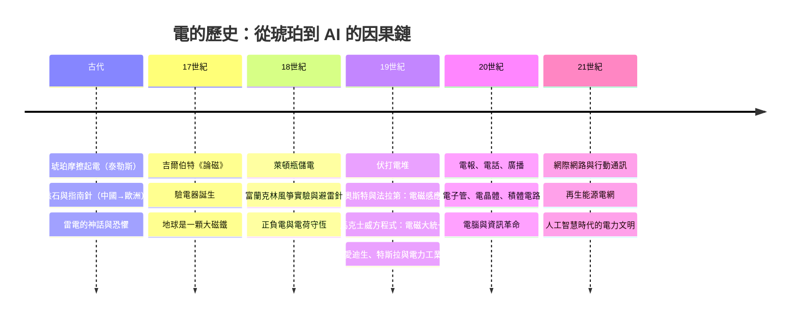

# 前言：看不見的力量——電如何點亮並驅動現代世界

西元前六百年左右的某個午後，古希臘哲學家泰勒斯撫摸著一塊琥珀。摩擦之後，琥珀吸起了一撮乾燥的草屑——這個微不足道的小把戲，是人類文字史上對「電」的最早記錄。沒有人能想到，兩千五百年後，這股看不見的力量會點亮整座城市的夜空、驅動工廠的脈搏、傳遞環繞地球的訊息，並在最終化為人們掌心中與之對話的人工智慧。

## 「馴服火種」的隱喻

本書以「被馴服的火種」為名，是刻意借用普羅米修斯的神話。天火原屬於神，凡人竊火而觸怒宙斯——這正如同雷電，千百年來被視為天怒的顯現、君權神授的印記。人類起初只能恐懼它、祭祀它、用鐘聲企圖驅趕它；直到富蘭克林用一隻風箏證明：雷，不過是放大了一萬倍的靜電。從那一刻起，火種不再屬於神，而屬於可以被理解、被儲存、被輸送、被計算的人類文明。

但「馴服」從來不只是科學的勝利。電的歷史是一部科技、經濟、制度、文化、政治、思想與教育彼此咬合的齒輪史：

- **科技**驅動：沒有萊頓瓶就沒有可重複的實驗；沒有伏打電堆就沒有電磁學；沒有交流電系統就沒有電力工業。
- **經濟**牽引：磁羅盤撐起遠洋貿易，電燈延長了資本主義的工時，電報壓縮了金融市場的時空。
- **制度**回應：專利法塑造了愛迪生與特拉斯的恩怨，標準化組織統一了電壓與頻率，監管機構誕生於電力壟斷之中。
- **文化**重構：靜電表演是宮廷沙龍的娛樂，電影院與廣播重塑了庶民生活，霓虹燈改寫了城市的臉孔。
- **政治**角力：誰掌握電網，誰就掌握現代國家的命脈；石油與鈾礦的地緣政治，是電的歷史的延長線。
- **思想**翻轉：法拉第的力線逼出場論，馬克士威的方程式統一光與電磁，相對論與量子力學皆從電磁學的裂縫中誕生。
- **教育**再生：電機工程成為大學學科，科學實驗室從私人書房走向國家建制——電，教會了人類如何組織知識本身。

## 從琥珀到AI：一條綿延兩千五百年的因果鏈

這條因果鏈最迷人之處在於：幾乎每一步都看似偶然，卻又被更深的結構牽引。若沒有遠洋貿易對導航的迫切需求，吉爾伯特或許不會研究磁石；若沒有宮廷沙龍對靜電表演的好奇，萊頓瓶也許晚生二十年；若沒有帝國電報網對海底電纜的投資，馬克士威的方程式或許只是數學家的私藏。科學供給好奇心，社會供給需求，制度供給舞台——三者缺一，火種便無法馴服。

## 本書的讀法

本書依時序分章：從古代的琥珀、慈石與雷電神話，到吉爾伯特以實驗為電學命名；從萊頓瓶與富蘭克林，到電磁大統一的數學英雄；再到電力工業、資訊革命，以及我們身處的AI時代。每一節的結尾，都有一段「因果鏈條」，說明這一節的結果如何成為下一節的原因——因為電的歷史告訴我們：文明的進步從不是跳躍，而是無數觀察、儀器、金錢、戰爭、誤解與靈感的接力。

電是看不見的。但當我們回望它走過的兩千五百年，我們看見的其實是人類自身：如何從恐懼未知，走向理解未知，再走向與未知共生。

現在，讓我們回到那塊被摩擦的琥珀。

---

**因果鏈條**：一塊琥珀吸引草屑的記錄，象徵著人類對「看不見的力」的第一次凝視。但觀察若無哲學的滋養、無不同文明的相互映照，便只能停在獵奇。下一節，我們走進古希臘米利都的街巷，也走進中國東漢的書齋，看看東西方如何各自記下了這同一道火花。
