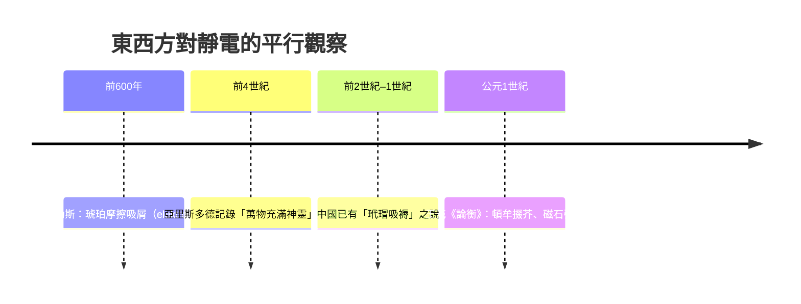

# 第 1 節 琥珀與摩擦起電：泰勒斯（Thales）對「靜電」的最初記錄

## 一個詞的誕生：elektron

電的英文名字 electricity，源自古希臘語 ἤλεκτρον（ēlektron），意即「琥珀」。這個詞源本身就是一份歷史檔案：人類最早認識的電現象，不是雷電，而是琥珀被摩擦後吸引輕物的能力。古希臘米利都（Miletus）的哲學家泰勒斯（Thales，約前624–前546）留下（經由後世文獻轉述）這樣的觀察：琥珀與毛皮或羊毛摩擦後，能吸引乾草屑、細碎的麩皮與羽毛。

米利都是當時愛奧尼亞的商業重鎮，商船往來於埃及、呂底亞與黑海之間，琥珀——這種波羅的海經由陸路貿易南下的樹脂化石——正是奢侈品的象徵。**貿易帶來了稀有物質，稀有物質帶來了奇異現象，奇異現象引發了最初的疑問。** 電學的起點，竟與貿易路線的地理學緊緊相扣。

## 泰勒斯的自然哲學：水為萬物本源

泰勒斯是米利都學派的創始人，被後世稱為「西方第一位哲學家」。他之所以偉大，不在於答案，而在於提問的方式：他拒絕以神話解釋世界，主張以自然解釋自然。他提出**水是萬物的本源**——大地浮於水上，萬物由水生成。這是史上第一次，有人試圖用單一的、物質性的原理統一解釋世界。

對於琥珀吸芥與磁石吸鐵，泰勒斯給出的解釋帶著他時代的色彩：他認為這些物體擁有某種「靈魂」（psychē），是一種能運動他物的內在生命力。亞里斯多德在《論靈魂》中記載：「有些人說靈魂貫穿於萬物之中，泰勒斯似乎因此認為萬物充滿了神靈。」在他眼中，琥珀與磁石會「動」，證明它們有靈、有生命。

以今日眼光看，這是錯誤的；但放在歷史脈絡中，這是關鍵的第一步——**泰勒斯把磁與電歸為同一類現象：能隔空吸引他物的「神祕作用」。** 這個分類雖然混淆了兩者，卻將它們同時收進了「自然哲學」的管轄範圍，為兩千年後吉爾伯特將它們區分開來，預留了伏筆。

## 希臘自然哲學的思想背景

泰勒斯並非孤例。米利都學派的阿那克西曼德提出「無限定者」，阿那克西美尼提出「氣」；赫拉克利特以火為本源，德謨克利特則提出原子論。這整個傳統的核心信念是：**紛繁的自然現象背後，有著可以由人類理性把握的統一原理。** 沒有這個信念，就不會有人費心記錄一塊琥珀的小把戲——那不過是奇聞；有了這個信念，它便成為「萬物原理」的一條線索。

希臘自然哲學還提供了另一項資產：公開辯論的傳統。米利都的學說可以質疑、可以修正，知識不再依附祭司的壟斷。這種「可爭論的知識」，正是後世科學的制度雛形。

## 東方的平行記載：《論衡》「頓牟掇芥」

幾乎在同一片星空下，中國也留下了靜電的觀察。西漢末年，《春秋緯·考異郵》已有「玳瑁吸褥」之說；而東漢王充（約公元27–97年）在《論衡·亂龍篇》中寫下更明確的一句：

> 「頓牟掇芥，磁石引針，皆以其真是，不假他類。」

「頓牟」一般解為玳瑁（或琥珀），「掇芥」即吸引草芥。王充將**摩擦起電的玳瑁**與**天然磁化的磁石**並列——與泰勒斯一樣，東方學者也把這兩種吸引力視為同類，並用「氣」的感通加以解釋。更耐人尋味的是，王充引述此語本是為了論證「感應」的原理，服務於他的自然哲學論戰，而非技術目的。

兩個文明相隔萬里，卻在同樣的技術條件下（絲綢、毛皮、琥珀、玳瑁的摩擦）觀察到同一現象，並且犯了同一個「錯誤」——把電與磁混為一談、用靈魂或氣加以詮釋。**這暗示靜電現象的發現有賴於特定的物質條件與貿易網絡，而解釋的深度則受限於當時的哲學框架。**

## 觀察為何停滯？觀察從未被超越。

---

**因果鏈條**：琥珀吸芥與磁石引針被古希臘與中國同時記錄，卻因缺乏實用動機而沉睡千年。真正把磁現象從書齋推向大海的，是另一個文明對「方向」的迫切需求——中國的工匠、水手與占卜師。下一節，慈石將化作指南針，改寫世界貿易的版圖。
