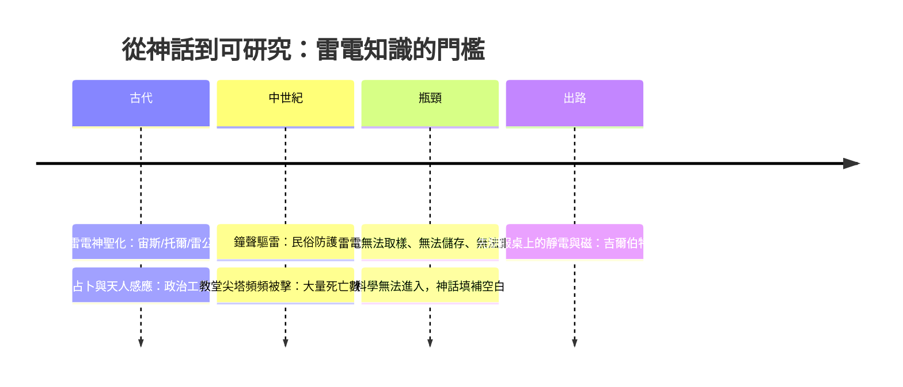

# 第 3 節 神話與雷電：古文明對天雷的恐懼與神聖化

## 雷電的文化譜系：宙斯、托爾與雷公

在所有自然現象中，雷電最適合成為神意的顯現：它突如其來、無所遁逃、毀滅力驚人，且擊中的往往是最高的樹、最高的塔、最顯赫的人。於是各文明不約而同地將雷電寫進神譜——

- **希臘**：宙斯（Zeus）手持雷電（keraunos）為諸神之王，雷霆是他裁決的武器；普羅米修斯竊火，遭罰永縛高加索山。
- **北歐**：雷神托爾（Thor）揮舞雷錘 Mjölnir 與巨人征戰，雷聲是他的戰車輾過天穹。
- **印度**：因陀羅（Indra）以金剛杵（vajra）擊殺旱魔弗栗多，雷電象徵秩序對混沌的勝利。
- **中國**：雷公電母司掌賞罰，民間相信雷殛是上天誅罰不孝不義之人；《論語》有「迅雷風烈必變」，聖人聞雷而變色，正是敬天之禮。

這份跨文化的相似性並非巧合，而是雷電的物理特性與人類心理結構共同作用的结果：**無法預測的巨大力量，最容易被解釋為意志。**

## 雷電作為政治工具：君權神授的天際版

一旦雷電被神聖化，它便成為權力的資源。羅馬皇帝的御座旁設有凱旋的雷電意象，元老院議事廳的天花板繪上雷擊圖案；占卜師（augur）解讀雷聲的方位以裁准軍政大事。在中國，「天人感應」理論將災異——包括雷電擊毀宗廟——解讀為上天對施政的譴責，董仲舒以此約束君權，皇帝則需下詔罪己。**雷電是弱者的監察院，也是強者的加冕禮**：它既能警告君王，也能為君王的統治背書。「奉天承運」四個字裡，藏著一道閃電。

## 避雷的民俗與荒謬：鐘聲驅雷

面對天罰，人類發展出各種防護手段——以及大量致命的誤解：

- 教堂於雷雨中**鳴鐘驅雷**，源自「惡靈畏鐘聲」的信仰。但鐘樓恰是全鎮最高的導體：法國聖奧梅爾的鐘樓在數十年間被雷擊上百次，一名敲鐘人喪生；1750年代法國物理學家德維斯（de Vassy）統計了兩百餘座教堂，記錄到數百次雷擊與上百人死傷，其中不少正是敲鐘者。
- 民間以**大蒜、聖物、燃燒桂葉**驅雷，各說各話，皆無效驗。
- 誠然，也有歪打正著的民俗：屋頂豎立金屬尖桿（未接地）偶爾發揮了近似避雷針的作用，但無人知其所以然。

**數千年的觀察積累了大量雷擊資料，卻沒有產生任何一條物理定律。** 原因很簡單：雷電無法靠近、無法儲存、無法重複——凡無法在實驗桌上重現的現象，哲學只能任由神話書寫它。

## 為何「抓住」它是一切的關鍵

科學方法論在此顯示出殘酷的門檻：希臘人能記下琥珀吸芥，因為琥珀就躺在桌上；但沒有人能把閃電「抓」到桌上。雷電研究缺的不是好奇心，而是**取樣工具**——一個能在地面上生產、儲存、放大電的裝置。缺了它，天雷與琥珀便永遠是兩個世界的事物；有了它，兩者才可能在1752年被一根風箏線縫合。

而在縫合之前，還有更基礎的工作要做：**先把桌上的靜電與磁石分清楚**。十七世紀初，一位伊麗莎白一世的御醫將拿起琥珀與磁石，用實驗宣告：它們是兩種不同的力。電學，即將擁有自己的名字。

---

**因果鏈條**：神話霸佔雷電數千年，是因為人類無法「抓住」它；而要抓住它，得先學會在實驗桌上辨識、分類、測量電與磁。下一章，吉爾伯特的《論磁》將以實驗反叛古人權威，為電學命名——科學的第一把鑿子，鑿向了神話的岩壁。
