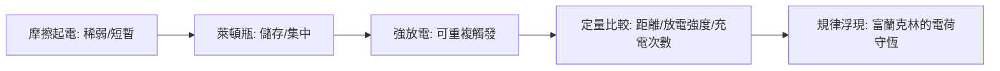

# 第 1 節 萊頓瓶（Leyden Jar）：人類史上第一個儲存電荷的容器

## 兩樁意外的電擊：von Kleist 與 Musschenbroek

1745年10月，普魯士波美拉尼亞的副主教**埃瓦爾德·格奧爾格·馮·克萊斯特（Ewald Georg von Kleist）** 嘗試以玻璃瓶蓄電：瓶中灌入酒精或水銀，以軟木塞封住，插上釘子連接起電機。他一手握瓶、一手觸碰釘子——瞬間被強烈電擊，人被擊倒，手臂麻痛數日。他寫信給學界友人描述此事，但描述不清，未受重視。

幾個月後的1746年1月，荷蘭萊頓大學的物理學教授**皮特·范·馬森布羅克（Pieter van Musschenbroek）**獨立重做了幾乎相同的實驗：以水銀瓶連接靜電起電機，一端接電、一手持瓶、另一手試探水銀——

> 「我突然感到手臂與全身遭到無法形容的猛擊……我以為我完了。」

他在給巴黎友人雷奧米爾的信中寫道，他願以「**再也不為法王做此實驗**」為誓，勸人切勿重蹈。這封信廣為流傳，這種裝置隨即被命名為**萊頓瓶**（Leyden jar）——「萊頓的瓶子」成了新時代的象徵。

## 電容原理的初現

萊頓瓶為何能電人？以今日眼光看，它就是最早的**電容器**：玻璃瓶壁是介電質，內外的導體（水銀或水，與握持者之手或外側金屬箔）構成兩個極板。充電時電荷被「壓縮」在介電質兩側隔空對峙；放電時兩側電荷瞬間中和，形成猛烈的電擊。

當時的人不懂這些，但萊頓瓶的改進史本身就是一部樸素的電容工程史：1746年，倫敦的丹尼爾·伯努利家族成員（Daniel Bernoulli 一系）與英國科學家**約翰·貝维斯（John Bevis）**發現外側包上金屬箔可大幅增強效能；不久內外貼箔、絕緣軟木塞、鏈條電極的標準形制問世——**徒手充電升級為儀器化儲能**。

Musschenbroek 的直覺也道破了本質：他推測電「被禁錮在玻璃之中」。錯誤的機制（他以為電藏在玻璃裡而非兩側導體），卻指向正確的方向——**玻璃是關鍵**。电容的真諦「以絕緣介電質隔開兩片導體」，要再等一百多年（法拉第之後）才被完全理解。

## 沙龍裡的電：宮廷文化與科學示範

萊頓瓶最意想不到的社會效應，是讓電學變成了**娛樂**。能儲存強力電擊的瓶子，天生就是表演道具：

- **1746年，法國**：努萊（Jean-Antoine Nollet）神父在國王面前安排了著名的表演——**一百八十名禁軍士兵手拉手排成一列**，隊首接觸萊頓瓶，放電瞬間全線同時跳起；他隨後又在七百名加爾都西會修士前重演，七百人齊跳。路易十五宮廷為之轟動。
- 貴族沙龍中流行「電吻」：帶電的女性一吻電倒紳士；電火花點燃酒精、擊穿紙牌，成為晚宴的保留節目。

這並非科學的墮落，而是科學的**傳播與融資**。宮廷的好奇心轉化為儀器經費與職位；沙龍示範訓練了整個歐洲的「實驗觀眾」，為下一代的科學普及培養了品味。努萊更以萊頓瓶研究電在人體的傳導，量出放電沿180人列隊的瞬間傳播——**娛樂掩護之下，是電生理學的最早實驗之一。**

## 儲能的真正意義：可重複、可量化

在萊頓瓶之前，靜電是「即用即逝」的：摩擦產生、吸引草屑、隨即消散，實驗者幾乎無法累積足夠的電做定量研究。萊頓瓶改變了遊戲規則：

1. **可重複**：同一瓶電，可反覆放電於不同實驗，排除偶然。
2. **可量化**：以「放電跨越的間隙距離」「火花大小」「需要搖動起電機多少下」作為半定量指標，實驗開始可以比較。
3. **可放大**：多瓶並聯（日後所謂「電池」battery 的最早用法）可以累積更大的「電力」——工程思維進入電學。

**儲能，是實驗科學從定性走向定量的門檻。** 而第一批跨越門檻的人中，有一位費城的印刷商，正用萊頓瓶追問一個大膽的問題：天上的雷，和這瓶裡的電，會不會是同一種東西？

---

**因果鏈條**：萊頓瓶讓人類第一次握住了集中的電荷，於是終於有人能設計實驗去「抓住」天雷。下一節，富蘭克林的風箏實驗將把神話擊碎為物理——而這位殖民地的科學家，也將在電學與建國政治的雙重舞台上，留下雙重的傳奇。
