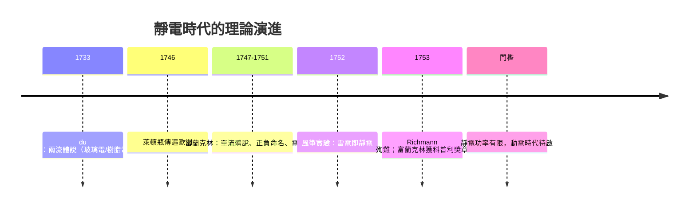

# 第 3 節 正電與負電的概念提倡：單流體理論與電荷守恆定律的初現

## du Fay 的兩流體說：玻璃電與樹脂電

十八世紀三十年代，法國宮廷化學家**夏爾·弗朗索瓦·迪費（Charles François du Fay）**以系統實驗發現一個關鍵事實：摩擦過的**玻璃棒**與摩擦過的**琥珀（樹脂類）**所帶的電，性質相反——同性相斥、異性相吸。他讓兩根帶電玻璃棒彼此推開、兩根帶電樹脂棒彼此推開，而玻璃棒卻吸引樹脂棒。

據此，du Fay 於1733年提出**兩流體說**：電由兩種各自獨立的「電的流體」構成——「玻璃型電」（vitreous）與「樹脂型電」（resinous）。同類流體相斥，異類流體相吸。

## 富蘭克林的單流體說與正負命名

1740年代末，富蘭克林在費城的電學研究中提出針鋒相對的模型：**電只有一種**，是一種瀰漫於一切物體的細微「電火流體」（electrical fire）。

- 摩擦玻璃，是把流體從毛布**抽**進玻璃：流體**過剩**者，稱為「**正電**」（+，positive，以玻璃電為準）；
- 流體**短缺**者，稱為「**負電**」（−，negative，樹脂電）。
- 電現象皆源於流體從過剩處流向短缺處的**趨勢**。

這個模型有驚人的解釋力：它一次說明了帶電體如何吸引中性物（中性物近端感應出異號）、為何摩擦總是「同時」產生兩種電（一得一失）、以及放電為何是「中和」。

## 電荷守恆：隱藏在模型中的定律

單流體說真正的不朽貢獻，是**電荷守恆**思想的初現：摩擦不「製造」電，只是**轉移**電——宇宙中的電火總量恆定，實驗不過是把電從A搬到B。富蘭克林寫道：「電火絕不會被（摩擦）製造出來，只是被收集。」這是物理學史上最早的守恆律之一，日後在法拉第、馬克士威手中演化為電磁學的基石，並最終成為能量守恆定律譜系的前奏。

## 「模型錯了，但語言留下了」：一則科學哲學趣談

歷史對兩位對手做出了微妙的判決。今日物理告訴我們：**導體中的電流，主要是帶負電的電子流動**——即流體若真存在，其流動方向與富蘭克林命名的「正電流方向」恰恰相反。富蘭克林把方向猜反了：他定的「正」端，實為電子的短缺端。

有趣的是，科學界並沒有因此翻修整座語言大廈：

- 「正」「負」電荷、「電流方向」沿用至今（工程學的「電流」仍從正極流向負極，稱「慣例電流」）；
- 只是後來的物理學家另立「電子」一詞，以負電荷載子解釋導電，兩套語言並行不悖。

這是科學哲學的經典教材：**科學的進步未必是語言的推倒重來，而是讓舊語言在新模型中獲得新定義。** 正負電如今不代表「某種流體的盈缺」，而只是電荷的一種代數標記——就像地圖上的南北極，方向錯了可以調整箭頭，不必燒掉地圖。富蘭克林的模型被淘汰了，他的命名卻成了人類的通用語；兩流體說「錯」得更少些，卻連命名權都輸掉了。**理論的勝負，有時取決於誰的詞更好用。**

而這場論爭本身也展示了一個健康的科學共同體如何運作：du Fay 的兩流體與富蘭克林的單流體在歐陸與英倫各有信徒，實驗互駁、通信論戰，直到能同時容納兩者優點的更好模型（後來的場論與電子論）出現，論爭自然消解。**科學不靠權威裁決，靠的是誰能解釋更多現象。**

## 靜電時代的頂點：動電在門外叩響

到1750年代中期，靜電學已達其前工業時代的高峰：有偵測器（驗電器）、有儲存器（萊頓瓶）、有天空的對照（風箏實驗與避雷針）、有理論綱領（流體模型與電荷守恆）。1751年，富蘭克林的《電學實驗與觀察》在倫敦出版，迅速譯為法文、德文、義大利文，成為歐洲電學的教科書——**一位殖民地印刷商寫的電學小冊，成了啟蒙時代最暢銷的科學讀物之一。**

但靜電學有天花板：摩擦起電的功率太小、太不穩定，儲存的電轉瞬即逝。要點亮燈泡、驅動馬達、傳遞訊息，人類需要的是**持續不斷的電流**——動電（current electricity）。這個跨越，將由一場義大利的青蛙腿爭論點燃，由一位帕維亞的教授用銅片與鋅片完成。

---

**因果鏈條**：靜電學的理論與儀器都已就位，唯獨電流缺席。義大利解剖學家伽伐尼將在青蛙腿的痙攣中誤打誤撞地看見電流，而伏打將以一堆銅片鋅片，把「電」從轉瞬的火花變成持續的洪流。下一章：電池誕生，電磁學的大門轟然開啟。
