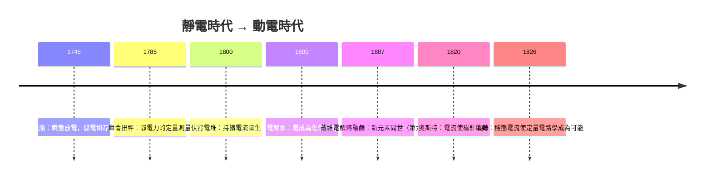

# 第五章　動電的誕生：從青蛙腿到電池

## 第 3 節 伏打電堆（Voltaic Pile，1800 年）：人類獲得穩定持續電流的轉折點

### 一、銅、鋅與濕紙：三十對的疊層革命

1800 年春，伏特在寫給皇家學會主席班克斯（Joseph Banks）的長信中公開了他的發明。構造樸素得近乎戲謔：一對銅片與鋅片，中間夾一片浸過鹽水（或稀酸）的濕紙板或布，如此為一「單元」；把數十個單元垂直疊起，用導線連接最上與最下的金屬片——一個能持續產生電的裝置就此完成。伏特稱之為「人工電器官」（organo elettrico artificiale），因為他認為它模仿了電鰩的電板結構。

其化學原理，伏特自己並未真正理解（他堅持電源是金屬接觸，且誤認濕紙只是導體）。今日我們知道：鋅在電解液中溶解並釋放電子（$\text{Zn} \to \text{Zn}^{2+} + 2e^-$），氫離子在銅端獲取電子析出（$2H^+ + 2e^- \to H_2$），化學能轉化為電能，兩種金屬的電位差便是電動勢。濕紙不是配角而是主角——電解質才是電池的心臟。這個「理論錯誤、裝置正確」的案例，再次說明技術可以先於科學成熟：工程實踐跑在解釋之前，是人類技術史的常態而非例外。

### 二、Nicholson 與 Carlisle：兩週後的電解水

電池的威力立即顯現。倫敦的威廉·尼科爾森（William Nicholson）與安東尼·卡萊爾（Anthony Carlisle）讀到伏特的信後，數週內（1800 年 5 月）便複製了電堆。他們在接線端點滴水時注意到氣泡產生，隨即確認：兩極分別析出氫與氧——**水被電分解了**。這是人類史上第一次電解，把一直被視為「元素」的水分解成兩種氣體，一舉支持了拉瓦錫的化學革命，也開創了「用電當化學試劑」的全新方法論。

### 三、從瞬態到穩態：實驗科學型態的質變

電堆真正的革命性，不在電量大小（它其實很微弱），而在**時間性**。靜電機與萊頓瓶給的是火花式的瞬態放電——一次性的、不可控的、難以精測的。電堆提供的卻是**持續、穩定、可開關、可調節**的電流。這個看似平凡的性質，改寫了實驗科學的整個型態：

持續電流讓「觀察過程」取代「捕捉瞬間」：電流的熱效應可以加熱導體，化學效應可以沉積金屬，生理效應可以持續刺激，磁效應（1820 年奧斯特的重大發現，第六章後詳述）更是只有在穩態電流下才可能被捕捉到。**沒有穩態電流，就沒有電磁學、電化學與電路學**。實驗物理學從此多了一個新的維度——時間中的連續過程——這是科學方法論層面的范式升級。

### 四、單位的命名與電池的技術系譜

伏特於 1827 年去世；半世紀後，國際電學單位制把電動勢的單位命名為「伏特」（volt），後來更進入國際單位制（SI）的核心。以人名為單位，是十九世紀末科學紀念文化的新形式：它把個人成就轉化為全體工程師每日使用的語言——每一塊電池上的「1.5V」，都是一塊微小的歷史紀念碑。

電池本身也進入持續的技術演化：伏打電堆的缺點是極化（氫氣積聚在銅面使電流迅速衰減）。1836 年英國的丹尼爾（John Daniell）發明雙液電池，用隔膜分隔銅液與鋅液，解決極化問題、提供穩定電壓，成為電報時代的標準電源；1859 年普朗泰（Gaston Planté）發明鉛酸蓄電池，首次實現「可充電」——儲能概念從此誕生，今日每輛電動車的電池板，血統仍可上溯至普朗泰的玻璃槽。這條系譜顯示：一項基礎發明 → 立即暴露工程缺陷 → 引發百年改良競賽 → 產業化。

### 五、收尾：通往戴維的電解

伏打電堆 1800 年問世，七年之後，倫敦皇家研究院的戴維（Humphry Davy）建造了空前巨大的電池組，用強大電流轟擊熔融的鹼，把鉀、鈉、鈣、鍶、鋇、鎂等一整排新元素從化合物中「電」了出來——化學的版圖被電重新繪製。動電時代的大門，就這樣被蛙腿、金屬舌頭與一疊濕紙板推開了。

### 因果鏈條

> 接觸電論戰逼出實驗優化 → 1800 年伏打電堆（銅—鋅—濕紙疊層）→ 致皇家學會信公開發表 → Nicholson 與 Carlisle 兩週內電解水 → 電成為化學試劑 → 持續電流使實驗科學從「瞬態」轉為「穩態」→ 電化學、電磁學、電路學獲得存在前提 → 單位以「伏特」命名，個人成就制度化为工程語言 → 電池系譜（Daniell、Planté）開啟改良與產業化 → 1807 年戴維巨型電池組電解新元素（下一章）。
