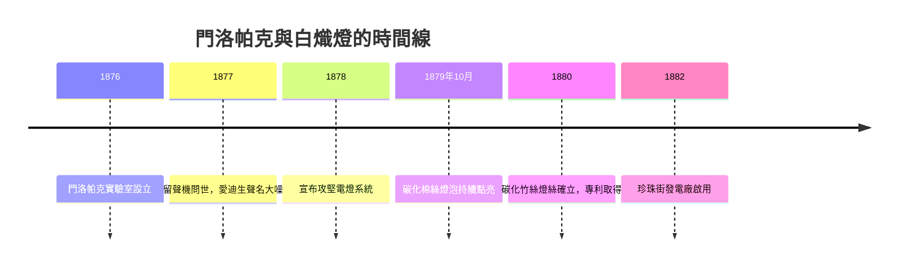

# 第 1 節 托馬斯·愛迪生（Thomas Edison）與門洛帕克實驗室：燈絲材料的千百次試錯

## 一、「發明工廠」的誕生：發明本身被發明出來

1876 年，托馬斯·愛迪生（Thomas Edison, 1847–1931）在紐澤西州門洛帕克（Menlo Park）設立了一座實驗室。表面上看，這只是一棟兩層樓的木造建築；實質上，它是人類史上第一個以「持續量產發明」為目標的組織——「發明工廠」（invention factory）。

在愛迪生之前，發明是孤獨工匠的事業：一個人在閣樓裡擺弄零件，靠靈感與運氣。愛迪生把這個模式翻了過來。他招募受過正規訓練的機械技師、化學家、數學家（如 Charles Batchelor、Francis Upton），分工合作：有人負責理論計算、有人負責精密加工、有人負責測試記錄。愛迪生自稱「總督」（governor），負責提出問題、下達攻擊方向。這是一種**制度創新**：發明從個人天才的副產品，變成組織化、流程化、可管理的研發活動。今天企業的 R&D 部門、貝爾實驗室、乃至現代所有研發中心，都是門洛帕克的後裔。

支撐這套制度的是**專利經濟學**。門洛帕克的每一項成果都立即申請專利，專利不是學術榮譽，而是可交易、可授權、可訴訟的資產。愛迪生一生取得一千零九十三件美國專利，專利組合就是他的資產負債表。發明→專利→授權或創業→收益→再投資研發，這個閉環讓「發明」第一次成為可持續的商業模式。這也塑造了美國式的創新文化：科學要能變成錢，錢再驅動科學。

## 二、燈絲的試錯：系統性淘汰法

電燈並非愛迪生發明——在他之前，弧光燈已用於公共場所，二十多位發明者做過白熾燈實驗。愛迪生的貢獻是**把電燈當作一個系統問題**來解：發電機、配線、電表、燈座、保險絲、燈泡，缺一不可；而核心難題是找到一種燈絲——電阻要高（以配合高電壓小電流的配電經濟學）、要能耐高溫不氧化、要能持續發光數百小時以上。

門洛帕克的團隊用了系統性淘汰法：把一切可能的材料拿來碳化測試。鉑、銥、各種金屬與合金失敗後，轉向碳；棉線碳化後勉強可用；1879 年 10 月，碳化棉絲燈泡持續亮了約十三個半小時；團隊再接再厲，最終發現**碳化竹絲**最佳——愛迪生甚至派人遠赴日本、中國、南美、印度蒐集竹樣，最後選定日本八幡的竹材，供應燈泡超過十年。據稱團隊前後測試了六千多種植物纖維。這種「窮舉式試錯」正是發明工廠的特徵：不靠單次靈感，靠組織化的搜索空間。

## 三、「天才是 99% 的汗水」：文化形象的製造

1879 年除夕，門洛帕克向公眾展示數十盞電燈，火車專程載來圍觀人潮。記者湧入實驗室，愛迪生刻意經營媒體關係，把自己塑造成「門洛帕克的奇才」（the Wizard of Menlo Park）。他那句被引用無數次的名言——「天才是百分之一的靈感加上百分之九十九的汗水」——正是這種形象的結晶：發明不再是天賦異稟者的特權，而是勤奮、紀律、團隊與資本的產物。

這句話背後有一套**思想轉變**：十九世紀末的美國，正從農業共和國轉型為工業強國，「汗水可換成功」的敘事完美契合新教工作倫理與企業資本主義的合流。愛迪生本人只受過三個月正規學校教育，靠電報員出身自學成才，他的傳記式神話成為美國教育與社會流動的樣板教材——幾代學童在課本裡讀到「失敗了一千次的愛迪生」，把「試錯」內化為科學方法的一部分。

## 四、發明與商業的綑綁：愛迪生電燈公司

愛迪生最深的制度遺產，是把「發明」與「商業化」焊死在一起。1878 年他成立愛迪生電燈公司（Edison Electric Light Company），由金融巨頭 J. P. 摩根與范德比爾特家族出資，資本五萬美元——發明者以專利入股，資本家以現金入股，風險共擔、利潤共享。這正是現代創投模式的雛形。

愛迪生的信條是：不能賣出去的發明不算發明。他常說自己「不做任何沒有商業用途的實驗」。留聲機、電燈、電影攝影機，每一項都配套成立公司、鋪設專利護城河。1889 年各公司合併為愛迪生通用電氣公司，1892 年與湯姆森-休斯頓合併後成為 **通用電氣（GE）**——發明工廠最終長成了工業巨頭。

| 面向 | 門洛帕克之前的發明模式 | 門洛帕克之後 |
|---|---|---|
| 主體 | 個人工匠 | 團隊組織 |
| 方法 | 靈感與巧手 | 系統性試錯 |
| 資金 | 個人積蓄、贊助人 | 股份公司、金融資本 |
| 產出 | 機器原型 | 專利組合 + 商業系統 |

## 因果鏈條

門洛帕克實驗室（組織化研發的制度創新）→ 專利經濟學使發明成為資產 → 金融資本（摩根）入股，發明與商業綑綁 → 系統性試錯解決燈絲難題（1879 白熾燈）→ 電燈系統催生發電與配電產業 → 「99% 汗水」的文化神話重塑教育與價值觀 → 研發-專利-資本的模式被 GE、貝爾實驗室等繼承，成為二十世紀科技經濟的標準引擎。
