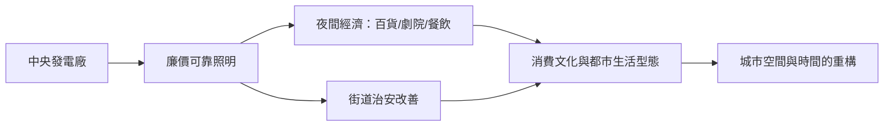

# 第 2 節 直流電（DC）供電系統：第一個中央發電廠與城市夜間照明

## 一、珍珠街：從「一盞燈」到「一個系統」

1882 年 9 月 4 日下午三點，愛迪生在華爾街的 J. P. 摩根辦公室按下開關，曼哈頓珍珠街（Pearl Street）發電廠開始供電，五十九個客戶的一百多盞白熾燈同時亮起。這一刻的意義遠超「電燈變亮」：這是**世界第一座中央發電廠**（central power station），人類第一次建立起「集中發電—網路配送—終端計費」的完整系統。

愛迪生的眼光正在於系統思維。他清楚地算過帳：如果每家每戶各自買電池或小發電機，電燈永遠是奢侈品；唯有像煤氣公司一樣「中央生產、管線配送」，電才能成為商品。為此他的團隊在兩年內幾乎同時發明了整條產業鏈：改良的大功率直流發電機（效率從 40% 提升到 82%）、並聯配電網路、保險絲與開關等安全裝置、絕緣包覆的地下電纜——甚至連燈泡都是為了配電經濟學而設計的（高電阻燈絲才能用 110 伏特的小電流配送，減少線路損耗 $P=I^2R$）。

## 二、電表與計費：把電變成「可計量的商品」

一個產業要成立，必須能收錢；要收錢，必須能計量。珍珠街系統配備了**化學式電度表**的先驅——愛迪生的電解式電表透過定期稱量鋅電極上析出的金屬量，推算用戶耗電量，是現代電度表的祖先。雖然笨拙（技師每月到府「稱電」），卻確立了關鍵原則：**電是按用量計費的商品**，而非像空氣一樣的免費存在。

同時，珍珠街也定下了最早的安全與工程標準：110 伏特的低電壓選擇（相對安全）、地下配線（避免火災與市容爭議）、保險絲保護。這些規範後來演變為紐約電氣法規與全國電氣規範（NEC）的源頭。**技術標準就是制度**——誰先定標準，誰就定義了產業的遊戲規則，這一課在十年後的電流戰爭中將被反覆驗證。

## 三、煤氣燈產業的抵抗：既得利益的反撲

電燈並非降臨在真空中。十九世紀的城市夜間照明由**煤氣燈產業**壟斷：煤氣公司鋪設管線、收取月費、僱用點燈人，是城市公用事業的巨頭。愛迪生刻意讓電燈系統模仿煤氣公司的商業模式（同樣的計費邏輯、同樣的錶計概念），正是為了讓投資人與用戶「無痛轉換」。

但煤氣公司沒有坐以待斃。它們動用政治遊說、質疑電的安全性（「地下電纜會漏電電死行人」的恐嚇宣傳）、挖訟專利、並以降價反擊；點燈人工會也視電燈為生計威脅。這是技術史上反覆出現的劇本：**新產業與既得利益在市場、媒體、法庭、議會四條戰線同時作戰**。煤氣燈最終未被立即消滅——它靠降價又撐了數十年，並在烹飪、取暖領域存活至今——但照明主導權的轉移已不可逆。

## 四、城市夜間經濟的誕生：社會與文化的改寫

電燈改變的不只是技術，是**時間本身**。在煤氣燈時代，夜間照明昏暗、昂貴且有火災之虞；電燈讓黑夜變成可經營的白晝延長線：

- **百貨公司**：櫥窗燈光成為廣告革命，夜間購物興起，消費主義獲得舞台。
- **劇院與娛樂**：1881 年巴黎與 1882 年後的百老匯劇院改用電燈，布景更安全、色彩更豐富，「夜生活」成為中產階級的生活方式。
- **治安與街道**：明亮的街道壓縮了犯罪空間，警察巡邏邏輯隨之改變；城市的心理感受——對黑夜的恐懼——被技術性地削弱。
- **報紙與印刷**：夜班印刷、24 小時的新聞週期成為可能。

社會學家稱此為城市時間結構的「解自然化」：人類活動第一次大規模擺脫日照的束縛。這是電力對文明最深刻的一次重塑，而且發生得悄無聲息。

## 五、金融資本的角色：摩根點亮華爾街

珍珠街系統造價不菲（約十餘萬美元，遠超門洛帕克的實驗室開銷），靠的是 **J. P. 摩根** 的資金與信用。摩根本人是首批客戶——他的辦公室與宅邸率先裝燈（儘管宅邸的地下發電機一度噪音與焦味擾鄰，被鄰居抗議）。摩根的意義不只是出錢：他把自己的辦公樓變成活廣告，向全美資本界背書「電是值得投資的事業」。

此後的擴張是資本密集的：每一座新發電廠都是一筆大工程。愛迪生電燈公司透過發行股票、授權地方特許公司（每個城市一家「愛迪生系統」公司）快速複製模式。**技術創新 → 金融創新 → 都市基礎設施**，三者在此緊密咬合；而摩根後來主導的 1892 年奇異（GE）合併，更顯示金融資本才是產業整合的最終裁決者。

## 因果鏈條

系統思維（把電燈視為發電-配電-計費整體）→ 珍珠街中央電廠（1882）確立公用事業模式 → 電表使電成為可計費商品，安全標準成為制度 → 煤氣產業反撲證明新技術必須同時打市場與政治之戰 → 廉價夜間照明催生夜間經濟，重構城市文化與治安 → 金融資本（摩根）加速複製與整合 → 「集中發電、統一配送」成為百年電力體制的原點，也埋下日後與交流電爭奪標準的伏筆。
