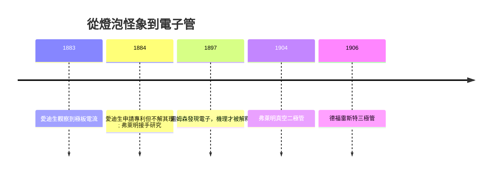

# 第 3 節 愛迪生效應：意外發現熱電子發射（為電子管埋下伏筆）

## 一、燈泡裡的幽靈電流

1883 年，門洛帕克實驗室正為白熾燈的壽命問題頭痛：碳燈絲總是不明原因地燒斷，而且燈泡玻璃會逐漸發黑。愛迪生為了對付這個「燈絲衰變」問題，在燈泡內封入一片與燈絲絕緣的金屬極板，想觀察燈絲粒子對極板的影響。

結果他觀察到一件與原問題無關的怪事：當燈絲通電加熱後，**電流竟隔著真空從燈絲「跳」到極板上**——若從極板端接入電路，檢流計的指針便會偏轉；燈絲冷卻，電流立刻消失。換言之，熱的碳絲會向真空釋放某種「看不見的載流者」，而且這電流是單向的：只有燈絲（負端）向極板方向流得通。

愛迪生機敏地做了一件符合「發明工廠」邏輯的事：1884 年 2 月，他以「電氣指示器」（electrical indicator）之名申請了美國專利——設想它可用來測量交流電的波形。但對於**為什麼**會有這道電流，愛迪生既不關心也無答案。他隨手記錄、順手申請專利，然後回去繼續改良燈絲。這項現象日後被稱為**愛迪生效應**（Edison Effect），即熱電子發射（thermionic emission）——電子在金屬受熱後獲得足夠能量逸出表面。

## 二、弗萊明接手：科學素養決定發現的命運

1884 年，英國電機工程師 **約翰·安布羅斯·弗萊明**（John Ambrose Fleming, 1849–1945）——他曾任愛迪生電燈公司倫敦顧問，也親耳聽過愛迪生描述這個怪象——開始研究此現象。他結合當時剛萌芽的對「陰極射線」的認識，確認這是單向導電的整流行為。但直到 1897 年 J. J. 湯姆森（J. J. Thomson）發現電子，人們才明白：愛迪生效應中流動的，正是從熱燈絲逸出的電子。

這裡藏著一個技術史的深刻教訓：**同樣的現象，在不同的知識框架下價值完全不同**。愛迪生以實用主義的眼光看它，只看到「一個奇怪的指示器」；而缺少了電子概念的時代，即使弗萊明也無法立即說清機理。科學理論的滯後，讓一項足以開啟電子學革命的發現沉睡了二十年。

## 三、1904 年真空二極管：無線電的需求點火

真正讓愛迪生效應發光的，是**無線電**。弗萊明 1900 年代受聘於馬可尼公司擔任技術顧問，面對的難題是：天線收到的是高頻交流振盪，但接收機需要單向電流才能驅動記錄裝置——需要一個**整流器**（檢波器）。當時主流的金屬屑檢波器（coherer）靈敏度差、需手動復位。

弗萊明想起了愛迪生效應的單向導電性：熱陰極放出電子只往陽極流，天然就是整流器。1904 年 11 月，他將燈絲與極板封入真空管，做出史上第一支**真空二極管**（熱陰極管），獲得專利並命名為「震盪管」。馬可尼的橫越大西洋接收機自此有了可靠的「心臟瓣膜」。

## 四、1906 年德福雷斯特三極管：放大時代的來臨

美國發明家 **李·德福雷斯特**（Lee de Forest, 1873–1961）在二極管的陰極與陽極之間插入一片柵狀金屬網（柵極），製成**三極管**（Audion, 1906）。柵極上微小的電壓變化，可以控制流過真空管的較大電流——這意味著**放大**（amplification）成為可能。

放大的意義無法高估：微弱的無線電訊號可以被放大再放大；長途電話不再需要每數百公里中繼一次；聲音可以驅動喇叭、廣播可以覆蓋大陸。真空管讓「電子學」從電力工程中獨立出來，成為二十世紀前半葉的關鍵技術，直到 1947 年電晶體接班。而這整條血統的起點，是 1883 年那顆發黑燈泡裡的意外觀察。

| 事件 | 性質 | 當事人的理解程度 |
|---|---|---|
| 1883 愛迪生觀察極板電流 | 現象發現 | 觀察到，不解其理 |
| 1884 愛迪生專利 | 實用設想 | 誤以為是指示器 |
| 1897 湯姆森發現電子 | 理論突破 | 機理被解釋 |
| 1904 弗萊明二極管 | 應用發明 | 知其用且漸知其理 |
| 1906 德福雷斯特三極管 | 應用發明 | 實用先於理論，連德福雷斯特都一度說錯工作原理 |

## 因果鏈條

白熾燈的品管問題 → 意外觀察到真空中的極板電流（1883）→ 愛迪生以專利制度「封存」現象卻不解其理 → 缺乏電子理論，發現沉睡二十年 → 湯姆森發現電子（1897）補上知識缺口 → 無線電對整流器的迫切需求（市場驅動）→ 弗萊明真空二極管（1904）→ 德福雷斯特三極管（1906）開啟放大與電子學時代。「發明者不理解自己的發現」——現象、理論與市場三者錯位，正是科學史最耐人尋味的常態：門洛帕克式的試錯工廠能製造現象，但只有科學理論才能釋放現象的全部潛能。
