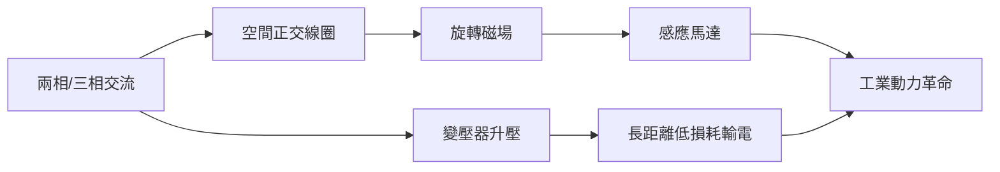

# 第 1 節 尼古拉·特斯拉（Nikola Tesla）與交流電（AC）多相系統、感應馬達

## 一、從塞爾維亞到門洛帕克：移民工程師的起點

尼古拉·特斯拉（Nikola Tesla, 1856–1943）生於當時屬奧地利帝國的斯米連（今克羅埃西亞境內），塞爾維亞裔，受過歐陸的工程教育，曾在布達佩斯與巴黎的愛迪生系統公司工作。1884 年，二十八歲的特斯拉懷著一封推薦信與幾乎空空的口袋抵達紐約，投效愛迪生門下。

兩人的合作註定失敗，因為他們是兩種發明哲學的化身。愛迪生是窮舉試錯的實幹家——「你給我一萬次失敗，我給你一個答案」；特斯拉則是先在腦中完成整台機器、再付諸實作的理論派——他聲稱能在腦內「運轉」馬達並計算磨損。特斯拉主張交流電才是未來；愛迪生已把身家押在直流系統上，視 AC 為異端。

著名的決裂導火線是那筆 **50,000 美元糾紛**：據特斯拉晚年的說法，愛迪生曾允諾，若他能大幅改良直流發電機便賞他五萬美元；特斯拉完成任務後，愛迪生卻說「你不懂我們美國人的幽默」，只肯加週薪。這則故事僅出自特斯拉單方回憶，史家對細節存疑，但它精準象徵了兩人的根本錯位：特斯拉期待的是工程師的榮譽契約，愛迪生奉行的是老闆的商業算計。1885 年，特斯拉憤而離職，一度淪落到挖溝謀生。

## 二、旋轉磁場：交流電的理論核心

特斯拉的洞見建立在一個優雅的物理原理上：**旋轉磁場**（rotating magnetic field）。若將兩組（或多組）相位相差一定角度的交流電，通入空間上錯開的線圈，兩者產生的磁場會合成一個**繞軸旋轉**的磁場。這個旋轉磁場無需電刷與換向器，就能「牽著」轉子同步或感應轉動——於是誕生了結構極簡、幾乎不需保養的**感應馬達**（induction motor）。

直流馬達必須靠換向器把電流方向機械式地翻轉，火花與磨損是宿命；交流感應馬達則沒有活動觸點，這是工程上的絕對優勢。而且交流電可以靠變壓器升壓降壓，長距離輸電的損耗遠低於低壓直流。特斯拉 1887 至 1888 年間申請了一系列專利，構成完整的**多相交流系統**：發電、輸電、變壓、馬達驅動，一整套而非單一零件。

$$\vec{B}(t) = B_0\big(\cos\omega t\,\hat{x} + \sin\omega t\,\hat{y}\big)$$

上式即旋轉磁場的數學本質：兩個正交、相位差 $90°$ 的磁場分量合成等幅旋轉向量。

## 三、1888 年：專利與威斯汀豪斯的相遇

1888 年 5 月，特斯拉在美國電機工程師學會（AIEE）發表多相系統的經典演講，台下坐著喬治·威斯汀豪斯的代理人。威斯汀豪斯當即買下特斯拉全部交流專利（連同後續專利，總價約數萬美元現金加上每匹馬力的權利金，並聘他為顧問）。這筆交易是電流戰爭的轉捩點：愛迪生陣營有品牌與資本，威斯汀豪斯陣營從此擁有理論與專利的正統。

## 四、理想主義者的代價：晚年與沃登克里弗塔

特斯拉是天才，也是悲劇人格。他強迫症式地迷戀數字三與可被三整除的量、潔癖、單身、與鴿子為伴；他鄙視商業談判，多次在權利金問題上自我了斷——感應馬達的權利金在股東壓力下被威斯汀豪斯公司買斷作廢，使他錯失成為巨富的機會。

他的視野遠超時代：無線遙控船（1898）、無線電、螢光照明、乃至**全球無線輸電**的狂想。1901 年起，他在長島興建**沃登克里弗塔**（Wardenclyffe Tower），夢想利用地球與大氣層的電学特性，把電力與訊息免費傳遍全球。但投資人摩根的資助在得知「電力無法計費」後戛然而止——免費的電沒有商業模式——塔於 1906 年前後停擺，最終 1917 年被拆除。特斯拉 1943 年窮困地死於紐約旅館，晚年靠喂鴿子度日；諷刺的是，同一年美國最高法院在專利訴訟中承認其無線電相關專利的優先權。

## 因果鏈條

歐陸理論教育 × 與愛迪生的決裂（思想與制度的不相容）→ 旋轉磁場與感應馬達的發明（1888）→ 威斯汀豪斯收購專利，AC 陣營獲得理論武器 → 多相交流系統取代直流成為輸電與工業動力標準 → 理想主義與商業制度的再度衝突（權利金被剝奪、沃登克里弗塔斷糧）→ 天才被市場邏輯淘汰於時代之外，但其技術遺產成為全球電力系統的骨幹。特斯拉的命運證明：推動技術革命需要兩種人——夢想家提出系統，商人把系統賣給世界。
