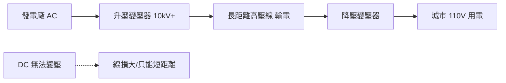

# 第 2 節 喬治·威斯汀豪斯（George Westinghouse）的商業戰略與變壓器的威力

## 一、鐵路氣剎起家：工程與商業的雙棲動物

喬治·威斯汀豪斯（George Westinghouse, 1846–1914）在進入電力業之前，已經是成功的企业家。1869 年，二十三歲的他以**鐵路空氣制動機**（air brake）致富：火車過去靠每節車廂的制動員手動擰閘，反應慢、事故多；威斯汀豪斯用壓縮空氣管線貫穿整列車，司機一拉閥門，全列同時剎停。這項發明的本質是**系統工程 × 安全經濟學**——事故減少，保險費降低，鐵路公司算得出帳，於是爭相採購。

氣剎事業給了威斯汀豪斯兩樣愛迪生之外電力業者最稀缺的資產：一是「**工程+商業**」雙棲的經營直覺（他不只發明，更擅長生產、銷售、專利訴訟與授權談判）；二是創造新標準的經驗——氣剰統一了全美鐵路的安全規範，他深知**誰定標準，誰收稅**的道理。這段前史預示了他在電流戰爭中的角色：他不是要證明 AC 比 DC 高明，而是要讓 AC 成為不可迴避的產業標準。

## 二、變壓器：交流電的殺手級武器

威斯汀豪斯1885 年注意到歐洲的 Gaulard 與 Gibbs 展示了一種「二次發電機」——其實就是變壓器。法拉第電磁感應原理說來簡單：

$$\frac{V_1}{V_2} = \frac{N_1}{N_2}$$

初級與次級線圈匝數比，就是電壓比。交流電流通過初級線圈，鐵芯中磁通量週期性變化，次級線圈感應出任意所需電壓。**升壓**時電流按比例縮小，線路損耗 $P = I^2 R$ 隨電流平方下降——這就是 AC 長距離輸電的全部祕密。

威斯汀豪斯買下 Gaulard-Gibbs 的美國權益，隨即令工程師威廉·史丹利（William Stanley）徹底改良：Gaulard-Gibbs 的串聯繞組設計笨拙低效，史丹利改為**並聯繞組**的閉鐵芯變壓器，使每戶用戶可獨立接取電壓，1886 年在馬薩諸塞州大巴靈頓（Great Barrington）建成美國第一座商業 AC 輸電示範系統。變壓器從此成為成熟商品——而這正是 DC 的死穴：直流電沒有廉價的變壓手段，110 伏特送不了幾公里。

## 三、買下特斯拉專利：一次教科書級的商業收購

1888 年，威斯汀豪斯面對的難題是：他有輸電優勢，卻缺工業動力——鐵路與工廠的馬達都是直流的。特斯拉的多相系統與感應馬達專利恰好補上這塊拼圖。威斯汀豪斯以現金加權利金買下全套專利，聘請特斯拉為顧問，並把特斯拉的實驗室搬到匹茲堡。這筆收購讓威斯汀豪斯電氣公司（Westinghouse Electric）在一夜之間擁有了完整的 AC 技術版圖：變壓器（史丹利）＋ 輸電（自建）＋ 馬達與多相系統（特斯拉）。

其商業戰略清晰可辨：

1. **買而不發明**：用資本換取時間，收購最強的技術資產。
2. **整案交付**：賣的不是設備而是「供電系統」——發電機、變壓器、線路、計費一條龍。
3. **打樣式行銷**：用公開示範工程征服猶疑的市政官員與投資人。

## 四、1893 年芝加哥世界博覽會：兩千盞燈的廣告戰

哥倫布世界博覽會（World's Columbian Exposition）是 AC 陣營的凱旋門。芝加哥博覽會招標照明系統，威斯汀豪斯以遠低於 GE 的報價搶下合約，用十二台大型 AC 發電機點亮了**約十萬盞燈**。兩千七百萬人次（相當於當時美國大半人口）親眼見證「白色城市」（White City）在夜間亮如白晝的奇觀——這是史上最大規模的電力公開演示，其公關效果勝過一千場技術辯論。

威斯汀豪斯甚至請特斯拉在博覽會現場展示高頻放電的「人體導電」表演，將科學奇觀轉化為媒體素材。博覽會之後，AC 系統的商譽徹底翻盤：連此前採用 DC 的城市也開始轉向。

## 五、尼亞加拉水電站（1895）：大型資本工程的誕生

最後一擊是尼亞加拉瀑布。瀑布蘊含的水力可發出遠超任何蒸汽電廠的電力，但發電點在瀑布邊，用電中心在數十公里外的工業城鎮——唯有 AC 高壓輸電可行。1893 年，尼亞加拉瀑布電力公司（由摩根、阿斯特等金融巨頭背書）採用威斯汀豪斯的系統（特斯拉的設計思想），1895 年首批電力輸出，1896 年 11 月送電至水牛城（Buffalo，約四十公里）。

尼亞加拉工程開創了**大型資本工程**（megaproject）的模式：數千萬美元融資、跨國技術協作（借用瑞士的水輪機設計）、政府特許、數年工期。它宣告了電力產業的規模邏輯——今後的電力不再是一城一鎮的小生意，而是綁定金融市場與水利資源的國家級基建。瀑布電力驅動了電解鋁、碳化矽等電化學工業，甚至滋養了後來的特急列車與五大湖工業帶。

## 因果鏈條

鐵路氣剰的成功（工程+商業雙棲訓練＋標準意識）→ 看中變壓器的物理優勢並完成本土改良（1886 大巴靈頓）→ 收購特斯拉專利補齊馬達短板（1888）→ 芝加哥博覽會的大規模公開示範（1893）扭轉公眾與市場信心 → 尼亞加拉水電站（1895–96）以大型資本工程模式確立 AC 的規模優勢 → 變壓器+高壓輸電成為全球電網的標準範式。威斯汀豪斯證明了：革命性技術的勝利，一半靠物理定律，一半靠商業戰略。
