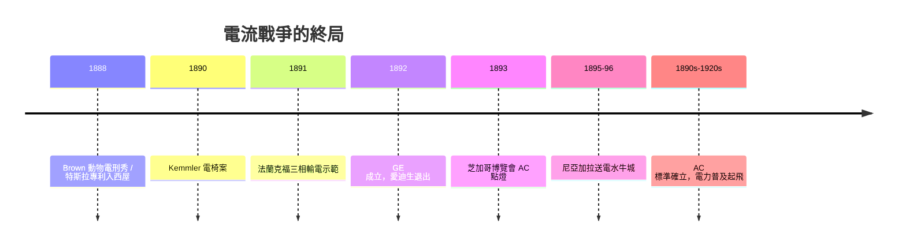

# 第 3 節 抹黑戰與電椅發明：直流電的退場與交流電的全面勝利

## 一、電刑動物秀：科學辯論淪為公關戰

技術上無法反駁變壓器，愛迪生陣營轉向**恐懼行銷**。既然 AC 高壓會致命，就讓公眾相信「AC = 死亡」——哪怕家用電壓早被設計在安全範圍。1887 至 1888 年間，哈羅德·布朗（Harold Brown, 愛迪生陣營的電氣顧問）巡迴全美舉行公開實驗：用交流電當眾電死流浪狗、貓、馬，並宣稱這就是「威斯汀豪斯電」流入千家萬戶的下場。愛迪生本人也在實驗室表演電死動物，甚至曾建議用 AC 電死死刑犯——目的只有一個：在詞彙層面佔領戰場，把「被處死」直接命名為「被威斯汀豪斯」（to be westinghoused）。

1888 年的紐約州州長希爾為此召開專家委員會，布朗與愛迪生在幕後運作，促成州法採用交流電作為死刑用電。愛迪生甚至資助布朗使用威斯汀豪斯生產的交流發電機（幾經轉手才取得，因威斯汀豪斯拒售給死刑用途）裝備奧本監獄。

**關於 Topsy 的澄清**：後世流傳「愛迪生用交流電電死大象 Topsy」的著名影像，實為**訛傳**。大象 Topsy 於 1903 年在康尼島被電死屬實，影片屬實，但那是 Luna Park 經營方與電影公司 Edison Manufacturing Co. 拍攝的處決記錄——Topsy 曾傷人而遭法庭裁決，且處決由康尼島方面主導；愛迪生本人並未策劃此事，時點（1903）也遠在電流戰爭結束之後。這個案例本身就是電影（愛迪生的另一項發明）參與製造歷史記憶的極佳教材。

## 二、1890 年 Kemmler 案：死刑技術的政治

1890 年 8 月 6 日，殺妻犯威廉·凱姆勒（William Kemmler）在紐約州奧本監獄成為史上第一位被電椅處決的人。威斯汀豪斯的律師團上訴抗爭，主張電刑是「殘酷而異常的懲罰」違憲；愛迪生陣營則力挺新技術。結果是一場尷尬的災難：第一次通電十七秒後凱姆勒仍有呼吸，執行者被迫加大電壓二次行刑，肉燒焦的臭味瀰漫刑場——《紐約時報》次日寫道，比絞刑「糟糕得多」。威斯汀豪斯冷冷評論：「他們用斧頭還會做得更好。」

電椅案暴露了抹黑戰的內在矛盾：**為了證明 AC 危險而採用的死刑技術，執行失敗反而削弱了恐懼宣傳**——公眾看到的是一台不成熟的機器，而非一種超越絞刑的「人道進步」。此後數十年，電椅在美國各州推廣（至 1940 年代已有二十多州採用），成為死刑技術政治化的經典案例：刑罰方式的選擇，從來不只是倫理問題，更是技術標準、媒體輿論與官僚體制的角力場。

## 三、1896 年尼亞加拉送電 Buffalo：市場的最終裁決

抹黑戰打得熱鬧，判決卻來自工程與經濟。1891 年德國法蘭克福國際電工展上，米勒-德布林（Oskar von Miller）示範從勞芬（Lauffen）到法蘭克福 176 公里的三相輸電，損耗極低——三相 AC 的技術優越性在國際舞台定案。1895 年尼亞加拉電站啟用，**1896 年 11 月 16 日電力送抵水牛城**，開關由象徵性地由特斯拉遙控啟動，為水牛城的工廠提供動力。至此，任何城市若要遠距取電或驅動馬達，只能選擇 AC；連愛迪生系統的電廠也私下加裝 AC 設備。

1892 年，摩根主導愛迪生通用電氣與湯姆森-休斯頓（本身以 AC 產品見長）合併為通用電氣（GE），愛迪生的名字從新公司名稱中消失——資本用最直白的方式宣告了戰爭的結果。愛迪生晚年被問及此事時自嘲：「我沒有做好防範，是我的失誤。」

## 四、「戰爭」的真相：標準之爭的制度化結局

史家今日多將「電流戰爭」（War of the Currents）視為媒體後設的敘事：它本質上不是善惡之戰，而是一場**標準之爭**（standards war）——如同後來的錄影帶規格戰與行動通訊規格戰。其制度化結局分三層：

1. **技術標準**：三相 AC（50/60 赫茲）成為發電與輸電的全球範式；DC 退守特殊場域（電池充電、電鍍、後來的都市地鐵與當代的高壓直流輸電 HVDC 反而回歸遠距離場景）。
2. **法律與管制**：州際電力商業、公用事業特許、電價管制逐步形成——技術標準需要制度框架才能運轉。
3. **產業結構**：GE 與西屋兩巨頭瓜分市場，研發競賽取代價格血戰；專利授權與交叉授權成為常態。

值得注意的是，勝負判定者是**經濟學而非物理學的單一戰場**：AC 贏在變壓器帶來的輸電經濟性，而非「更安全」——事實上 110V DC 論觸電安全性確實勝出。標準之爭的教訓在於：最優技術不一定獲勝，與生態系（馬達、燈泡、變壓器、融資結構）整合得最好的系統才會獲勝。

## 五、從 1894 年起：電力的普及數字

勝利後是爆炸性普及。以美國為例：1894 年全國約有一千餘座中央發電廠在運轉；到 1907 年，美國製造業動力中電動機占比約 8%，至 1929 年躍升至約 80%——工廠從「一根天軸驅動全廠」的蒸汽時代，改寫為每台機器獨立供電的彈性佈局，生產組織因此徹底重構（經濟學家保羅·大衛 Paul David 稱之為「電動機的遲來紅利」）。照明用電占比逐年下降、動力與工業用電成長為主體，電力從奢侈品變成公共基礎設施——這條普及曲線，正是二十世紀「第二次工業革命」的心電圖。

## 因果鏈條

變壓器的技術劣勢無法正面反駁 → 愛迪生陣營轉向恐懼行銷（動物電刑秀、電椅）→ Kemmler 案的失敗演出反噬宣傳效果 → 法蘭克福示範與尼亞加拉工程（1895–96）以工程事實與資本規模終審 AC 勝利 → 摩根主導 GE 合併，資本裁決技術路線 → 標準之爭以制度化方式收場（三相 AC 標準＋公用事業管制＋雙寡頭產業結構）→ 1894 年後電力普及曲線起飛，重塑工業組織與日常生活。電燈已亮、馬達已轉，而空氣中另有一場戰爭正待開打——下一戰的戰場，是「無線」。
