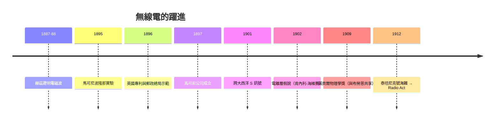

# 第 2 節 馬可尼（Guglielmo Marconi）與跨大西洋無線電報

## 一、波隆那的閣樓：自學者的系統工程

馬可尼（Guglielmo Marconi, 1874–1937）生於義大利波隆那，父親是富裕地主，母親是愛爾蘭貴族後裔（安妮·詹姆森，Jameson 家族）——這條英義血統日後成為他商業帝國的臍帶。他沒有大學學位，在波隆那大學旁聽被拒於門外，卻因家庭教師（雷格利奧里教授）接觸到赫茲（Heinrich Hertz）證明電磁波的實驗（1887–88）。

馬可尼的天賦不是理論而是**系統整合**。他把金屬屑檢波器（coherer）、火花發射機、改良天線與接地組合成可用的無線電報系統，並立即在兩個方向上推進：**距離**（從閣樓到花園、到山丘，1895 年已傳兩公里以上）與**實用性**（摩斯電碼、便攜、可服務軍艦與航運）。義大利郵政部門對他的方案興趣寥寥；1896 年，二十一歲的馬可尼在母親陪同下前往倫敦——母親的英國人脈（其親戚是工程師）把他帶到英國郵政總局總工程師普利斯（William Preece）面前。普利斯正為英國燈塔與海岸通訊尋找新技術，當即成為馬可尼的保護人與公關推手。

## 二、1896 年英國專利與郵政總局的背書

1896 年 6 月，馬可尼取得英國專利（第 12,039 號，「電脈衝傳送」）；郵政總局隨即在索爾茲伯里平原與跨越布里斯托海峽（1897 年，約 14 公里）做公開示範，並邀請記者見證。英國官方的支持揭示了無線電發展的政治結構：**大英帝國擁有全球最長的海岸線與最龐大的海軍，無線電對它是戰略必需**；官方背書給了馬可尼技術信用，而英國資本市場給了他錢。1897 年 7 月，馬可尼無線電報與訊號公司（後為馬可尼公司）成立，資本十萬英鎊。此後數年，他一路把距離推向英吉利海峽（1899）、以至更遠。

## 三、1901 年跨大西洋的 S 訊號：地球曲率與未知的救場

1901 年 12 月 12 日，馬可尼在紐芬蘭聖約翰斯的訊號山，以風箏拉起的天線收到了從英國康瓦爾波爾杜（Poldhu）發出的摩斯字母 **S**（三個點）。訊號微弱、重複性存疑、且馬可尼公司與海底電纜財閥的訴訟迫使他不得在英國領土使用收訊站（紐芬蘭當時是英國殖民地，故改在該處），但商業上它成功了：消息登上頭條，跨大西洋無線電的時代宣告開始。

物理學界的質疑是實質的：地球是曲的，直線傳播的電磁波理論上繞不過大西洋——馬可尼的示範似乎違反物理。後來的解答是**電離層**：大氣高層的帶電層會反射（折射）電波，使之沿地球曲面迴繞。肯內利（Kennelly）與海維賽（Heaviside）在 1902 年獨立提出此反射層假說（後稱肯內利-海維賽層，1924 年才由阿普爾頓實驗證實）。諷刺的是，**發明者對傳播機理並不理解**——是物理學家的事後解釋救了理論，也確認了現象。馬可尼勝在工程直覺與頻率選擇（長波長恰好利於繞射與電離層反射），而理論補課整整花了一代人的時間。

## 四、1909 年諾貝爾獎：發明者與科學家的和解

1909 年諾貝爾物理學獎由馬可尼與德國物理學家**卡爾·布勞恩**（Karl Ferdinand Braun）共享。這是一次意味深長的和解：布勞恩改良了發射機（調諧耦合電路，減少火花干擾、大幅提升距離與選台能力）與晶體檢波器，是「讓無線電真正可用」的科學工程師。諾貝爾委員會以共享獎項的姿態，承認無線電是**系統工程（馬可尼）與電路科學（布勞恩）**的合體——馬可尼也大方表示功勞一半屬於布勞恩。此後馬可尼帝國繼續擴張：1902 年起建立跨洋商用無線電報業務，公司業務遍佈大英帝國各殖民港。

## 五、泰坦尼克號與 Radio Act 1912：電波管制的誕生

無線電最震撼的公共時刻是災難。1912 年 4 月 14 日夜，泰坦尼克號撞上冰山，船上的馬可尼報務員（菲利普斯與青年布萊德）連發 CQD 與 SOS，卡帕西亞號收到訊號趕來救起七百餘人。若非無線電，死亡將是全部；而無線電也暴露了混亂：附近加州人號的報務員已關機睡覺，不同公司的電台互不通訊，業餘電台的雜訊干擾了救援頻率。

輿論震怒之下，美國國會通過 **1912 年無線電法（Radio Act of 1912）**：要求電台執照、指定報務員全天候值班、劃分頻譜並建立呼號制度。這是電波這一公共資源第一次被制度化管理——因為頻譜的物理特性（同頻互相干擾）決定了**無線電天然需要管制**，有線電報時代「誰拉線誰擁有」的邏輯在此失效。此法雖執行寬鬆，卻是現代通訊管制體系（FCC 前身）與國際電波協調（1912 年倫敦公約）的起點。

## 因果鏈條

貴族血統 × 自學系統工程 → 英國人脈與郵政總局背書（1896）→ 英帝國的海權需求供養商業帝國 → 1901 跨大西洋示範在物理質疑中成功 → 電離層的未知機理救場，理論事後補課 → 與布勞恩共享諾貝爾獎（1909），工程與科學的體制性合流 → 泰坦尼克海難（1912）暴露無序，催生 Radio Act 與頻譜管制制度。無線電證明：新技術的成熟需要四者俱足——工程整合、資本、國家戰略、以及一場足夠痛的災難來立法。
