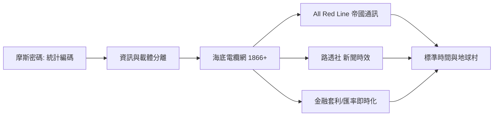

# 第 3 節 摩斯密碼與全球電報網：世界縮小為「地球村」的起點

## 一、摩斯密碼：用統計學壓縮人類語言

塞繆爾·摩斯（Samuel Morse）的電報機（1837–1844）之所以成功，一半靠硬體，一半靠那套看來樸素的編碼。**摩斯密碼**以點（短音）與劃（長音）表示字母，其設計暗藏資訊壓縮的智慧：常用字母（E、T、A）配最短的碼（E = 一個點），罕用字母（Q、Z）配長碼——據說助手維爾（Alfred Vail）曾數過印刷廠鉛字盤裡各字母的數量，以此定出碼長。這正是**字母頻率統計 → 變長編碼**的思路，是香農（Claude Shannon, 1948）資訊理論中「依機率分配編碼長度」的直覺遠祖；霍夫曼編碼（1952）不過是同一思想的現代化裝潢。

更深刻的是**資訊與載體的分離**：訊息被抽象為兩態符號的序列（點/劃、通/斷），從此不再依附於信件、馬匹或旗語的物理形態。一切數位化——從二進制電腦到網際網路——都可以回溯到這個瞬間：**當語言被化約為最簡符號系統，通訊速率才可能突破媒體限制**。

$$H = -\sum p_i \log_2 p_i \quad \text{（香農熵：摩斯密碼的統計直覺在一個世紀後的數學化）}$$

## 二、海底電纜與 All Red Line：帝國通訊的政治

1858 年第一條跨大西洋電纜數週即斷；1866 年，大西洋電報公司（菲爾德 Field 與工程師湯姆森開路）成功敷設並長期營運，歐美間通訊從十天的郵輪壓縮到數分鐘。此後電纜網環球延展：經紅海到印度（1870）、再到新加坡、澳洲（1872）、橫越太平洋（1902–03）。

大英帝國的戰略目標是 **All Red Line**：用「全紅」（帝國領土）上的電纜把倫敦與每塊殖民地直連，繞開任何外國登陸點。1902 年環球電纜閉環，帝國內任何兩點的通訊不經外國之手。電報於此成為**帝國的經營工具**：殖民總署即時指揮、軍隊協同、關稅與資源調度；同時英國對電纜的壟斷成為戰時武器（一戰伊始英國即剪斷德國的海底電纜，德國被迫走無線電，訊號被英國截聽——齊默曼電報事件的物理前提）。通訊基礎設施的主權問題，從此成為地緣政治的核心議題——今日的海底光纜之爭，是 All Red Line 的直接續集。

## 三、路透社與新聞時效：媒體的時區革命

保羅·路透（Paul Reuter）1851 年在倫敦設立通訊社，靠電報傳遞歐洲股市行情與新聞，再以信鴿補足電報網的斷點（布魯塞爾-亞琛之間）。電報把新聞業的競爭軸從「報導深度」改寫為「**時效**」：1858 年跨洋電纜通後，歐洲的消息比報紙早數日抵達紐約，報社被迫重組採編流程；西方聯盟、美聯社等通訊社的「訊息批發」模式成形。電報還孕育了客觀性規範：訊息按字計費昂貴，逼出精煉的「電報體」——倒金字塔寫法（最重要訊息在前）誕生於線路可能隨時中斷的恐懼。新聞的定義（及時、簡潔、可傳輸）就此被技術重寫。

## 四、金融市場：套利、匯率與時間差

電報對經濟的衝擊以金融最深。在電報之前，倫敦與紐約的匯率與商品價差靠郵輪傳遞，套利週期以「週」計；1866 年後，兩地匯率**分鐘級連動**：

- **套利空間壓縮**：跨洋價差被即時訊息抹平，金融市場開始「同步化」——這是全球資本市場一體化的真正起點。
- **匯率機制重構**：外匯交易從「憑匯票的實物信用」轉為「電報指令的即時結算」，倫敦作為電報樞紐兼金融中心的位置互相強化。
- **風險管理**：糧食與棉花商人以電報對沖跨洋價格風險，商品期貨市場（芝加哥）與電報網共生成長。

經濟史學者的估計顯示，1866–1870 年代跨洋匯率波動顯著收斂——「時間差」這一利潤來源被通訊技術永久性地消滅。此後每一次通訊提速（電話、衛星、光纖、演算法交易），本質上都是同一場革命的續集：**資訊速度即資本主義的速度**。

## 五、「地球村」的文明轉折

麥克魯漢（Marshall McLuhan）在 1960 年代提出「地球村」（global village）一詞，但其物理起點在十九世紀的電報線上。電報完成了三重文明轉折：

1. **資訊與載體分離**：訊息可脫離紙張與人體旅行，成為獨立流動的對象。
2. **資訊與速度的新的經濟學**：資訊本身成為商品（行情、新聞、指令皆可計費販售）。
3. **時間的全球同步**：為了協調電報時刻表，1884 年華盛頓國際子午線會議確立格林威治標準時——**標準時間本身，就是為了配合通訊網而發明的制度**。鐵路與電報共同殺死了地方太陽時。

## 因果鏈條

字母頻率統計催生變長編碼（摩斯密碼）→ 資訊與載體分離，通訊突破物理媒體 → 海底電纜技術與帝國政治互相需求（All Red Line）→ 新聞時效與金融同步化重塑市場經濟 → 標準時間等新制度為協調全球通訊而誕生 → 「地球村」的文明意識成形 → 電報網的載流線路原理，等待一支能把微弱訊號放大的真空管——愛迪生效應埋下的伏筆，即將在無線電的呼喚中發芽，開啟電子學時代。
