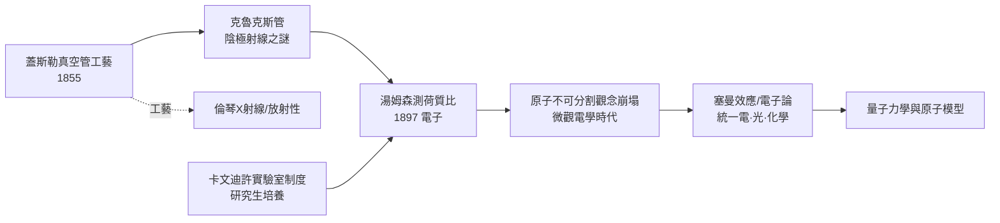

# 第 1 節 湯姆森（J. J. Thomson）與陰極射線管：發現「電子（Electron）」

## 一根玻璃管裡的宇宙革命

1897 年 4 月 30 日，劍橋皇家學院的講堂上，約瑟夫·約翰·湯姆森（J. J. Thomson, 1856–1940）宣布了一項將撕裂古典原子觀的實驗結果：陰極射線並非「以太波」或「輻射能」，而是一種帶負電的**物質粒子**，而且其質量竟比最輕的氫原子還要小上千倍。原子——這個自古希臘以來被視為「不可分割」的宇宙基石——被一根玻璃管裡射出的幽藍光芒敲開了裂縫。

## 卡文迪許實驗室：測出看不見的粒子

湯姆森時任卡文迪許實驗室（Cavendish Laboratory）教授。他的策略極為精巧：陰極射線會在電場中偏折，也會在磁場中偏折，兩者聯立便可解出粒子的**電荷對質量之比**（荷質比 $q/m$）。他發現無論陰極用鋁、鉑還是其他金屬，無論管中殘餘氣體是空氣、氫還是二氧化碳，$q/m$ 的數值都相同——這意味著這種粒子是**一切物質的共同成分**，是比原子更基本的單元。1891 年斯通尼（G. Johnstone Stoney）為基本電荷單位造的字「electron」，最終被借來命名這個粒子。

## 工藝史的前奏：玻璃與真空

電子的發現絕非憑空的理論洞察，而是站在兩百年**玻璃工藝與真空技術**的肩膀上。1855 年，德國吹玻璃師傅蓋斯勒（Heinrich Geissler）改良了水銀真空幫浦，吹製出低壓放電管，管內殘餘氣體發出奇幻輝光，成為科學示範與娛樂表演的寵兒。1870 年代，英國的克魯克斯（William Crookes）將真空度再推向極限，製成「克魯克斯管」，殘氣稀薄到輝光消失，只剩陰極對面玻璃壁上的螢光——他稱之為「物質第四態」的奇異射線。

一場關於射線本質的國際論戰隨之展開：德國學派（赫茲、倫納德）主張是以太波，因其能穿透薄金屬箔；英國學派（克魯克斯、湯姆森）主張是帶電粒子，因其能被磁鐵偏折、推動小風車。湯姆森的勝利，正是英國實驗傳統與德國真空工藝的合流。值得一提的是，1895 年倫琴在蓋斯勒管系統中偶然發現 X 射線，1896 年貝克勒因此追查出天然放射性——這條由玻璃與真空鋪成的路，一舉打開了微觀世界的整座礦脈。

## 哲學意涵：原子不再不可分割

電子的發現在思想史上是一記重錘。自德謨克利特以降，「原子」一詞的語源就是「不可分割」；道爾吞的化學原子論也預設原子是化學變化的終點。如今科學家證明：電可以從原子裡剝離出來，以自由粒子的形態在真空中奔流。物質的統一性獲得了全新的詮釋——所有元素共享同一種電的積木，化學、電學、光學開始在微觀層次匯流。更深刻的連鎖反應在於：1896 年塞曼效應（磁場使光譜線分裂）已被洛倫茲以「原子內帶電振子」解釋，湯姆森的電子正好為它提供了實體；「電子論」隨即成為解釋導電、發光、化學鍵的統一框架。微觀電學時代於焉展開，最終通向 1900 年普朗克的量子假說與 1913 年波耳的原子模型——後者正是以電子的軌道跳躍解釋光譜。玻璃管裡的藍光，點燃了二十世紀物理學的引信。

## 教育制度的祕密武器：卡文迪許

電子的誕生地不是孤膽英雄的閣樓，而是一所制度化的科研工廠。1874 年成立的卡文迪許實驗室，由麥克斯韋規劃、瑞利男爵與湯姆森先後執掌，開創了「研究生制度」與實驗物理的系統化訓練：學生不再只聽講，而是亲手操作、測量、發表。湯姆森門下的七位助手與學生先後獲諾貝爾獎（包括發現電子電荷的密立根追隨者傳統、發現威爾遜雲室的威爾遜、發現中子的查兌克一系）。這種「實驗室作為教育機器」的模式，是德國研究型大學（李比希化學實驗室傳統）的英國變種，預示了二十世紀「大科學」的體制：國家與大學資助儀器、培養團隊、批量產出發現。科學史在此顯示：**發現電子的不只是一個人，而是一套制度。**

## 因果鏈條

**文字鏈**：玻璃與真空工藝成熟 → 陰極射線成為可重複研究的對象 → 電磁偏折測出荷質比 → 電子現身、原子可分 → 微觀電學統一化學與光學 → 制度化實驗室放大科學生產力 → 為量子時代與電子時代奠基。
