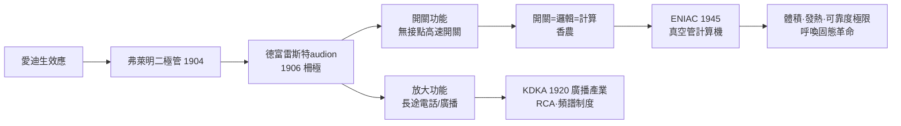

# 第 2 節 李·德富雷斯特（Lee de Forest）與三極真空管：訊號放大與開關的硬體革命

## 柵極：一場自己都不理解的發明

1906 年，美國發明家李·德富雷斯特（Lee de Forest, 1873–1961）在弗萊明二極管（1904 年，愛迪生效應製成的檢波管）的燈絲與屏極之間，插入了一片折疊的金屬絲網——他稱之為「柵極」（grid），並將此管命名為 **audion**。令人莞爾的是，德富雷斯特本人起初並不清楚柵極為什麼有效：他原本的動機只是想再加一個電極「改善檢波」，還誤以為管內殘餘氣體的游離是關鍵。直到物理學家（如阿諾德與朗繆爾在 GE 與 AT&T）指出高真空才是正解，並重建管子結構，三極管的神奇性質才被真正理解：**柵極上微小的電壓變化，可以控制屏極上巨大的電流變化**——這就是「放大」（amplification）。這是電學史上最著名的「先有成品、後有理論」案例之一，也呼應了本書反覆出現的規律：儀器先於理解。

## 兩大功能：放大與開關

三極管的偉大，在於它一身兼二職，扮演了整個電子時代的地基：

1. **放大器**：微弱的訊號（天線裡的無線電波、麥克風的聲音振動）可以被逐級放大到足以驅動喇叭、跨越海洋。長途電話從此有了中繼的心臟——1915 年 AT&T 以真空管中繼打通了紐約到舊金山、乃至越洋的電話。
2. **開關**：柵極電壓也可以讓屏極電流「全開」或「全關」。一個以電控制電的快速、無接點開關——這在機械繼電器（每秒只能動作幾十次、且會磨損）面前是神蹟。開關快到每秒數萬、數十萬次。

「開關 = 計算」的思想基石由此奠定：布林的邏輯代數（AND、OR、NOT）可以用開關的串聯、並聯、反相來物理實現。1930 年代貝爾實驗室的香農在碩士論文中證明了這一點；既然開關能承載邏輯，那麼電路就是會思考的機器的肉身。三極管讓開關的密度與速度擺脫了機械極限——計算機從齒輪與繼電器的世紀，一腳踏進了電子的世紀。

## 廣播產業：把電變成大眾媒體

德富雷斯特自己率先用 audion 做無線電話與音樂廣播實驗（1910 年轉播卡魯索歌劇），但真正引爆產業的是 1920 年 11 月 2 日匹茲堡的 **KDKA 電台**開播，定期播報哈定當選總統的新聞。此後數年，美國電台從個位數暴增到數百座，收音機從電報員的專利品變成客廳裡的家具——這是人類史上第一次：**電直接進入千萬家庭的日常生活，以「空中的聲音」重塑公共生活**。產業結構隨之重塑：RCA（美國無線電公司）1919 年由政府促成合併成立，壟斷真空管與無線電專利；廣告商與「廣播網」（NBC 1926、CBS 1927）創造了收聽率的商業模式；政府則以《1927 年無線電法》建立頻譜許可制度——電波是有限公共資源，需由制度分配。科技、商業、法律在此同步演化。

德富雷斯特一生手握三百多項專利，卻屢陷專利訴訟（audion 專利後被法院判與 AT&T 的阿諾德專利部分重疊），創業屢敗、晚年貧困——發明家與資本體系的緊張關係，在他的身上戲劇化地上演。

## 真空管計算機：燈泡燒壞的日常

第二次世界大戰把「計算」變成國家級急務。1945 年竣工的 **ENIAC**（賓州大學，莫奇利與埃克特主持）動用約 **17,468 支真空管**、7,200 枚二極管、重達 27 噸、耗電 150 千瓦，是第一台通用型電子計算機：繼電器的機械速度被徹底拋棄，每秒可執行五千次加法。但真空管的代價同樣驚人：燈絲會燒斷、性能會漂移，工程師的日常就是搶修故障——平均每隔幾天就有管子陣亡，團隊甚至發展出「降壓運轉」延壽的偏方。ENIAC 證明了電子計算的可行性，也同時證明了真空管路線的天花板：**體積、發熱、可靠度**，都在替下一場固態革命寫序言。

## 因果鏈條

**文字鏈**：玻璃與真空工藝 → 二極管檢波 → 三極管意外問世 → 放大催生電話與廣播產業（資本+制度重構頻譜）→ 開關承載布林邏輯 → 真空管計算機問世 → 硬體極限浮現 → 為電晶體鋪路。
