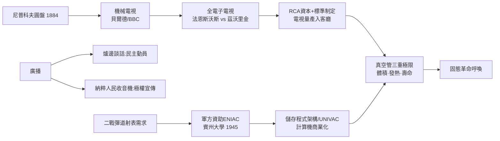

# 第 3 節 早期的廣播、電視與第一代電子計算機（ENIAC）

## 電視的技術譜系：從轉動的圓盤到電子掃描

電視是典型「多源並進、終點匯流」的技術。1884 年，德國學生尼普科夫（Paul Nipkow）取得**機械掃描圓盤**專利：一個鑿著螺旋排列小孔的旋轉圓盤，把影像分解成一條條光線掃描線，光電池再將明暗轉成電訊號。1920 年代，英國的貝爾德（John Logie Baird）用尼普科夫盤做出第一個能公開示範的電視系統（1926），BBC 於 1929 年以此機械電視開播。但機械掃描有著天生天花板：轉速、慣性與光電靈敏度限制了線數與影格率。

真正的決勝點是「全電子電視」：**影像以電子束逐行轟擊、用陰極射線管還原**。 Utah 農場長大的天才菲洛·法恩斯沃斯（Philo Farnsworth）在 1927 年以「影像析像管」（Image Dissector）示範全電子電視；同一時間，西屋／RCA 的俄裔工程師茲沃里金（Vladimir Zworykin）開發「光電析像管」（Iconoscope，1923 年構想、1930 年代成熟）。RCA 擁有雄厚資本與法務機器，先起訴法恩斯沃斯專利無效、敗訴後於 1939 年支付百萬美元買斷授權——然而戰後 RCA 憑量產與標準制定（1941 年美國 NTSC 標準）主導了整個產業。專利戰的結果揭示了一個殘酷規律：**發明者未必是贏家，系統整合者與資本才是**。電視在 1950 年代走入客廳，完成繼收音機之後的第二次媒體革命：人類第一次同時、同步地「觀看」同一場事件。

## 媒體與政治：爐邊談話與納粹宣傳

廣播重塑大眾政治的速度遠比電視更快。1933 年起，羅斯福總統以「**爐邊談話**」（Fireside Chats）越過報社老闆與國會，直接用溫暖的嗓音對千萬家庭說話，重塑了總統與人民的關係，也幫助他在大蕭條中推行新政——行政權藉由新媒體擴張，這是制度史上重要的一課。硬幣的另一面更為陰暗：同一時代，納粹德國把廉價「人民收音機」（Volksempfänger）配送到每個家庭，戈培爾以電波進行前所未有的集中宣傳，廣播成為極權動員的引擎。1936 年柏林奧運更透過電視試播展示「現代帝國」形象。同一種技術，可以是民主的對話，也可以是獨裁的擴音器——媒體技術是政治制度的放大器，而非中立管道。這也催生了戰後的公共電視、公平原則與傳播倫理等制度反思。

## ENIAC 的誕生脈絡：戰爭資助的計算機器

第一代電子計算機不是學院的閒情產物，而是**戰爭需求＋軍方預算**的結晶。二戰期間，美國陸軍彈道研究實驗室為了編製火炮射表（每張射表需人工計算數百小時），於 1943 年與賓州大學摩爾學院簽約，委託莫奇利與埃克特建造電子數值積分計算機（ENIAC），1945 年底竣工、1946 年 2 月公開揭幕。它用約 17,000 支真空管、每秒 5,000 次加法，把一發炮彈的彈道計算從 30 秒縮短到彈道飛行的瞬間之外皆可即時完成。資金來自陸軍軍械部，預算最終達約 50 萬美元（當年天價）。

ENIAC 的直系後裔快速開枝散葉：馮紐曼參與後提出的「儲存程式」架構（EDVAC 報告，1945）確立了現代計算機的基本形態；莫奇利與埃克特創辦公司推出 UNIVAC，1951 年交付美國普查局——計算機從軍工走向商業，1952 年更因預測艾森豪當選而聲名大噪。**戰爭 → 軍方資金 → 頂尖工程 → 商業擴散**，這條鏈路在本書已反覆出現（電報、雷達、原子彈），ENIAC 是其中最經典的一環。

## 極限與呼喚：真空管撑不起未來

到 1950 年代初，真空管文明的矛盾全面顯露：電視要數十支管子、計算機要上萬支、飛彈導引系統需要更小更輕的邏輯單元——而每支真空管都是一個發熱的玻璃燈泡，燈絲終會燒斷。軍方報告直指：飛彈與航空電子所需的可靠度，真空管路線「在物理上不可能達成」。體積、功耗、壽命三重天花板，把問題逼到了物質結構的層次：能不能不用「加熱燈絲發射電子」，而是直接在**固體內部**控制電子的流動？這個問題的答案，早已藏在貝爾實驗室的量子物理與戰時雷達的「貓鬚檢波器」裡。固態革命，蓄勢待發。

## 因果鏈條

**文字鏈**：廣播奠定電子媒體 → 電視經專利戰與資本整合問世 → 媒體放大政治（民主與極權並行）→ 戰爭催生電子計算機 → 真空管物理極限顯露 → 轉向固態電子學。
